---

## 21. Diagramas de flujo de valor

### 21.1 Diagrama de Sankey — Flujo del dinero

```mermaid
sankey-beta
Origen - Cliente,Ingresos por venta vales,100
Origen - Enlace,Comisiones,5
Origen - Capta,Capital propio,40
Origen - Banco,Financiamiento,60

Capital propio - Fideicomiso,Transferencia,40
Financiamiento - Fideicomiso,Transferencia,60
Fideicomiso - Cliente,Colocación,100

Cliente - Enlace,Pago quincenal,80
Cliente - Enlace,Pago vencido,20

Enlace - Capta,Recuperación,75
Enlace - Capta,Mora,5
Enlace - Capta,Quebranto,20

Capta - Banco,Pago financiamiento,55
Capta - Fideicomiso,Pago fiduciario,10
Capta - Operativo,Gastos operativos,10
Capta - Inversionista,Dividendos,15
Capta - Reinversión,Capital de trabajo,15
```

### 21.2 Diagrama de Sankey — Flujo de clientes

```mermaid
sankey-beta
Leads web,Prospectos,300
Referidos,Prospectos,200
Marketing,Prospectos,100
Visitas presenciales,Prospectos,400

Prospectos,En validación,700
Prospectos,Rechazados,200
Prospectos,En espera,100

En validación,Aprobados,500
En validación,Devueltos,150
En validación,Rechazados por afiliación,50

Aprobados,Enlaces activos,450
Aprobados,En proceso de firma,50

Enlaces activos,Clientes finales,2500
Enlaces activos,Inactivos,200
Enlaces activos,Bloqueados,50

Clientes finales,Créditos vigentes,2000
Clientes finales,Cancelados,300
Clientes finales,Liquidados,200
```

### 21.3 Diagrama de Sankey — Flujo de vales

```mermaid
sankey-beta
Vales asignados,Vales activos,10000
Vales activos,Vales canjeados,8500
Vales activos,Vales cancelados,1000
Vales activos,Vales vencidos,500

Vales canjeados,Pagares activos,7500
Vales canjeados,Pagares liquidados,900
Vales canjeados,Pagares vencidos,100

Pagares activos,Pagos al día,6000
Pagares activos,Pagos atrasados,1000
Pagares activos,Convenios,500

Pagos al día,Recuperación,5500
Pagos atrasados,Cobranza,800
Convenios,Reestructura,400
```

### 21.4 Diagrama de Sankey — Flujo de información

```mermaid
sankey-beta
Cliente,Datos personales,100
Cliente,Datos financieros,80
Cliente,Datos biométricos,60
Cliente,Documentos,70
Enlace,Datos comerciales,90
Enlace,Datos bancarios,85

Datos personales,CaptaQA,100
Datos financieros,CaptaQA,80
Datos biométricos,DatosAnalizadosDB,60
Documentos,DatosAnalizadosDB,70
Datos comerciales,CaptaQA,90
Datos bancarios,CaptaQA,85

CaptaQA,Reportes operativos,200
CaptaQA,DatawareHouseDB,100
CaptaQA,SavingDB,30
DatosAnalizadosDB,Analisis IA,100
DatawareHouseDB,Reportes ejecutivos,80
```

### 21.5 Diagrama de Sankey — Flujo de transferencias

```mermaid
sankey-beta
Transferencias creadas,Pendientes,1000
Transferencias creadas,Procesadas,9000

Pendientes,En proceso,600
Pendientes,Canceladas,300
Pendientes,Rechazadas,100

Procesadas,Cobradas,8000
Procesadas,Rechazadas,500
Procesadas,Devoluciones,500

Cobradas,Cliente recibe,7500
Cobradas,Pendiente cobro,500

Devoluciones,Sustitución,300
Devoluciones,Rechazadas,150
Devoluciones,Pendientes,50
```

---

## 22. Timeline del proyecto

### 22.1 Historia del proyecto

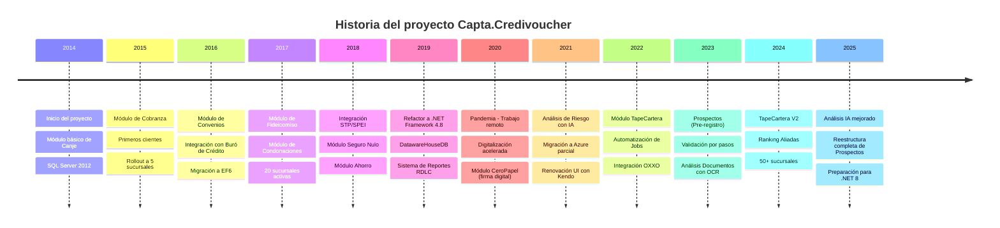

### 22.2 Timeline de evolución tecnológica

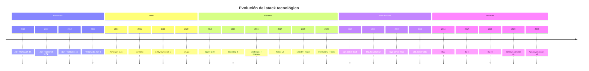

### 22.3 Timeline del roadmap futuro

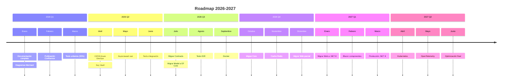

---

## 23. Diagramas UML

### 23.1 Casos de uso — General

```mermaid
graph TB
    subgraph Actores
        Gestor[👤 Gestor]
        Coordinador[👥 Coordinador]
        Admin[👑 Administrador]
        Mesa[⚖️ Mesa de Control]
        Auditor[🔍 Auditoría]
        Cliente[👤 Cliente]
        Afiliacion[✍️ Afiliación]
        Sistema[🤖 Sistema IA]
    end
    
    subgraph "Casos de Uso - Canje"
        CU1[Realizar Canje]
        CU2[Reimprimir Contrato]
        CU3[Cancelar Canje]
    end
    
    subgraph "Casos de Uso - Cobranza"
        CU4[Capturar Abono]
        CU5[Generar Corte]
        CU6[Crear Convenio]
        CU7[Condonar Deuda]
    end
    
    subgraph "Casos de Uso - Prospectos"
        CU8[Capturar Prospecto]
        CU9[Validar Documentos]
        CU10[Firmar Digitalmente]
        CU11[Autorizar Prospecto]
    end
    
    subgraph "Casos de Uso - BC"
        CU12[Consultar BC]
        CU13[Actualizar BC]
        CU14[Generar Reporte]
    end
    
    subgraph "Casos de Uso - Sistema"
        CU15[Autenticarse]
        CU16[Gestionar Usuarios]
        CU17[Configurar Sistema]
    end
    
    Gestor --> CU1
    Gestor --> CU2
    Gestor --> CU4
    Coordinador --> CU5
    Coordinador --> CU3
    Mesa --> CU11
    Mesa --> CU6
    Mesa --> CU7
    Admin --> CU15
    Admin --> CU16
    Admin --> CU17
    Auditor --> CU14
    Afiliacion --> CU8
    Afiliacion --> CU9
    Cliente --> CU10
    Sistema --> CU12
    Sistema --> CU13
```

### 23.2 Casos de uso — Módulo Canje

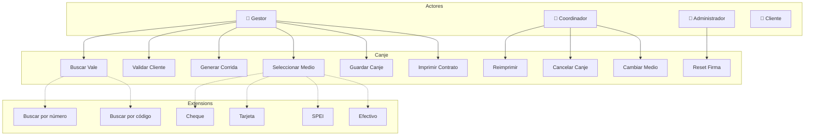

### 23.3 Casos de uso — Prospectos

```mermaid
graph TB
    subgraph Actores
        Ejecutiva[👩‍💼 Ejecutiva]
        Afiliacion[✍️ Afiliación]
        Comite[⚖️ Comité]
        Cliente[👤 Cliente]
        SistemaIA[🤖 Sistema IA]
    end
    
    subgraph "Captura"
        UC1[Capturar Prospecto]
        UC2[Subir Documentos]
        UC3[Estudio Socioeconómico]
        UC4[Capturar Biometría]
    end
    
    subgraph "Validación"
        UC5[Consultar BC]
        UC6[Análisis Riesgo IA]
        UC7[Verificar Documentos]
        UC8[Firmar Digitalmente]
    end
    
    subgraph "Autorización"
        UC9[Revisar Prospecto]
        UC10[Aprobar]
        UC11[Rechazar]
        UC12[Enviar a Comité]
    end
    
    subgraph "Conversión"
        UC13[Crear Enlace]
        UC14[Asignar Usuario]
        UC15[Configurar Enlace]
    end
    
    Ejecutiva --> UC1
    Ejecutiva --> UC2
    Ejecutiva --> UC3
    Ejecutiva --> UC4
    Ejecutiva --> UC5
    SistemaIA --> UC6
    SistemaIA --> UC7
    Cliente --> UC8
    Afiliacion --> UC9
    Afiliacion --> UC10
    Afiliacion --> UC11
    Afiliacion --> UC12
    Comite --> UC10
    Comite --> UC11
    Afiliacion --> UC13
    Admin --> UC14
    Admin --> UC15
    
    Admin[👑 Administrador] --> UC14
```

### 23.4 Casos de uso — Cobranza

```mermaid
graph TB
    subgraph Actores
        Gestor[👤 Gestor]
        Coordinador[👥 Coordinador]
        Mesa[⚖️ Mesa de Control]
        Auditor[🔍 Auditoría]
    end
    
    subgraph "Cobranza"
        UC1[Capturar Abono]
        UC2[Consultar Saldo]
        UC3[Ver Programación]
        UC4[Aplicar Pago]
        UC5[Cancelar Abono]
    end
    
    subgraph "Corte"
        UC6[Generar Corte]
        UC7[Imprimir Corte]
        UC8[Reimprimir Corte]
    end
    
    subgraph "Convenio"
        UC9[Crear Convenio]
        UC10[Autorizar Convenio]
        UC11[Cancelar Convenio]
    end
    
    subgraph "Condonación"
        UC12[Crear Condonación]
        UC13[Autorizar Condonación]
    end
    
    Gestor --> UC1
    Gestor --> UC2
    Gestor --> UC3
    Gestor --> UC4
    Coordinador --> UC5
    Coordinador --> UC6
    Coordinador --> UC7
    Auditor --> UC8
    Coordinador --> UC9
    Mesa --> UC10
    Mesa --> UC11
    Mesa --> UC12
    Mesa --> UC13
```

### 23.5 Casos de uso — Buró de Crédito

```mermaid
graph TB
    subgraph Actores
        Ejecutiva[👩‍💼 Ejecutiva]
        Coordinador[👥 Coordinador]
        Auditor[🔍 Auditoría]
        Sistema[🤖 Sistema]
    end
    
    subgraph "Consultas"
        UC1[Consultar BC Individual]
        UC2[Consultar BC Masivo]
        UC3[Ver Reporte]
        UC4[Descargar XML]
    end
    
    subgraph "Actualizaciones"
        UC5[Actualizar BC]
        UC6[Importar Archivo]
        UC7[Validar Formato]
        UC8[Generar Interfaz]
    end
    
    subgraph "Omitir BC"
        UC9[Omitir Crédito]
        UC10[Ver Bitácora]
        UC11[Descargar Comprobante]
    end
    
    subgraph "Credenciales"
        UC12[Crear Credencial]
        UC13[Ver Credencial Actual]
    end
    
    Ejecutiva --> UC1
    Ejecutiva --> UC3
    Ejecutiva --> UC4
    Coordinador --> UC2
    Coordinador --> UC5
    Coordinador --> UC6
    Coordinador --> UC7
    Coordinador --> UC9
    Auditor --> UC10
    Auditor --> UC11
    Sistema --> UC8
    Admin[👑 Administrador] --> UC12
    Admin --> UC13
```

### 23.6 Diagrama de componentes UML

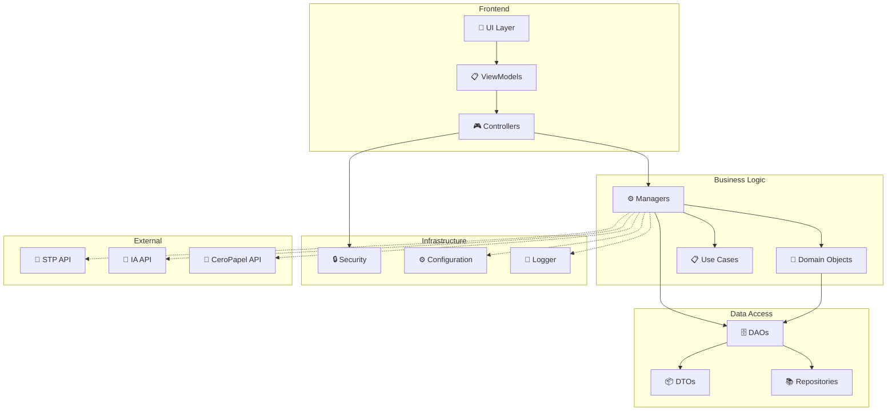

---

## 24. Diagramas de componentes por módulo

### 24.1 Componentes — Módulo Canje

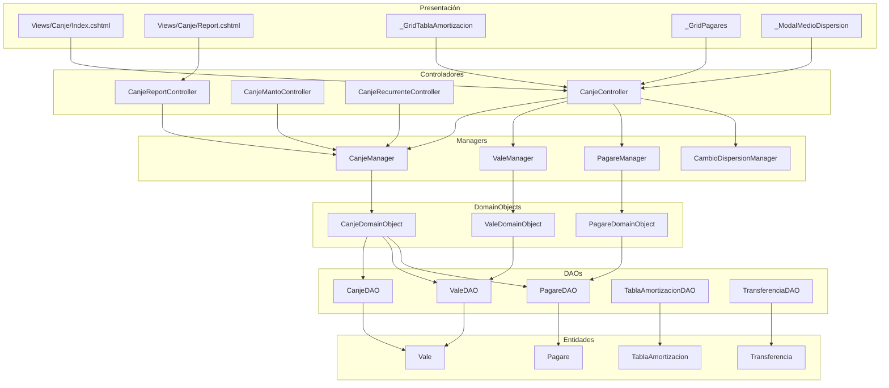

### 24.2 Componentes — Módulo Cobranza

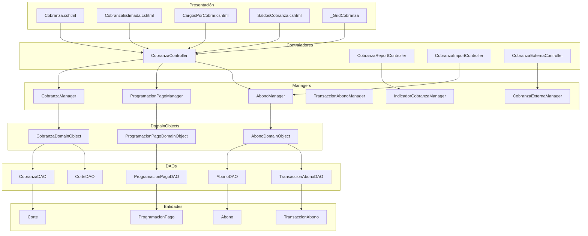

### 24.3 Componentes — Módulo Prospectos

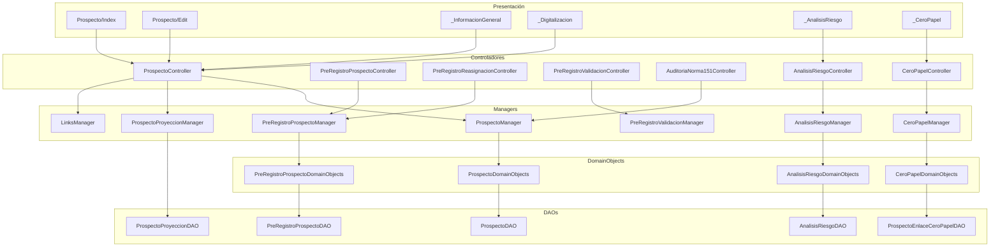

### 24.4 Componentes — Módulo Buró de Crédito

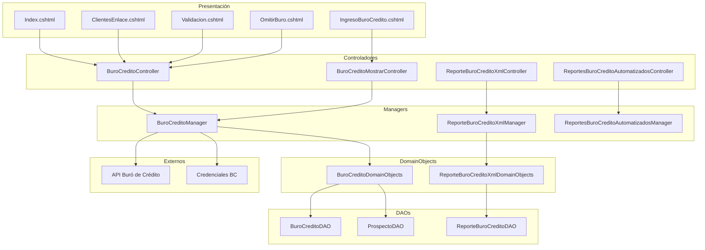

### 24.5 Componentes — Módulo TapeCartera

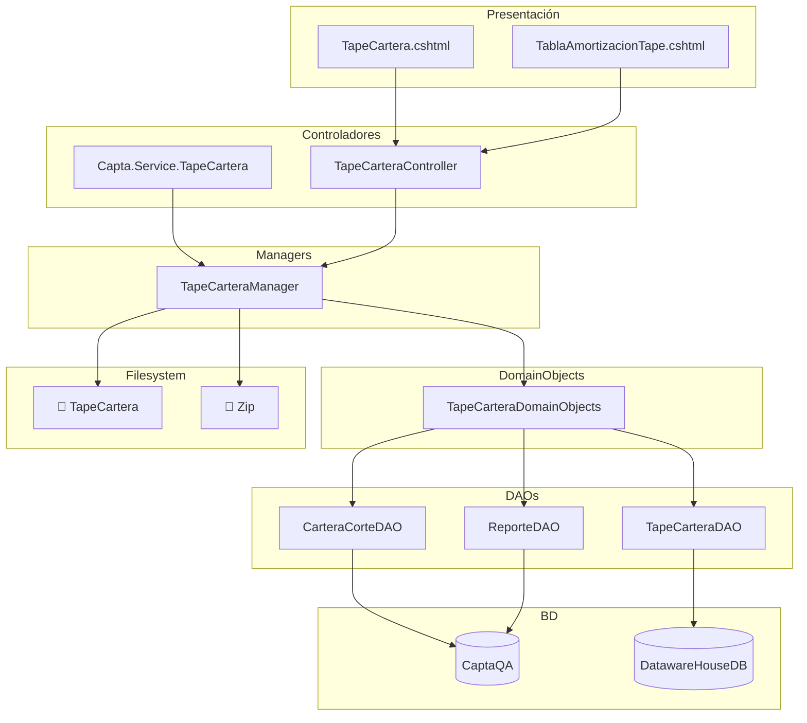

### 24.6 Componentes — Módulo Fideicomiso

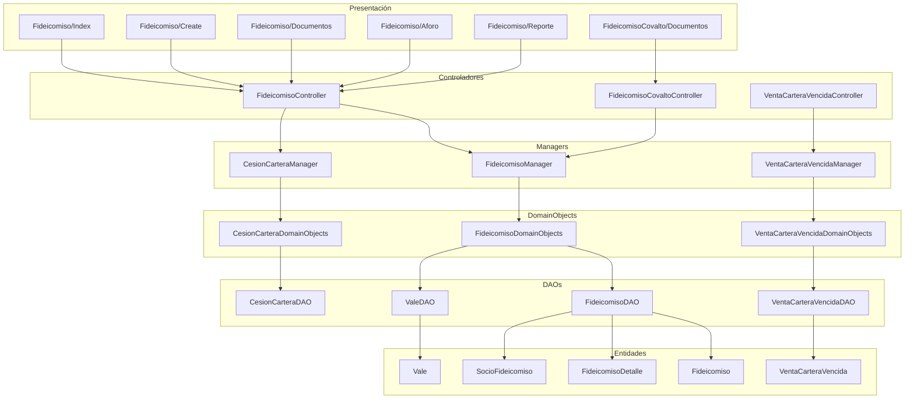

---

## 25. Mindmap de la base de datos completa

### 25.1 Mindmap — CaptaQA (Core)

```mermaid
mindmap
  root((CaptaQA))
    Clientes
      Cliente
      ClienteImagen
      ClienteImagenesApp
      ClienteTarjeta
      ClienteTransferenciaAlta
      ClienteLigth
      ReferenciaCliente
      InformacionLaboral
      Aval
      Beneficiario
      BeneficiarioPagare
      EstudioSocioeconomico
    Enlaces
      Enlace
      EnlaceConfig
      EnlaceConfigPorcentaje
      EnlaceGrupo
      EnlaceGrupoDetalle
      EnlaceImagen
      EnlaceTarjeta
      EnlaceNuevo
      EnlaceTransferenciaAlta
      EnlaceCuentaTransferenciaAlta
      EnlacePagare
      EnlaceSeguroNulo
      GrupoEnlace
      GrupoEnlaceDetalle
      Distribuidor
    Vales y Pagarés
      Vale
      Valera
      ValeViaje
      ValeSinCreditoProgresemos
      ValeBloqueCobranza
      Pagare
      PagarePersonal
      PagareAuto
      PagareEvento
      PagareGems
      PagareAhorro
      PagareJudicial
      PagareSustentabilidad
      PagareConvenio
      PagareSeguroNulo
      PagareDomicilio
      PagareViaje
      TablaAmortizacion
      TablaAmortizacionPersonal
      TablaAmortizacionAuto
      TablaAmortizacionEvento
      TablaAmortizacionConvenio
      TablaAmortizacionFideicomiso
      TablaAmortizacionSeguroNulo
      TablaAmortizacionSustentabilidad
    Pagos
      Abono
      AbonoPersonal
      AbonoAhorro
      AbonoGems
      AbonoEvento
      AbonoConvenio
      AbonoConvenioDetalle
      AbonoAuto
      AbonoSeguroNulo
      AbonoSustentabilidad
      AbonoViaje
      AbonoDistribucion
      AbonoDistribucionSeguroNulo
      TransaccionAbono
      TransaccionAbonoQuebrantos
      ProgramacionPago
      ProgramacionPagoPersonal
      ProgramacionPagoAuto
      ProgramacionPagoEvento
      ProgramacionPagoConvenio
      ProgramacionPagoGems
      ProgramacionPagoAhorro
      ProgramacionPagoSeguroNulo
      ProgramacionPagoSustentabilidad
      ProgramacionPagoViaje
      Anticipo
      ReciboCobranza
      ReciboCobranzaDetalle
      Refunds
      RefundsPersonal
    Cobranza
      Corte
      CorteDetalle
      CorteLote
      CorteMaestro
      CorteMovimiento
      CorteEnlace
      CorteImagen
      CorteImagenDetalle
      CorteImagenPagos
      CorteConfiguracion
      ConfigCorte
      ConfigCorteDetalle
      CobranzaEstimada
      CobranzaExterna
      CobranzaExternaDetalle
      CobradorExterno
      ComisionCobradorExterno
    Convenios
      Convenio
      ConvenioDetalle
      Condonacion
      CondonacionDetalle
      SeguroNulo
      SeguroNuloDetalle
      Seguro
      SeguroNulo
      DesgloseSeguro
      DesgloseSeguroDetalle
      EnlaceSeguroNulo
      SucursalSeguro
      PaquetesSeguros
    Transferencias
      Transferencia
      TransferenciaPersonal
      TransferenciaConvenio
      TransferenciaSeguroNulo
      TransferenciaSustentabilidad
      TransferenciaAlta
      TransferBatch
      Transfer
      TransferConfirmacion
      TransferConfirmacionDetalle
      TransferPersonal
      WithdrawalBatch
      WithdrawalWithoutCard
      Cheque
      ChequeImportado
      ChequeImportadoDetalle
      BitacoraCheque
      RstConfirmacion
      RstConfirmacionDetalle
    Prospectos
      Prospectos
      ProspectosBitacoraEstatus
      ProspectoImagen
      ProspectoLinks
      ProspectoEnlaceCeroPapel
      ProspectoProyeccion
      LeadsWeb
      LeadsWebBitacoraBaja
      LeadsWebRotacion
      LeadsWebBitacoraAsignacion
      PreRegistroProspectos
      PreRegistroProspectoLinks
      PreRegistroProspectoImagen
      PreRegistroProspectosBitacoraEstatus
      PreRegistroValidacion
      PreRegistroValidacionPaso
      PreRegistroValidacionBitacora
      SolicitudCredito
      SolicitudCreditoProspecto
      SolicitudCreditoPreProspecto
      EstudioSocioeconomicoProspecto
      EstudioSocioeconomicoPreProspecto
    Fideicomiso
      Fideicomiso
      FideicomisoDetalle
      SocioFideicomiso
      SocioFideicomisoPorcentaje
      Aforo
      PrediccionesAforo
      PrediccionesCapitalCesion
      NotificacionCesion
      NotificacionCarteraVendida
      TablaAmortizacionFideicomiso
      VentaCarteraVencida
      VentaCarteraVencidaDetalle
      CompradorCartera
    Seguridad
      AspNetUsers
      AspNetUsers2
      AspNetRoles
      AspNetUserRoles
      AspNetUserClaims
      AspNetUserLogins
      CustomAspNetUser
      CustomerAspNetUsers
      Usuario
      Rol
      PermisoRolControlador
      PermisoRolOperation
      PermisoUsuarioRol
      PermisoUsuarioSucursal
      PermisoUsuarioCaja
      Operation
      User
      UserToken
      AuditLog
    Catálogos
      Estado
      Ciudad
      Municipio
      Colonia
      Pais
      TipoAsentamiento
      Banco
      BancoTransferencia
      PlazaBanco
      Cuenta
      CuentaCheque
      CuentaClabe
      CuentaRecaudacion
      CuentaRecaudacionSucursal
      CuentaTransferenciaAlta
      CuentaGeneralAliadas
      MedioPago
      TipoPrestamo
      TipoCliente
      TipoEvento
      TipoPersona
      TipoAbono
      TipoDocumento
      TipoPrestamo
      Pena
      Nivel
      NivelAliado
      Plaza
      Sucursal
      Empresa
      SucursalCuenta
      SucursalProyeccion
      SucursalSeguro
      ComisionTasa
      ComisionPromotorPorNivel
      TasasInteresesPreferentes
      TasaInteres
      TasaAnual
      TasaInfo
      DayOff
      PorcentajeDescuento
      PorcentajeMontoPago
      PorcentajePlazo
      PorcentajeProyeccionDiaria
      PorcentajeTuDecides
      PagosProgramadosFrecuentes
      OperadorTelefonia
      ProveedorSeguro
      SocioComercial
      SocioPorcentaje
      SocioCofinanciamiento
      Region
      Mes
      EstadoCivil
      Credenciales
    Reportes
      ReporteBuroCredito
      ReporteSegurosOpcionales
      SaldoCorte
      SaldoDeudor
      SaldoDeudorCliente
      SaldoDeudorClienteActualizado
      TrackingMenu
      LogError
      LogCambiosTransaccionAbono
      LogPeticionesAnalisisRiesgo
      LogPeticionesCeroPapel
    Integraciones
      LayoutCobranza
      LayoutCobranzaDetalle
      MovimientosBancarios
      ConceptosBancarios
      StpNotificacionesAbono
      StpDevolucion
      StpSaldo
      Conciliacion
      ConciliacionFinanciera
      ConciliacionFinancieraConcepto
      ConciliacionFinancieraDetalle
      ConciliacionPagoReferenciado
      ConciliacionPagoCIE
      ConciliacionSTP
      ConciliacionSTPDetalle
      ReferenciaAbono
      ReferenciaAbonoDetalle
      ReferenciaBaseCIE
      RegistroPagosCIE
      CuentaClabe
      Spei
    Otros
      Ahorro
      AhorroDetalle
      Gems
      GemsDetalle
      Evento
      EventoDetalle
      Cofinanciamiento
      CofinanciamientoDetalle
      Acta
      ActaDetalle
      Fideicomiso
      Anticipo
      Caja
      FondoCaja
      FondoCajaMovimiento
      CalculaInteres
      ScheduledTask
      NotificacionCesion
      NotificacionesWhatsapp
      ConfiguracionCorreo
      ConfiguracionEmpresa
      ConfigurationMail
      Notification
      NotificationUser
      PushNotification
      Routing
      Segmento
      Trazabilidad
      Route
      TrackingMenu
      ReporteBuroCredito
      Predicciones
      AuditLog
      TokenSignatureCaja
      XmlPath
      Trace
      Icon
      Cotizador
      Seguro
      SeguroNulo
      AutosMarca
      AutosModelo
      Autos
      TasaInteres
      PagoCapital
      PagosCapitalSocio
      PagosProgramadosFrecuentes
      Cuenta
      Credenciales
```

### 25.2 Mindmap — DatawareHouseDB

```mermaid
mindmap
  root((DatawareHouseDB))
    TapeCartera
      TapeCartera
      TapeCarteraDetalle
      TapeCarteraV2
      TapeCarteraDetalleV2
    Cartera
      CarteraCorte
      CarteraCorteDetalle
      CarteraCredito
    Créditos
      CreditosActivos
      CreditosActivosDetalle
      CreditosQuebrantados
    Abonos
      AbonoDesglosado
      AbonoDesglosadoDetalle
      RespaldoAbonoDesglosado
      RespaldoAbonoDesglosadoDetalle
    Reportes
      DataProgramacionPago
      CatalogoEstatus
      FlujoCaja
```

### 25.3 Mindmap — SavingDB

```mermaid
mindmap
  root((SavingDB))
    Inversión
      Investment
      InvestmentProgramming
    Socios
      Partner
    Retiros
      Withdrawal
    Pagos
      Payment
      PaymentQueryable
```

### 25.4 Mindmap — DatosAnalizadosDB

```mermaid
mindmap
  root((DatosAnalizadosDB))
    Análisis Documentos
      AnalisisDocumentoProspecto
      AnalisisDocumentoDetalle
    Análisis Estados
      AnalisisEstadoCuentaDetalle
    Proyecciones
      ProyeccionSugeridaProspecto
```

### 25.5 Mindmap — Relaciones entre BD

```mermaid
mindmap
  root((Relaciones BD))
    CaptaQA como Core
      Clientes
      Enlaces
      Vales
      Pagarés
      Cobranza
      Convenios
      Prospectos
      Fideicomiso
    ETL Nocturno
      CaptaQA → DWH
      CaptaQA → Savings
      CaptaQA → DatosAnalizados
    DWH para Analítica
      Reportes ejecutivos
      Tape de cartera
      Conciliaciones
    Savings para Ahorro
      Inversiones
      Retiros
      Pagos
    DatosAnalizados para IA
      OCR
      Análisis de documentos
      Proyecciones
```

---

## 26. Diagramas Gantt históricos y por módulo

### 26.1 Gantt histórico del proyecto

```mermaid
gantt
    title Historia del proyecto Capta.Credivoucher (2014-2025)
    dateFormat YYYY-MM-DD
    axisFormat %Y
    
    section Fundación
    Setup inicial                    :2014-01-01, 2014-06-30
    Módulo Canje básico              :2014-03-01, 2014-12-31
    Módulo Cobranza                  :2014-07-01, 2015-06-30
    
    section Expansión
    Buró de Crédito                  :2015-01-01, 2015-12-31
    Convenios                        :2015-06-01, 2016-06-30
    Condonaciones                    :2016-01-01, 2016-06-30
    Migración a EF6                  :2016-03-01, 2016-09-30
    Fideicomiso                      :2017-01-01, 2017-12-31
    20 sucursales                    :2017-06-01, 2018-06-30
    
    section Integraciones
    STP / SPEI                       :2018-01-01, 2018-12-31
    Seguro Nulo                      :2018-06-01, 2019-03-31
    Ahorro                           :2019-01-01, 2019-09-30
    DatawareHouseDB                  :2019-06-01, 2020-06-30
    
    section Modernización
    Refactor .NET 4.8                :2019-09-01, 2020-03-31
    Reportes RDLC                    :2020-01-01, 2020-12-31
    CeroPapel (firma digital)        :2020-06-01, 2021-06-30
    Análisis IA                      :2021-01-01, 2021-12-31
    Renovación UI Kendo              :2021-06-01, 2022-06-30
    
    section Automatización
    Módulo TapeCartera               :2022-01-01, 2022-12-31
    Integración OXXO                 :2022-06-01, 2022-12-31
    Jobs automatizados               :2023-01-01, 2023-06-30
    
    section Prospectos
    Módulo Pre-registro              :2023-03-01, 2023-12-31
    Validación por pasos             :2023-06-01, 2023-12-31
    OCR Análisis Documentos          :2024-01-01, 2024-09-30
    
    section Actualidad
    TapeCartera V2                   :2024-03-01, 2024-12-31
    Ranking Aliadas                  :2024-06-01, 2024-12-31
    Análisis IA mejorado             :2025-01-01, 2025-12-31
    Reestructura Prospectos          :2025-06-01, 2026-06-30
    Preparación .NET 8               :2025-09-01, 2026-12-31
```

### 26.2 Gantt por módulo (2025-2026)

```mermaid
gantt
    title Roadmap por módulo 2025-2026
    dateFormat YYYY-MM-DD
    axisFormat %b %y
    
    section Canje
    Refactor CanjeController         :2025-01-01, 2025-06-30
    CanjeRecurrente V2               :2025-04-01, 2025-12-31
    Optimización performance         :2026-01-01, 2026-06-30
    
    section Cobranza
    Async/await en Cobranza          :2025-02-01, 2025-08-31
    Caché de saldos                  :2025-05-01, 2025-11-30
    Refactor de cálculo de mora      :2026-01-01, 2026-06-30
    
    section Prospectos
    Análisis IA V2                   :2025-01-01, 2025-09-30
    Firma digital mejorada           :2025-03-01, 2025-12-31
    Integración biométrica           :2026-01-01, 2026-06-30
    
    section Buró
    Actualización masiva V2          :2025-02-01, 2025-08-31
    Reportes XML avanzados           :2025-06-01, 2025-12-31
    Caché de consultas               :2026-01-01, 2026-06-30
    
    section TapeCartera
    Tape V3                          :2025-01-01, 2025-06-30
    Reportes ejecutivos              :2025-04-01, 2025-12-31
    Optimización ETL                 :2026-01-01, 2026-06-30
    
    section Fideicomiso
    Covalto V2                       :2025-03-01, 2025-12-31
    Monex                            :2025-06-01, 2026-03-31
    Cesiones automáticas             :2026-01-01, 2026-06-30
    
    section Infraestructura
    Migrar Contracts                 :2025-06-01, 2025-12-31
    Migrar Model a EF Core           :2025-09-01, 2026-03-31
    Migrar Core a .NET 8             :2026-01-01, 2026-06-30
```

### 26.3 Gantt del proyecto de documentación actual

```mermaid
gantt
    title Proyecto de documentación Capta (2026)
    dateFormat YYYY-MM-DD
    axisFormat %b
    
    section Fase 1
    Análisis de código                :done, a1, 2026-10-01, 2026-10-05
    Mapeado 1 (Arquitectura)          :done, a2, 2026-10-05, 2026-10-06
    Mapeado 2 (Rutas)                 :done, a3, 2026-10-06, 2026-10-07
    Mapeado 3 (Dependencias)          :done, a4, 2026-10-07, 2026-10-08
    
    section Fase 2
    Mapeado 4 (BD)                    :done, b1, 2026-10-08, 2026-10-10
    Mapeado 5 (Navegación)            :done, b2, 2026-10-10, 2026-10-11
    Mapeado 6 (Documentación)         :done, b3, 2026-10-11, 2026-10-12
    
    section Fase 3
    Diagramas Mermaid básicos         :done, c1, 2026-10-12, 2026-10-13
    Diagramas Mermaid avanzados       :active, c2, 2026-10-13, 2026-10-15
    Revisión de diagramas             :c3, after c2, 1d
    
    section Fase 4
    Configuración MkDocs              :c4, 2026-10-15, 1d
    Publicación GitHub Pages          :c5, after c4, 1d
    Publicación Confluence            :c6, after c5, 2d
    
    section Fase 5
    Wiki interna                      :c7, 2026-10-20, 5d
    Capacitación al equipo            :c8, after c7, 3d
```

### 26.4 Gantt de tests automatizados

```mermaid
gantt
    title Plan de Testing (2026-2027)
    dateFormat YYYY-MM-DD
    axisFormat %b %y
    
    section Setup
    Configurar xUnit + Moq           :2026-01-01, 2026-01-15
    Setup CI (GitHub Actions)        :2026-01-10, 2026-01-31
    Cobertura (Coverlet)             :2026-01-20, 2026-02-15
    
    section Unit Tests
    Tests de Helpers                 :2026-02-01, 2026-03-31
    Tests de Managers                :2026-03-01, 2026-06-30
    Tests de DomainObjects           :2026-05-01, 2026-07-31
    Tests de cálculos financieros    :2026-06-01, 2026-09-30
    
    section Integration Tests
    Setup LocalDB / Docker           :2026-06-01, 2026-06-30
    Tests de DAOs                    :2026-07-01, 2026-10-31
    Tests de SPs                     :2026-09-01, 2026-12-31
    Tests de Controllers             :2026-11-01, 2027-02-28
    
    section E2E Tests
    Setup Playwright                 :2026-09-01, 2026-09-30
    Flujos críticos (Login, Canje)   :2026-10-01, 2026-12-31
    Flujos completos                 :2027-01-01, 2027-06-30
    Tests de performance             :2027-04-01, 2027-09-30
```

### 26.5 Gantt de migración a .NET 8

```mermaid
gantt
    title Migración a .NET 8 (2026-2027)
    dateFormat YYYY-MM-DD
    axisFormat %b %y
    
    section Preparación
    Auditoría de dependencias        :done, p1, 2025-10-01, 2025-12-31
    Prueba de concepto               :active, p2, 2026-01-01, 2026-03-31
    Plan de migración detallado      :p3, after p2, 1M
    
    section Contratos
    Migrar a .NET Standard 2.0       :c1, 2026-04-01, 2026-07-31
    Tests unitarios                  :c2, 2026-06-01, 2026-08-31
    
    section Modelo
    Migrar a EF Core 8               :m1, 2026-06-01, 2026-10-31
    Actualizar DbContext             :m2, 2026-08-01, 2026-11-30
    Migrar entidades                 :m3, 2026-09-01, 2027-01-31
    
    section Core
    Migrar Managers                  :cr1, 2026-11-01, 2027-03-31
    Migrar DomainObjects             :cr2, 2026-12-01, 2027-04-30
    Migrar DAOs                      :cr3, 2027-01-01, 2027-05-31
    Migrar Helpers                   :cr4, 2027-02-01, 2027-05-31
    
    section Web
    Migrar a ASP.NET Core MVC        :w1, 2027-03-01, 2027-09-30
    Migrar autenticación (Identity)  :w2, 2027-05-01, 2027-08-31
    Migrar vistas Razor              :w3, 2027-06-01, 2027-10-31
    Migrar bundles a Webpack         :w4, 2027-08-01, 2027-11-30
    
    section Servicios
    Migrar servicios a Background    :s1, 2027-06-01, 2027-09-30
    Migrar APIs a Minimal APIs       :s2, 2027-08-01, 2027-11-30
    
    section Producción
    UAT                              :pr1, 2027-11-01, 2027-12-31
    Go-Live .NET 8                   :milestone, 2028-01-01, 0d
```

---

## 27. Diagramas adicionales misceláneos

### 27.1 Diagrama de red detallado

```mermaid
graph TB
    subgraph Cloud["☁️ Cloud"]
        Azure[Azure AD]
        Blob[Azure Blob Storage]
        KV[Key Vault]
    end
    
    subgraph DMZ["DMZ 10.100.0.0/24"]
        FW1[🔥 FW1 10.100.0.1]
        FW2[🔥 FW2 10.100.0.2]
        WAF[🛡️ WAF 10.100.0.10]
        LB[⚖️ LB 10.100.0.20]
    end
    
    subgraph App["App 10.10.0.0/24"]
        IIS01[IIS01 10.10.0.11]
        IIS02[IIS02 10.10.0.12]
        IIS03[IIS03 10.10.0.13]
        SVC01[SVC01 10.10.0.21]
        SVC02[SVC02 10.10.0.22]
    end
    
    subgraph Data["Data 10.20.0.0/24"]
        SQL01[SQL01 10.20.0.11]
        SQL02[SQL02 10.20.0.12]
        SQL03[SQL03 10.20.0.13]
        FS01[FS01 10.20.0.21]
        FS02[FS02 10.20.0.22]
    end
    
    subgraph Backup["Backup 10.30.0.0/24"]
        NAS[NAS 10.30.0.11]
        TAPE[Tape Library 10.30.0.12]
    end
    
    subgraph Mon["Monitoreo 10.40.0.0/24"]
        APM[APM 10.40.0.11]
        LOG[Log 10.40.0.12]
        ZAB[Zabbix 10.40.0.13]
    end
    
    Azure -.-> KV
    Azure -.-> Blob
    IIS01 --> Azure
    IIS02 --> Azure
    IIS03 --> Azure
    
    FW1 --> WAF
    FW2 --> WAF
    WAF --> LB
    LB --> IIS01
    LB --> IIS02
    LB --> IIS03
    
    IIS01 --> SQL01
    IIS02 --> SQL01
    IIS03 --> SQL01
    IIS01 --> SQL02
    IIS01 --> SQL03
    
    SVC01 --> SQL01
    SVC02 --> SQL01
    SVC01 --> FS01
    SVC02 --> FS02
    
    SQL01 --> NAS
    SQL02 --> NAS
    SQL03 --> NAS
    NAS --> TAPE
    
    IIS01 -.-> APM
    IIS02 -.-> LOG
    SVC01 -.-> ZAB
    SQL01 -.-> ZAB
```

### 27.2 Diagrama de estados — Módulo CeroPapel

```mermaid
stateDiagram-v2
    [*] --> Pendiente: Enlace creado
    Pendiente --> Enviado: SMS enviado
    Enviado --> Firmado: Cliente firma
    Enviado --> Cancelado: Timeout (7 días)
    Enviado --> Rechazado: Cliente rechaza
    
    Firmado --> Verificado: Sistema valida
    Verificado --> Guardado: Contrato descargado
    Verificado --> Error: Documento inválido
    
    Guardado --> [*]
    Error --> Pendiente: Reintentar
    Cancelado --> [*]
    Rechazado --> [*]
```

### 27.3 Diagrama de estados — Módulo Análisis de Riesgo

```mermaid
stateDiagram-v2
    [*] --> Pendiente: Prospecto creado
    Pendiente --> Analizando: Enviado a IA
    Analizando --> Completado: Respuesta recibida
    Analizando --> Error: Timeout / error
    Analizando --> Reintento: Fallo transitorio
    Reintento --> Analizando
    
    Completado --> BajoRiesgo: Score bajo
    Completado --> MedioRiesgo: Score medio
    Completado --> AltoRiesgo: Score alto
    
    BajoRiesgo --> Aprobado
    MedioRiesgo --> RevisionManual
    AltoRiesgo --> Rechazado
    
    RevisionManual --> Aprobado
    RevisionManual --> Rechazado
    
    Aprobado --> [*]
    Rechazado --> [*]
    Error --> [*]
```

### 27.4 Diagrama de estados — Módulo Fideicomiso

```mermaid
stateDiagram-v2
    [*] --> Borrador: Creado
    Borrador --> EnProceso: Documentos cargados
    EnProceso --> Validado: Aforo calculado
    Validado --> Enviado: Enviado a fiduciario
    Enviado --> Aceptado: Fiduciario acepta
    Enviado --> Rechazado: Fiduciario rechaza
    Aceptado --> Activo: Cesión formalizada
    Activo --> Notificado: Clientes notificados
    Notificado --> EnCobranza: Cobranza activa
    EnCobranza --> Liquidado: Todo cobrado
    EnCobranza --> Revertido: Reversión
    Liquidado --> [*]
    Revertido --> [*]
    Rechazado --> [*]
```

### 27.5 Diagrama de componentes — Infraestructura

```mermaid
graph TB
    subgraph "IIS"
        W3SVC[Servicio W3SVC]
        AppPool1[App Pool - Capta]
        AppPool2[App Pool - APIs]
        Site1[Sitio - capta-web]
        Site2[Sitio - capta-api-buro]
        Site3[Sitio - capta-api-voucher]
    end
    
    subgraph "Windows Services"
        S1[Capta.Service.FileWatcher]
        S2[Capta.Service.CustomerLock]
        S3[Capta.Service.STPEnvio]
        S4[Capta.Service.SMS]
        S5[Capta.Service.ColaConsulta]
        S6[Capta.Service.TapeCartera]
    end
    
    subgraph "SQL Server"
        Inst1[SQL Instance - CaptaQA]
        Inst2[SQL Instance - DWH]
        Inst3[SQL Instance - Savings]
        Agent[SQL Agent Jobs]
    end
    
    subgraph "File System"
        FS1[C:\Capta\Uploads]
        FS2[C:\Capta\ExpedienteDigital]
        FS3[C:\Capta\Prospecto]
        FS4[C:\Capta\TapeCartera]
        FS5[C:\Contratos\CeroPapel]
    end
    
    W3SVC --> AppPool1
    W3SVC --> AppPool2
    AppPool1 --> Site1
    AppPool2 --> Site2
    AppPool2 --> Site3
    
    Site1 --> Inst1
    Site1 --> FS1
    Site1 --> FS2
    Site2 --> Inst1
    Site3 --> Inst1
    
    S1 --> FS1
    S2 --> Inst1
    S3 --> Inst1
    S4 --> Inst1
    S5 --> Inst1
    S6 --> Inst2
    S6 --> FS4
    
    Agent --> Inst1
    Agent --> Inst2
```

---

## 28. Resumen y estadísticas finales

### 28.1 Total de diagramas por sección

```mermaid
pie showData
    title "Diagramas por sección del documento"
    "Arquitectura" : 3
    "Flujos de petición" : 3
    "Base de datos" : 4
    "Flujos de negocio" : 8
    "Estados" : 11
    "Componentes" : 10
    "Seguridad" : 4
    "Infraestructura" : 8
    "Clases" : 12
    "Adicionales" : 15
    "Flujo de valor (Sankey)" : 5
    "Timeline" : 3
    "UML" : 6
    "Mindmaps" : 9
    "Gantt" : 5
```

### 28.2 Cobertura de diagramas por aspecto del sistema

```mermaid
xychart-beta
    title "Cobertura de diagramas por aspecto"
    x-axis [Arquitectura, Módulos, BD, Flujos, Estados, Clases, Infra, Seguridad, Roadmap]
    y-axis "Cantidad de diagramas" 0 --> 20
    bar [6, 15, 9, 13, 11, 12, 8, 4, 8]
```

### 28.3 Complejidad de diagramas

```mermaid
quadrantChart
    title Complejidad vs Utilidad de diagramas
    x-axis "Baja complejidad" --> "Alta complejidad"
    y-axis "Baja utilidad" --> "Alta utilidad"
    quadrant-1 "Revisar"
    quadrant-2 "Mantener"
    quadrant-3 "OK"
    quadrant-4 "Simplificar"
    "Arquitectura general": [0.4, 0.95]
    "Flujo petición HTTP": [0.7, 0.9]
    "ER completo": [0.95, 0.95]
    "Flujo Canje": [0.6, 0.9]
    "Flujo Abono": [0.65, 0.9]
    "Estados Pagaré": [0.3, 0.8]
    "Mindmap BD": [0.9, 0.85]
    "Gantt roadmap": [0.5, 0.7]
    "Topología red": [0.85, 0.8]
    "User Journey": [0.4, 0.85]
```

### 28.4 Distribución final

```mermaid
mindmap
  root((90+ Diagramas))
    Diagramas Básicos 47
      Arquitectura 3
      Flujos petición 3
      BD 4
      Flujos negocio 8
      Estados 7
      Componentes 4
      Seguridad 4
      Infra 3
      Clases 7
      Adicionales 4
    Diagramas Avanzados 43
      Sankey 5
      Timeline 3
      UML 6
      Componentes módulo 6
      Mindmaps 9
      Gantt 5
      Red 2
      Estados adicionales 4
      Misceláneos 3
```

---

*Fin de los diagramas adicionales*