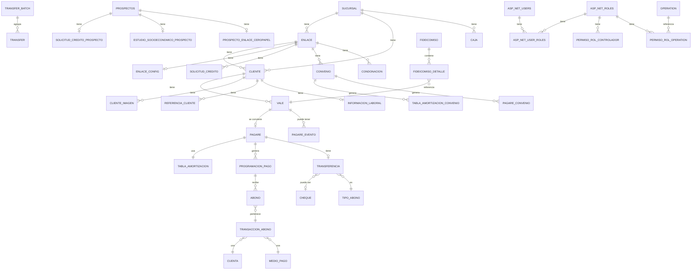

# 🗺️ MAPEADO DEL PROYECTO — Capta.Credivoucher

> **Documento generado:** análisis de arquitectura y endpoints del sistema Capta.Credivoucher
> **Estado:** Mapeados 1 y 2 completos · Pendientes: 3, 4, 5, 6
> **Fecha:** 2026

---

## 📑 Índice

1. [Resumen ejecutivo](#resumen-ejecutivo)
2. [Mapeado 1 — Arquitectura](#mapeado-1--arquitectura)
3. [Mapeado 2 — Rutas / Endpoints](#mapeado-2--rutas--endpoints)
4. [Pendientes](#pendientes)

---

## 📌 Resumen ejecutivo

| Aspecto | Valor |
|---|---|
| **Nombre** | Capta.Credivoucher (sistema de vales / crédito) |
| **Framework** | .NET Framework **4.8** |
| **Tipo** | ASP.NET **MVC 5** + OWIN + Web API embebida |
| **Bases de datos** | SQL Server — **4 BD** (Core, DWH, Savings, DatosAnalizados) |
| **ORM** | **EF6** + **BLToolkit.4** + **Dapper 1.60** + ADO.NET |
| **Autenticación** | ASP.NET Identity + OWIN Cookie auth |
| **DI** | **Ninject 3.2** |
| **Frontend** | KnockoutJS + Kendo UI + Bootstrap 3 + jQuery 2.1 |
| **Reportes** | Microsoft Report Viewer (RDLC) + iTextSharp + NPOI / ClosedXML / EPPlus |
| **Logging** | log4net |
| **Bundling** | System.Web.Optimization |
| **Sitemap** | MvcSiteMapProvider (XML `Menu.sitemap`) |
| **Permisos** | Azman (custom) sobre tabla `PermisoRolControlador` |
| **Tamaño estimado** | ~2,500 archivos · ~330,000 LOC |
| **Controllers** | ~180 |
| **Views** | ~700 |
| **Entidades** | ~350 |
| **Managers** | ~140 |
| **DAOs** | ~150 |

---

## 🗺️ Mapeado 1 — Arquitectura

### 🏛️ Estructura de la solución (18 proyectos)

```
Capta.WebApplication.sln
│
├── Capta.WebApplication      ← MVC 5 (capa de presentación)
├── Capta.Core                ← Lógica de negocio + DAOs
├── Capta.Model               ← Entidades + DbContext
├── Capta.Contracts           ← DTOs, Filters, Enums, Constants
├── Capta.Test                ← Proyecto de pruebas
│
├── Capta.Service.FileWatcher         ← Windows Service (vigila archivos)
├── Capta.Service.CustomerLock        ← Windows Service (bloqueo nocturno)
├── Capta.Service.STPEnvio            ← Windows Service (envío STP)
├── Capta.Service.SMS                 ← Windows Service (SMS)
├── Capta.Service.ColaConsulta        ← Windows Service (cola consultas)
├── Capta.Service.TapeCartera         ← Windows Service (tape mensual)
│
├── Capta.Buro.Api                    ← Web API (Buró de Crédito)
├── Capta.VoucherVerify.Api           ← Web API (verificación vales)
├── Capta.FideicomisoCesion.Api       ← Web API (fideicomiso)
│
├── Capta.Services.Prospectos         ← Servicio de prospectos
└── SharedBinaries (carpeta externa)  ← DLLs: Financial, Isi.Components,
                                        Isi.LRFramework, ToolKits
```

### 🧱 Arquitectura en capas

```
┌──────────────────────────────────────────────────────────────────┐
│                    Capta.WebApplication (MVC)                    │
│  ┌──────────────┬───────────────┬────────────────┬─────────────┐ │
│  │ Controllers  │Views (.cshtml)│ App_Start      │ Securirty   │ │
│  │  (~180)      │ (~700)        │ (Ninject, Auth)│ (Azman)     │ │
│  └──────────────┴───────────────┴────────────────┴─────────────┘ │
│  ┌──────────────┬───────────────┬────────────────┬─────────────┐ │
│  │ Filters      │ Middleware    │ Helpers        │ Models (EF) │ │
│  └──────────────┴───────────────┴────────────────┴─────────────┘ │
└──────────────────────────┬───────────────────────────────────────┘
                           │  (Ninject inyecta Managers)
                           ▼
┌──────────────────────────────────────────────────────────────────┐
│                        Capta.Core                                │
│  ┌─────────────────────┬─────────────────────┬─────────────────┐ │
│  │ Servicios/Impl/     │ Servicios/Impl/     │ Servicios/Impl/ │ │
│  │   Managers          │   DomainObjects     │   UseCases      │ │
│  │   (~140)            │   (~150)            │   (2)           │ │
│  ├─────────────────────┼─────────────────────┼─────────────────┤ │
│  │ Integration/DAO     │ Interface           │ Servicios/      │ │
│  │   (~150)            │   (12)              │   Accessor (11) │ │
│  └─────────────────────┴─────────────────────┴─────────────────┘ │
│  ┌─────────────────────┬─────────────────────┬─────────────────┐ │
│  │ Helper              │ Logger              │ Utilerias       │ │
│  │   (25)              │ (log4net)           │ (Excel, Letras) │ │
│  └─────────────────────┴─────────────────────┴─────────────────┘ │
└──────────────────────────┬───────────────────────────────────────┘
                           │  (usa entidades y DbContext)
                           ▼
┌──────────────────────────────────────────────────────────────────┐
│                        Capta.Model                               │
│  ┌────────────────────────────────────────────────────────────┐  │
│  │ Context/Core                → BD CaptaQA   (~350 entidades)│  │
│  │ Context/CoreDatawareHouse   → BD DWH       (~12 entidades) │  │
│  │ Context/CoreSavings         → BD Savings   (~6 entidades)  │  │
│  │ Context/DatosAnalizados     → BD Análisis  (~4 entidades)  │  │
│  └────────────────────────────────────────────────────────────┘  │
└──────────────────────────────────────────────────────────────────┘
                           ▲
                           │  (contratos, DTOs, Enums)
┌──────────────────────────────────────────────────────────────────┐
│                      Capta.Contracts                             │
│   Constants (34)  Enums (~200)  Filters (~180)  Info (~500)     │
│   Request  Respond  Export  Xml  Attributes  Extensions          │
└──────────────────────────────────────────────────────────────────┘
```

### 🔄 Flujo típico de una petición

```
1. Usuario → URL /Abono/ListadoQuincenalInfo
                │
                ▼
2. RouteConfig → AbonoController.ListadoQuincenalInfo(filter)
                │
                ▼
3. [Authorize] → [ControladorConPermisos]
   - CustomAuthorizationFilter(Permisos.Lectura)
   - CheckSession(UserLoggedIn)
   - Valida contra Azman (tabla PermisoRolControlador)
                │
                ▼
4. AbonoController recibe Managers por Ninject:
   - ProgramacionPagoManager, AbonoManager, etc.
                │
                ▼
5. AbonoManager.GetListaProgramacionPago(filter)
   ├── TransactionScope (Suppress)
   ├── System.Threading.Tasks.Parallel.Invoke
   │   ├── _manager.GetListaTransaccionAbonoPorEnlaceId()
   │   ├── _transaccionAbonoQuebrantosManager.GetLista...
   │   ├── _cobranzaManager.GetCorte()
   │   └── _programacionPagoManager.GetLista...
   ▼
6. Cada Manager llama a su DAO correspondiente
   - ProgramacionPagoDAO.GetListaProgramacionPago()
                │
                ▼
7. DAO abre SqlConnection y ejecuta SP
   - BaseClassDAO (BLToolkit) o BaseClassDapperDAO (Dapper)
   - Ej: EXEC GetCollectionByCutDate @EnlaceId, ...
                │
                ▼
8. Se mapea DataTable/row → Contracts.Info.ProgramacionPagoInfo
                │
                ▼
9. Controller devuelve Json(new { totalPeriodo, saldoVencido, ... })
                │
                ▼
10. Vista .cshtml (Knockout) renderiza la tabla
```

### 📊 Distribución del código

| Capa | Archivos | LOC estimadas |
|---|---|---|
| Controllers | ~180 | ~50,000 |
| Views (.cshtml) | ~700 | ~150,000 |
| DAOs | ~150 | ~40,000 |
| Managers | ~140 | ~35,000 |
| DomainObjects | ~150 | ~20,000 |
| Entidades | ~350 | ~15,000 |
| DTOs/Filters/Enums | ~900 | ~20,000 |
| **Total aprox** | **~2,500** | **~330,000** |

### 🎯 Patrones arquitectónicos identificados

| Patrón | Dónde se ve |
|---|---|
| **MVC + Service Layer** | Controllers → Managers → DAOs |
| **Repository (implícito)** | Carpeta `Integration/DAO/` |
| **Unit of Work (BLToolkit)** | `Isi.LRFramework.DataAccess` base |
| **Dependency Injection** | Ninject (`NinjectWebCommon.cs`) |
| **Domain Objects** | Capa intermedia entre Manager y DAO |
| **DTO** | Todo en `Capta.Contracts.Info` |
| **Filter / Specification** | Todo en `Capta.Contracts.Filter` |
| **Parallel queries** | `Parallel.Invoke` en `AbonoController` |
| **TransactionScope.Suppress** | Para evitar MSDTC en paralelo |
| **Sync-over-async** | Varios `task.Wait()` (patrón heredado) |
| **Report Generation Helper** | `Helpers.ReporteSegundoPlanHelper` (reports async con polling) |
| **Base Controller con sesión** | `SucursalId`, `CajaId` en `Session` |

### 🧩 Convenciones MVC

| Elemento | Convención |
|---|---|
| **Base Controller** | `Common.BaseController` |
| **Autorización** | `[Authorize, ControladorConPermisos]` a nivel clase |
| **Permisos** | `[CustomAuthorizationFilter(Permisos.Lectura\|Escritura)]` a nivel acción |
| **Sesión** | `[CheckSession(UserLoggedIn)]` |
| **Errores JSON** | `[Filters.JsonHandleException]` |
| **Validación** | `[Filters.ValidateModelState]` |
| **Sucursal/Caja** | `GetSucursalSeleccionada()`, `GetCajaSeleccionada()` de `Session` |

---

## 🔗 Mapeado 2 — Rutas / Endpoints

### 📌 Convenciones de enrutamiento

| Patrón | Ejemplo | Manejado por |
|---|---|---|
| `{controller}/{action}/{id}` | `/Cliente/Edit/123` | `RouteConfig` (default) |
| `app/{controlador}/{accion}` | `/app/Abono/Index.js` | `HomeController.Js` |
| `css/{controlador}/{accion}/{tipo?}` | `/css/Abono/Index/print.css` | `HomeController.Css` |

### 🏠 Home / Cuenta

| URL | Método | Acción | Descripción |
|---|---|---|---|
| `/` | GET | `Home.Index` | Dashboard |
| `/Home/About` | GET | `Home.About` | Acerca de |
| `/Home/Contact` | GET | `Home.Contact` | Contacto |
| `/Home/Menu` | Child | `Home.Menu` | Menú lateral (SiteMap) |
| `/Home/GetSucursales` | GET/Json | `Home.GetSucursales` | Sucursales por usuario |
| `/Home/SetSucursal` | Json | `Home.SetSucursal` | Guarda sucursal en Session |
| `/Home/SetCaja` | Json | `Home.SetCaja` | Guarda caja en Session |
| `/Home/Js` | GET | `Home.Js` | Sirve JS de vistas |
| `/Home/Css` | GET | `Home.Css` | Sirve CSS de vistas |
| `/Account/Login` | GET/POST | `Account.Login` | Login |
| `/Account/LogOff` | POST | `Account.LogOff` | Cerrar sesión |
| `/Account/Register` | GET/POST | `Account.Register` | Registro |
| `/Account/ForgotPassword` | GET/POST | `Account.ForgotPassword` | Recuperar contraseña |
| `/Account/ResetPassword` | GET/POST | `Account.ResetPassword` | Resetear contraseña |
| `/Account/Index` | GET | `Account.Index` | Lista usuarios |
| `/Account/Edit/{id}` | GET/POST | `Account.Edit` | Editar usuario |
| `/Account/UserRoles/{id}` | GET/POST | `Account.UserRoles` | Asignar roles |

### 💰 Canje / Vales

| URL | Método | Acción | Descripción |
|---|---|---|---|
| `/Canje/Index` | GET | `Canje.Index` | Pantalla principal de canje |
| `/Canje/BuscarVale` | POST/Json | `Canje.BuscarVale` | Busca vales para canje |
| `/Canje/GuardarCanje` | POST/Json | `Canje.GuardarCanje` | Registra canje del vale |
| `/Canje/Imprimir` | GET | `Canje.Imprimir` | PDF del canje |
| `/Canje/ListaCanje` | Json | `Canje.ListaCanje` | Filtro colocación |
| `/Canje/ExportExcel` | Json | `Canje.ExportExcel` | Prepara export |
| `/Canje/DownloadFileCanje` | File | `Canje.DownloadFileCanje` | Excel export |
| `/Canje/CambioDispersion` | POST/Json | `Canje.CambioDispersion` | Cambia medio de pago |
| `/Canje/CambioCheque` | POST/Json | `Canje.CambioCheque` | Cambia número de cheque |
| `/Canje/ResetFirmaCliente` | Json | `Canje.ResetFirmaCliente` | Reinicia firma |
| `/Canje/ImprimirPagareEnlace` | GET | `Canje.ImprimirPagareEnlace` | PDF del pagaré |
| `/Canje/ImprimirPlantilla` | GET | `Canje.ImprimirPlantilla` | PDF plantilla |
| `/Canje/CambioStatusVale` | POST/Json | `Canje.CambioStatusVale` | Rechazar vale |
| `/CanjeRecurrente/Index` | GET | `CanjeRecurrente.Index` | Canje recurrente |
| `/CanjeRecurrente/GetListIndex` | POST/Json | `CanjeRecurrente.GetListIndex` | Lista |
| `/CanjeManto/CorregirFechaPago` | GET | `CanjeManto.CorregirFechaPago` | Correcciones |
| `/CanjeReport/Concentrado` | GET | `CanjeReport.Concentrado` | Reporte concentrado |
| `/CanjeReport/CanjePdfDownload` | GET | `CanjeReport.CanjePdfDownload` | Descarga masiva PDF |
| `/CanjeReport/ValesActivos` | GET | `CanjeReport.ValesActivos` | Reporte vales activos |
| `/CanjeReport/ExportarArchivos` | GET/POST | `CanjeReport.ExportarArchivos` | Carga masiva |
| `/Vales/Index` | GET | `Vales.Index` | Lista de vales |
| `/Vales/Vales` | GET | `Vales.Vales` | Generar vales |
| `/Vales/GuardarValesAsignados` | POST/Json | `Vales.GuardarValesAsignados` | Asigna rango |
| `/Vales/Cancelar` | POST/Json | `Vales.Cancelar` | Cancela vale |
| `/Vales/Activar` | POST/Json | `Vales.Activar` | Activa vale |
| `/Vales/ListaValesActivos` | Json | `Vales.ListaValesActivos` | Reporte |
| `/Vales/DownloadExcel` | File | `Vales.DownloadExcel` | Excel |
| `/Vales/InformacionValeApp` | Json | `Vales.InformacionValeApp` | Info app móvil |
| `/Vales/GetNOM151Pdf` | GET/File | `Vales.GetNOM151Pdf` | PDF NOM-151 |
| `/Vales/GetFirmaPdf` | GET/File | `Vales.GetFirmaPdf` | PDF firma |
| `/CancelacionVale/Index` | GET | `CancelacionVale.Index` | Cancelar vale |
| `/CancelacionVale/ListaPagares` | POST/Json | `CancelacionVale.ListaPagares` | Lista pagarés |

### 💵 Abonos / Cobranza

| URL | Método | Acción | Descripción |
|---|---|---|---|
| `/Abono/Index` | GET | `Abono.Index` | Captura de abonos |
| `/Abono/ListadoQuincenalInfo` | Json | `Abono.ListadoQuincenalInfo` | **Endpoint crítico** (parallel queries) |
| `/Abono/Create` | POST/Json | `Abono.Create` | Aplicar pagos |
| `/Abono/AplicarPagosClientes` | POST/Json | `Abono.AplicarPagosClientes` | Aplicar a clientes |
| `/Abono/PrintTicketReceiptMoney` | File | `Abono.PrintTicketReceiptMoney` | PDF recibo |
| `/Abono/ListaAbonoDesglosado` | Json | `Abono.ListaAbonoDesglosado` | Lista abonos |
| `/Abono/ExportExcel` | Json | `Abono.ExportExcel` | Prepara export |
| `/Abono/DownloadFile` | File | `Abono.DownloadFile` | Excel |
| `/Abono/StartReportGeneration` | POST/Json | `Abono.StartReportGeneration` | **Reporte en segundo plano** |
| `/Abono/GetReportGenerationStatus` | POST/Json | `Abono.GetReportGenerationStatus` | Polling de estatus |
| `/Abono/DownloadGeneratedReport` | GET/File | `Abono.DownloadGeneratedReport` | Descarga reporte listo |
| `/Abono/CancelarTransaccionAbono` | Json | `Abono.CancelarTransaccionAbono` | Cancela abono |
| `/Abono/AbonoDesglosado` | GET | `Abono.AbonoDesglosado` | Vista desglosado |
| `/Abono/AbonoDesglosadoConvenio` | GET | `Abono.AbonoDesglosadoConvenio` | Vista desglosado convenio |
| `/Abono/AbonoDesglosadoSeguroNulo` | GET | `Abono.AbonoDesglosadoSeguroNulo` | Vista desglosado seguro nulo |
| `/Abono/TransaccionAbono` | GET | `Abono.TransaccionAbono` | Lista transacciones |
| `/Abono/EditTransaccionAbono/{id}` | GET | `Abono.EditTransaccionAbono` | Editar transacción |
| `/Abono/OtrosIngresosQuebrantados` | GET | `Abono.OtrosIngresosQuebrantados` | Vista otros ingresos |
| `/Abono/LimiteDeLineasDeCredito` | GET | `Abono.LimiteDeLineasDeCredito` | Vista límite líneas |
| `/Abono/GetCuentasBySucursal` | Json | `Abono.GetCuentasBySucursal` | Cuentas por sucursal |
| `/Abono/GetCuentasPorUsuario` | Json | `Abono.GetCuentasPorUsuario` | Cuentas por usuario |
| `/Abono/ValidarCancelarAbono` | Json | `Abono.ValidarCancelarAbono` | Valida contraseña |
| `/Abono/ListaInformacionCliente` | Json | `Abono.ListaInformacionCliente` | Info del cliente |
| `/Cobranza/Cobranza` | GET | `Cobranza.Cobranza` | Corte quincenal |
| `/Cobranza/CobranzaEstimada` | GET | `Cobranza.CobranzaEstimada` | Cobranza estimada |
| `/Cobranza/CargosPorCobrar` | GET | `Cobranza.CargosPorCobrar` | CxC |
| `/Cobranza/SaldosCobranza` | GET | `Cobranza.SaldosCobranza` | Saldos |
| `/Cobranza/GetCorte` | POST/Json | `Cobranza.GetCorte` | Datos del corte |
| `/Cobranza/GuardarCorte` | POST/Json | `Cobranza.GuardarCorte` | Guardar corte |
| `/Cobranza/CorteMasivo/{key}` | File | `Cobranza.CorteMasivo` | PDF corte masivo |
| `/Cobranza/ListaCargosPorCobrar` | Json | `Cobranza.ListaCargosPorCobrar` | Lista CxC |
| `/Cobranza/ListaCobranzaEstimada/{key}` | Json | `Cobranza.ListaCobranzaEstimada` | Lista cobranza estimada |
| `/CobranzaImport/Import` | GET/POST | `CobranzaImport.Import` | Importar layout |
| `/CobranzaImport/Resumen` | GET | `CobranzaImport.Resumen` | Resumen importaciones |
| `/CobranzaImport/Detalle/{id}` | GET | `CobranzaImport.Detalle` | Detalle importación |
| `/CobranzaImport/CancelacionRecibos` | GET | `CobranzaImport.CancelacionRecibos` | Cancelar recibos |
| `/CobranzaImport/AplicarPagoIndividual` | POST/Json | `CobranzaImport.AplicarPagoIndividual` | Aplica 1 pago |
| `/CobranzaImport/AplicarPago` | POST/Json | `CobranzaImport.AplicarPago` | Aplica grupo |
| `/CobranzaCallCenter/Index` | GET | `CobranzaCallCenter.Index` | Cobranza CC |
| `/CallCenterCobranza/Index` | GET | `CallCenterCobranza.Index` | Compromisos de llamada |
| `/CallCenterCobranza/LlamadasCallCenter` | GET | `CallCenterCobranza.LlamadasCallCenter` | Hacer llamadas |
| `/CallCenterCobranza/ReporteCallCenter` | GET | `CallCenterCobranza.ReporteCallCenter` | Reporte llamadas |
| `/CallCenterCobranza/SolicitudLlamadas` | GET | `CallCenterCobranza.SolicitudLlamadas` | Solicitudes |

### 👥 Clientes

| URL | Método | Acción | Descripción |
|---|---|---|---|
| `/Cliente/Index` | GET | `Cliente.Index` | Lista clientes |
| `/Cliente/Create` | GET | `Cliente.Create` | Nuevo cliente |
| `/Cliente/Edit/{id}` | GET | `Cliente.Edit` | Editar |
| `/Cliente/EstadoDeCuenta` | GET | `Cliente.EstadoDeCuenta` | Estado de cuenta |
| `/Cliente/Resumen` | GET | `Cliente.Resumen` | Resumen por cliente |
| `/Cliente/Guardar` | POST/Json | `Cliente.Guardar` | Guardar |
| `/Cliente/Editar` | POST/Json | `Cliente.Editar` | Editar |
| `/Cliente/UploadFiles` | POST | `Cliente.UploadFiles` | Sube INE/selfie/comprobante |
| `/Cliente/TraerClientePorId` | POST/Json | `Cliente.TraerClientePorId` | Trae cliente |
| `/Cliente/TraerListaClientePorNombre` | POST/Json | `Cliente.TraerListaClientePorNombre` | Búsqueda por nombre |
| `/Cliente/GetResumenClientes` | Json | `Cliente.GetResumenClientes` | Resumen reporte |
| `/Cliente/BuscarClientesPorVale` | Json | `Cliente.BuscarClientesPorVale` | Búsqueda por vale |
| `/ClienteManto/Index` | GET | `ClienteManto.Index` | Mantenimiento |
| `/ClienteManto/DeleteConfirmed` | Json | `ClienteManto.DeleteConfirmed` | Bloqueo masivo |
| `/ClienteManto/ListaClientes` | Json | `ClienteManto.ListaClientes` | Lista paginada |
| `/ClienteResumen/Index` | GET | `ClienteResumen.Index` | Resumen clientes |
| `/ClientesAuditoria/Index` | GET | `ClientesAuditoria.Index` | Auditoría |
| `/ClienteMontoExtendidoReporte/Index` | GET | `ClienteMontoExtendidoReporte.Index` | Monto extendido |
| `/ClienteTarjeta/Index` | GET | `ClienteTarjeta.Index` | Tarjetas de cliente |
| `/ClienteTarjeta/Create` | GET/POST | `ClienteTarjeta.Create` | Nueva tarjeta |
| `/ClienteTarjeta/Block` | Json | `ClienteTarjeta.Block` | Bloquear |
| `/ClienteTarjeta/Unblock` | Json | `ClienteTarjeta.Unblock` | Desbloquear |

### 🏢 Enlaces / Aliadas

| URL | Método | Acción | Descripción |
|---|---|---|---|
| `/Enlace/Index` | GET | `Enlace.Index` | Lista enlaces |
| `/Enlace/Create` | GET | `Enlace.Create` | Nuevo enlace |
| `/Enlace/Edit/{id}` | GET | `Enlace.Edit` | Editar |
| `/Enlace/Caratula/{id}` | GET | `Enlace.Caratula` | **Carátula completa del enlace** |
| `/Enlace/Resumen` | GET | `Enlace.Resumen` | Resumen |
| `/Enlace/EstudioSocioeconomico` | GET | `Enlace.EstudioSocioeconomico` | Estudio |
| `/Enlace/EstudioSocioeconomicoLista` | GET | `Enlace.EstudioSocioeconomicoLista` | Lista estudios |
| `/Enlace/GuardarEstudioSocioeconomico` | Json | `Enlace.GuardarEstudioSocioeconomico` | Guardar estudio |
| `/Enlace/LinkUser` | GET | `Enlace.LinkUser` | Vincular usuario app |
| `/Enlace/AsignarUsuario` | Json | `Enlace.AsignarUsuario` | Asignar |
| `/Enlace/BuscarRfc` | Json | `Enlace.BuscarRfc` | Valida RFC |
| `/Enlace/ValidarLimiteColocacion` | Json | `Enlace.ValidarLimiteColocacion` | Límite |
| `/Enlace/ValidarLimiteCliente` | Json | `Enlace.ValidarLimiteCliente` | Límite cliente |
| `/EnlaceConfiguracion/Configuracion` | GET | `EnlaceConfiguracion.Configuracion` | Config del enlace |
| `/EnlaceConfiguracion/GuardarConfiguracion` | Json | `EnlaceConfiguracion.GuardarConfiguracion` | Guardar config |
| `/EnlaceConfiguracion/EliminarDelPrograma` | Json | `EnlaceConfiguracion.EliminarDelPrograma` | Quitar del programa 17 |
| `/EnlaceGrupo/Create` | GET/POST | `EnlaceGrupo.Create` | Grupo de enlaces |
| `/EnlaceGrupo/BuscarVales` | Json | `EnlaceGrupo.BuscarVales` | Vales del grupo |
| `/EnlaceNuevo/Index` | GET | `EnlaceNuevo.Index` | Nuevo flujo enlace |
| `/EnlaceOperacion/Index` | GET | `EnlaceOperacion.Index` | Operación |
| `/EnlaceOperacion/ReporteEstado` | GET | `EnlaceOperacion.ReporteEstado` | Estado |
| `/EnlaceOperacion/ReporteDirecciones` | GET | `EnlaceOperacion.ReporteDirecciones` | Direcciones |
| `/EnlaceRecuperacionCom/Index` | GET | `EnlaceRecuperacionCom.Index` | Recuperación comercial |
| `/EnlaceTarjeta/Index` | GET | `EnlaceTarjeta.Index` | Tarjetas |
| `/RankingColocacionAliadas/Index` | GET | `RankingColocacionAliadas.Index` | Ranking |
| `/RankingColocacionAliadas/ObtenerFotoAliada` | GET | `RankingColocacionAliadas.ObtenerFotoAliada` | Foto |
| `/Afiliaciones/Index` | GET | `Afiliaciones.Index` | Afiliaciones |
| `/MigracionAliadas/Index` | GET | `MigracionAliadas.Index` | Migración |

### 📄 Convenios / Condonaciones / Seguros

| URL | Método | Acción | Descripción |
|---|---|---|---|
| `/Agreement/Index` | GET | `Agreement.Index` | Convenios |
| `/Agreement/Create` | GET/POST | `Agreement.Create` | Crear |
| `/Agreement/Authorize/{id}` | GET | `Agreement.Authorize` | Autorizar |
| `/Agreement/Reestructurar/{id}` | GET | `Agreement.Reestructurar` | Reestructurar |
| `/Agreement/IndexEspecial` | GET | `Agreement.IndexEspecial` | Convenios especiales |
| `/Agreement/CreditAgreement` | GET | `Agreement.CreditAgreement` | Crédito convenio |
| `/Condonacion/Index` | GET | `Condonacion.Index` | Condonaciones |
| `/Condonacion/Create` | GET/POST | `Condonacion.Create` | Crear |
| `/Condonacion/Authorize/{id}` | GET | `Condonacion.Authorize` | Autorizar |
| `/Condonacion/CreditForgiveness` | GET | `Condonacion.CreditForgiveness` | Condonación |
| `/SeguroNulo/Index` | GET | `SeguroNulo.Index` | Seguro nulo |
| `/SeguroNulo/Create` | GET/POST | `SeguroNulo.Create` | Crear |
| `/SeguroNulo/Authorize/{id}` | GET | `SeguroNulo.Authorize` | Autorizar |
| `/Seguro/Index` | GET | `Seguro.Index` | Fondos de riesgo |
| `/SeguroReporte/SaldoDeudor` | GET | `SeguroReporte.SaldoDeudor` | Saldo deudor |
| `/SeguroReporteCliente/SaldoDeudorCliente` | GET | `SeguroReporteCliente.SaldoDeudorCliente` | Saldo cliente |
| `/SegurosOpcionalesClientes/SegurosOpcionalesClientes` | GET | `SegurosOpcionalesClientes.SegurosOpcionalesClientes` | Seguros opcionales |

### 🎫 Pagarés / Amortizaciones

| URL | Método | Acción | Descripción |
|---|---|---|---|
| `/Pagare/Index` | GET | `Pagare.Index` | Lista pagarés |
| `/Pagare/Create/{id}` | GET | `Pagare.Create` | Crear |
| `/Pagare/Reestructurar/{id}` | GET | `Pagare.Reestructurar` | Reestructurar |
| `/Pagare/ListaPagaresPaginado` | Json | `Pagare.ListaPagaresPaginado` | Lista |
| `/Pagare/Cancelar` | Json | `Pagare.Cancelar` | Cancelar |
| `/Pagare/PagareImprimir` | File | `Pagare.PagareImprimir` | PDF pagaré |
| `/PagarePersonal/Index` | GET | `PagarePersonal.Index` | Pagarés personales |
| `/PagarePersonal/PdfDownload` | File | `PagarePersonal.PdfDownload` | PDF |
| `/PagarePersonal/ImprimirCorrida` | File | `PagarePersonal.ImprimirCorrida` | PDF corrida |
| `/PagareSustentabilidad/Index` | GET | `PagareSustentabilidad.Index` | Sustentabilidad |
| `/PagareSustentabilidad/PagareImprimir` | File | `PagareSustentabilidad.PagareImprimir` | PDF |
| `/PagareJudicial/Index` | GET | `PagareJudicial.Index` | Judicial |
| `/PagareJudicial/PagareImprimir` | File | `PagareJudicial.PagareImprimir` | PDF |
| `/PagaresVencidos/Index` | GET | `PagaresVencidos.Index` | Vencidos |
| `/TablaAmortizacion/Create/{id}` | GET | `TablaAmortizacion.Create` | Corrida |
| `/TablaAmortizacion/GenerarTabla` | Json | `TablaAmortizacion.GenerarTabla` | Calcula corrida |
| `/TablaAmortizacion/GenerarTablaTuDecides` | Json | `TablaAmortizacion.GenerarTablaTuDecides` | Corrida TuDecides |
| `/TablaAmortizacionPersonal/Create` | GET | `TablaAmortizacionPersonal.Create` | Personal |
| `/TablaAmortizacionPersonal/TraerTasa` | Json | `TablaAmortizacionPersonal.TraerTasa` | Tasa |
| `/TablaAmortizacionAuto/Create` | GET | `TablaAmortizacionAuto.Create` | Auto |
| `/TablaAmortizacionEvento/Create` | GET | `TablaAmortizacionEvento.Create` | Evento |
| `/AmortizacionManto/Index` | GET | `AmortizacionManto.Index` | Mantenimiento |
| `/AmortizacionManto/Guardar` | Json | `AmortizacionManto.Guardar` | Genera saldos insolutos |

### 🏦 Transferencias / Dispersión

| URL | Método | Acción | Descripción |
|---|---|---|---|
| `/Transferencia/Index` | GET | `Transferencia.Index` | Transferencias |
| `/Transferencia/Create/{id}` | GET | `Transferencia.Create` | Crear |
| `/Transferencia/Cancelar` | Json | `Transferencia.Cancelar` | Cancelar |
| `/Transferencia/Cheques` | GET | `Transferencia.Cheques` | Cheques |
| `/Transferencia/ChequeCobrado` | Json | `Transferencia.ChequeCobrado` | Marcar cobrado |
| `/Transferencia/ChequeCancelado` | Json | `Transferencia.ChequeCancelado` | Cancelar |
| `/TransferenciaPersonal/Index` | GET | `TransferenciaPersonal.Index` | Personales |
| `/TransferenciaSustentabilidad/Index` | GET | `TransferenciaSustentabilidad.Index` | Sustentabilidad |
| `/TransferBatch/Index` | GET | `TransferBatch.Index` | Lotes |
| `/TransferBatch/DownloadFileLayout` | File | `TransferBatch.DownloadFileLayout` | Layout TXT |
| `/TransferBatch/DownloadFileLayoutAltaExcel` | File | `TransferBatch.DownloadFileLayoutAltaExcel` | Layout alta |
| `/TransferBatch/DownloadFileLayoutDispersionExcel` | File | `TransferBatch.DownloadFileLayoutDispersionExcel` | Layout dispersión |
| `/TransferConfirmacionImport/Import` | GET/POST | `TransferConfirmacionImport.Import` | Importa confirmación |
| `/TransferConfirmacionReport/Index` | GET | `TransferConfirmacionReport.Index` | Concentrado |
| `/TransferReport/Index` | GET | `TransferReport.Index` | Reporte |
| `/TransferSustitution/Index` | GET | `TransferSustitution.Index` | Sustituciones |
| `/TransferSustitution/EditEstatus` | Json | `TransferSustitution.EditEstatus` | Cambio estatus |
| `/TransferSustitution/Subir` | POST | `TransferSustitution.Subir` | Sube evidencia |
| `/WithdrawalBatch/Index` | GET | `WithdrawalBatch.Index` | Lotes retiro sin tarjeta |
| `/WithdrawalBatch/DownloadFileLayout` | File | `WithdrawalBatch.DownloadFileLayout` | Layout |
| `/RstSustitution/Index` | GET | `RstSustitution.Index` | Sustituciones RST |
| `/RstConfirmacionImport/Import` | GET/POST | `RstConfirmacionImport.Import` | Importa |
| `/RstConfirmacionReport/Index` | GET | `RstConfirmacionReport.Index` | Concentrado |

### 🧾 Fideicomiso / Venta Cartera / Tape

| URL | Método | Acción | Descripción |
|---|---|---|---|
| `/Fideicomiso/Index` | GET | `Fideicomiso.Index` | Fideicomiso |
| `/Fideicomiso/Create` | GET/POST | `Fideicomiso.Create` | Nuevo lote |
| `/Fideicomiso/Documentos` | GET | `Fideicomiso.Documentos` | Documentos |
| `/Fideicomiso/Reporte` | GET | `Fideicomiso.Reporte` | Reporte |
| `/Fideicomiso/Aforo` | GET | `Fideicomiso.Aforo` | Aforo |
| `/Fideicomiso/TablaAmortizacionCredito` | GET | `Fideicomiso.TablaAmortizacionCredito` | Tabla amort |
| `/Fideicomiso/ReversionCreditos` | GET | `Fideicomiso.ReversionCreditos` | Reversiones |
| `/Fideicomiso/ValesAlMomento` | GET | `Fideicomiso.ValesAlMomento` | Vales al momento |
| `/Fideicomiso/StartReportGeneration` | Json | `Fideicomiso.StartReportGeneration` | Reporte async |
| `/FideicomisoCovalto/Documentos` | GET | `FideicomisoCovalto.Documentos` | Covalto |
| `/VentaCarteraVencida/Index` | GET | `VentaCarteraVencida.Index` | Venta cartera |
| `/VentaCarteraVencida/Create` | GET/POST | `VentaCarteraVencida.Create` | Nuevo lote |
| `/VentaCarteraVencida/CompradorCartera` | GET | `VentaCarteraVencida.CompradorCartera` | Compradores |
| `/VentaCarteraVencida/Notificacion` | GET | `VentaCarteraVencida.Notificacion` | Notificaciones |
| `/VentaCarteraVencida/DownloadPdfCartaCesion` | File | `VentaCarteraVencida.DownloadPdfCartaCesion` | Carta cesión |
| `/TapeCartera/TapeCartera` | GET | `TapeCartera.TapeCartera` | Tape |
| `/TapeCartera/ExcelTapeCartera` | Json | `TapeCartera.ExcelTapeCartera` | Prepara |
| `/TapeCartera/DownloadTapeCartera` | File | `TapeCartera.DownloadTapeCartera` | Descarga |
| `/TapeCartera/ListaPretapes` | Json | `TapeCartera.ListaPretapes` | Lista pretapes |
| `/TapeCartera/GenerarPretape` | Json | `TapeCartera.GenerarPretape` | Generar pretape |
| `/TapeCartera/DownloadPretape` | File | `TapeCartera.DownloadPretape` | Descargar pretape |
| `/TapeCartera/GetUltimaFechaTape` | Json | `TapeCartera.GetUltimaFechaTape` | Fecha del tape |

### 📊 Reportes / Finanzas

| URL | Método | Acción | Descripción |
|---|---|---|---|
| `/ReporteLineaCredito/ReporteLineaCredito` | GET | `ReporteLineaCredito.ReporteLineaCredito` | Reporte línea |
| `/ReporteLineaCredito/GetListLineaCredito` | Json | `ReporteLineaCredito.GetListLineaCredito` | Lista |
| `/ReporteLineaCredito/DownloadFileReporteLineaCredito` | File | `ReporteLineaCredito.DownloadFileReporteLineaCredito` | Excel |
| `/ReporteLineaCredito/GetListLineaCreditoEnlace` | Json | `ReporteLineaCredito.GetListLineaCreditoEnlace` | Por enlace |
| `/ReporteLineaCredito/GetListLineaCreditoSucursal` | Json | `ReporteLineaCredito.GetListLineaCreditoSucursal` | Por sucursal |
| `/FinanzasReport/InteresDevengado` | GET/POST | `FinanzasReport.InteresDevengado` | Interés devengado |
| `/FinanzasReport/ConcentradoAbono` | GET | `FinanzasReport.ConcentradoAbono` | Concentrado abono |
| `/FinanzasReport/StartReportGeneration` | Json | `FinanzasReport.StartReportGeneration` | Reporte async |
| `/FinanzasReportEjecutivo/ConcentradoAbonoEjecutivo` | GET | `FinanzasReportEjecutivo.ConcentradoAbonoEjecutivo` | Ejecutivo |
| `/CorteReport/CortePdfDownload` | GET | `CorteReport.CortePdfDownload` | Corte PDF |
| `/CobranzaReport/CarteraCreditoEnlace` | GET | `CobranzaReport.CarteraCreditoEnlace` | Cartera enlace |
| `/CobranzaReport/CarteraCreditoCliente` | GET | `CobranzaReport.CarteraCreditoCliente` | Cartera cliente |
| `/CarteraReport/Index` | GET | `CarteraReport.Index` | Cartera |
| `/CarteraDescarga/CarteraExcelDownload` | GET | `CarteraDescarga.CarteraExcelDownload` | Descarga |
| `/RankingComportamientoPago/Index` | GET | `RankingComportamientoPago.Index` | Ranking |
| `/IndicadorCobranza/Index` | GET | `IndicadorCobranza.Index` | Indicadores |
| `/IndicadorCobranza/ComportamientoPago` | GET | `IndicadorCobranza.ComportamientoPago` | Comportamiento |
| `/RptConcentradoCartera/Index` | GET | `RptConcentradoCartera.Index` | Concentrado |
| `/Rentabilidad/RentabilidadExcelDownload` | GET | `Rentabilidad.RentabilidadExcelDownload` | Rentabilidad |
| `/DisponibleDistribuidora/DisponibleDistribuidora` | GET | `DisponibleDistribuidora.DisponibleDistribuidora` | Disponible |
| `/PagosProgramadosQuincenal/Index` | GET | `PagosProgramadosQuincenal.Index` | Pagos quincenales |
| `/ReporteCobranzaPronosticada/Index` | GET | `ReporteCobranzaPronosticada.Index` | Pronosticada |
| `/ReporteFallecidos/Index` | GET | `ReporteFallecidos.Index` | Fallecidos |
| `/ReporteBuroCreditoXml/Index` | GET | `ReporteBuroCreditoXml.Index` | Buró XML |
| `/ReporteBuroCreditoXml/DescargarPdf` | GET/File | `ReporteBuroCreditoXml.DescargarPdf` | PDF individual |
| `/ReporteBuroCreditoXml/DescargarZip` | POST/File | `ReporteBuroCreditoXml.DescargarZip` | ZIP masivo |
| `/ReportesBuroCreditoAutomatizados/Index` | GET | `ReportesBuroCreditoAutomatizados.Index` | Automatizados |

### 🔍 Buró de Crédito

| URL | Método | Acción | Descripción |
|---|---|---|---|
| `/BuroCredito/Index` | GET | `BuroCredito.Index` | Reporte BC |
| `/BuroCredito/CredencialesBuro` | GET | `BuroCredito.CredencialesBuro` | Credenciales |
| `/BuroCredito/CreateCredencial` | Json | `BuroCredito.CreateCredencial` | Nueva credencial |
| `/BuroCredito/CredencialActual` | Json | `BuroCredito.CredencialActual` | Credencial vigente |
| `/BuroCredito/ReporteRevolvente` | Json | `BuroCredito.ReporteRevolvente` | Reporte |
| `/BuroCredito/GenerarFileIntf` | GET/File | `BuroCredito.GenerarFileIntf` | Archivo interfaz |
| `/BuroCredito/ClientesEnlace` | GET | `BuroCredito.ClientesEnlace` | Clientes por enlace |
| `/BuroCredito/Import` | GET/POST | `BuroCredito.Import` | Importa |
| `/BuroCredito/Validacion` | GET | `BuroCredito.Validacion` | Validación |
| `/BuroCredito/ValidarFormato` | Json | `BuroCredito.ValidarFormato` | Valida |
| `/BuroCredito/IncidenciasValidacion` | File | `BuroCredito.IncidenciasValidacion` | ZIP incidencias |
| `/BuroCredito/OmitirBuro` | GET | `BuroCredito.OmitirBuro` | Omitir |
| `/BuroCredito/GuardarCreditoOmitido` | Json | `BuroCredito.GuardarCreditoOmitido` | Guarda |
| `/BuroCredito/BitacoraOmitirBuro` | GET | `BuroCredito.BitacoraOmitirBuro` | Bitácora |
| `/BuroCredito/Subir` | POST | `BuroCredito.Subir` | Sube comprobante |
| `/BuroCredito/DescargarComprobante` | File | `BuroCredito.DescargarComprobante` | Descarga comprobante |
| `/BuroCreditoMostrar/Index` | GET | `BuroCreditoMostrar.Index` | Mostrar |
| `/BuroCreditoMostrar/IngresoBuroCredito` | GET | `BuroCreditoMostrar.IngresoBuroCredito` | Ingreso |
| `/BuroCreditoMostrar/IndexActualizarBuro` | GET/POST | `BuroCreditoMostrar.IndexActualizarBuro` | Actualizar |
| `/BuroCreditoMostrar/_ListaDetalleClteConvenio` | GET | `BuroCreditoMostrar._ListaDetalleClteConvenio` | Detalle convenio |
| `/BuroCreditoMostrar/ListadoClteEnConvenioProgramacionPagos` | Json | `BuroCreditoMostrar.ListadoClteEnConvenioProgramacionPagos` | Programación |
| `/BuroCreditoMostrar/SavePagos` | Json | `BuroCreditoMostrar.SavePagos` | Guarda pagos |
| `/BuroCreditoMostrar/PrintTicketReceiptMoney` | File | `BuroCreditoMostrar.PrintTicketReceiptMoney` | Ticket |

### 🎫 STP / SPEI / Conciliación

| URL | Método | Acción | Descripción |
|---|---|---|---|
| `/StpSaldo/Index` | GET | `StpSaldo.Index` | Saldo STP |
| `/StpSaldo/Actualizar` | POST/Json | `StpSaldo.Actualizar` | Actualiza |
| `/StpNotificacionesAbono/Index` | GET | `StpNotificacionesAbono.Index` | Notificaciones |
| `/StpNotificacionesAbono/RetryNotif` | Json | `StpNotificacionesAbono.RetryNotif` | Reintento por bloques |
| `/ConciliacionSTP/Import` | GET/POST | `ConciliacionSTP.Import` | Importa STP |
| `/ConciliacionSTP/ListaDiferencias` | Json | `ConciliacionSTP.ListaDiferencias` | Diferencias |
| `/Conciliacion/Index` | GET | `Conciliacion.Index` | Conciliación |
| `/Conciliacion/GetConciliacion` | POST/Json | `Conciliacion.GetConciliacion` | Datos |
| `/ConciliacionBancaria/ConciliacionBancaria` | GET | `ConciliacionBancaria.ConciliacionBancaria` | Conciliación bancaria |
| `/ConciliacionBancaria/AplicarPago` | Json | `ConciliacionBancaria.AplicarPago` | Aplicar pago |
| `/ConciliacionPagoReferenciado/Index` | GET | `ConciliacionPagoReferenciado.Index` | Pago referenciado |
| `/ConciliacionPagoReferenciado/UpdateOperacion` | Json | `ConciliacionPagoReferenciado.UpdateOperacion` | Actualiza |
| `/ConciliacionFinanciera/Index` | GET | `ConciliacionFinanciera.Index` | Financiera |
| `/ConciliacionFinanciera/GenerarRespaldo` | Json | `ConciliacionFinanciera.GenerarRespaldo` | Respaldo |
| `/RegistroPagosCIE/Index` | GET | `RegistroPagosCIE.Index` | Registro CIE |
| `/RegistroPagosCIE/ConciliacionPago` | GET | `RegistroPagosCIE.ConciliacionPago` | Conciliación |
| `/RegistroPagosCIE/ReferenciasPago` | GET | `RegistroPagosCIE.ReferenciasPago` | Referencias |
| `/RegistroPagosCIE/RetornarAbonos` | GET | `RegistroPagosCIE.RetornarAbonos` | Retornar |
| `/RegistroPagosCIE/GenerarReferenciaBase` | Json | `RegistroPagosCIE.GenerarReferenciaBase` | Generar base |
| `/ReferenciaAbono/ReferenciasPago` | GET | `ReferenciaAbono.ReferenciasPago` | Referencias |
| `/ReferenciaAbono/SolicitudesAbono` | GET | `ReferenciaAbono.SolicitudesAbono` | Solicitudes |
| `/ReferenciaAbono/RetornarAbonos` | GET | `ReferenciaAbono.RetornarAbonos` | Retornar |
| `/ReferenciaAbono/CancelarReferenciaAbono` | Json | `ReferenciaAbono.CancelarReferenciaAbono` | Cancelar |
| `/MovimientosBancarios/Importar` | GET/POST | `MovimientosBancarios.Importar` | Importa |

### 🧑‍💼 Prospectos / Pre-registro

| URL | Método | Acción | Descripción |
|---|---|---|---|
| `/Prospecto/Index` | GET | `Prospecto.Index` | Prospectos |
| `/Prospecto/Create` | GET | `Prospecto.Create` | Nuevo |
| `/Prospecto/Edit/{id}` | GET | `Prospecto.Edit` | Editar |
| `/Prospecto/_Digitalizacion` | POST | `Prospecto._Digitalizacion` | Carga docs |
| `/Prospecto/ExisteArchivo` | Json | `Prospecto.ExisteArchivo` | Existe doc |
| `/Prospecto/DescargarArchivo` | Json | `Prospecto.DescargarArchivo` | Descargar |
| `/Prospecto/exportpdfBuro` | File | `Prospecto.exportpdfBuro` | PDF buró |
| `/Prospecto/DownloadEstudioSocioeconomico` | File | `Prospecto.DownloadEstudioSocioeconomico` | Estudio |
| `/Prospecto/DownloadSolicitudCredito` | File | `Prospecto.DownloadSolicitudCredito` | Solicitud |
| `/Prospecto/DownloadInfoProspecto` | File | `Prospecto.DownloadInfoProspecto` | Info |
| `/Prospecto/DownloadFileReporte` | File | `Prospecto.DownloadFileReporte` | ZIP reporte |
| `/Prospecto/ProspectoExpedientes` | GET/POST | `Prospecto.ProspectoExpedientes` | Expedientes masivos |
| `/Prospecto/BuscarProspectoIndividual` | Json | `Prospecto.BuscarProspectoIndividual` | Individual |
| `/Prospecto/DescargarZIPMasivo` | File | `Prospecto.DescargarZIPMasivo` | ZIP |
| `/Prospecto/EnviarCorreoAnalisis` | Json | `Prospecto.EnviarCorreoAnalisis` | Correo análisis |
| `/Prospecto/GuardarProyeccion` | Json | `Prospecto.GuardarProyeccion` | Proyección |
| `/Prospecto/ObtenerResumenClientesDocumentos` | Json | `Prospecto.ObtenerResumenClientesDocumentos` | Análisis docs |
| `/Prospecto/ObtenerResumenValerasDocumentos` | Json | `Prospecto.ObtenerResumenValerasDocumentos` | Valeras |
| `/Prospecto/ObtenerValerasClienteDocumentos` | Json | `Prospecto.ObtenerValerasClienteDocumentos` | Valeras por cliente |
| `/Prospecto/ObtenerDetalleValesDocumentos` | Json | `Prospecto.ObtenerDetalleValesDocumentos` | Vales |
| `/ProspectoExpedientes/ProspectoExpedientes` | GET | `ProspectoExpedientes.ProspectoExpedientes` | Vista |
| `/PreRegistroProspecto/Index` | GET | `PreRegistroProspecto.Index` | Pre-registro |
| `/PreRegistroProspecto/Edit/{id}` | GET | `PreRegistroProspecto.Edit` | Editar |
| `/PreRegistroProspecto/Create` | POST/Json | `PreRegistroProspecto.Create` | Guardar |
| `/PreRegistroProspecto/_Digitalizacion` | POST | `PreRegistroProspecto._Digitalizacion` | Docs |
| `/PreRegistroProspecto/EnviarValidacion` | Json | `PreRegistroProspecto.EnviarValidacion` | Enviar |
| `/PreRegistroProspecto/DarDeBaja` | Json | `PreRegistroProspecto.DarDeBaja` | Baja |
| `/PreRegistroProspecto/GuardarProyeccion` | Json | `PreRegistroProspecto.GuardarProyeccion` | Proyección |
| `/PreRegistroProspecto/AutorizarEnlace` | Json | `PreRegistroProspecto.AutorizarEnlace` | Autorizar |
| `/PreRegistroReasignacion/Index` | GET | `PreRegistroReasignacion.Index` | Reasignación |
| `/PreRegistroReasignacion/GetArbol` | Json | `PreRegistroReasignacion.GetArbol` | Árbol |
| `/PreRegistroReasignacion/Reasignar` | Json | `PreRegistroReasignacion.Reasignar` | Reasignar |
| `/PreRegistroReasignacion/Deshabilitar` | Json | `PreRegistroReasignacion.Deshabilitar` | Deshabilitar |
| `/PreRegistroReasignacion/Habilitar` | Json | `PreRegistroReasignacion.Habilitar` | Habilitar |
| `/PreRegistroValidacionAfiliacion/Index` | GET | `PreRegistroValidacionAfiliacion.Index` | Validación |
| `/PreRegistroValidacionAfiliacion/Aprobar` | Json | `PreRegistroValidacionAfiliacion.Aprobar` | Aprobar |
| `/PreRegistroValidacionAfiliacion/Rechazar` | Json | `PreRegistroValidacionAfiliacion.Rechazar` | Rechazar |
| `/AuditoriaNorma151/Index` | GET | `AuditoriaNorma151.Index` | Norma 151 |
| `/EnvioMasivoAutorizacion/Index` | GET | `EnvioMasivoAutorizacion.Index` | Envío masivo |
| `/EnvioMasivoAutorizacion/EnviarSmsMasivo` | Json | `EnvioMasivoAutorizacion.EnviarSmsMasivo` | SMS masivo |
| `/EnvioMasivoAutorizacion/ConsultarBuroMasivo` | Json | `EnvioMasivoAutorizacion.ConsultarBuroMasivo` | Buró masivo |
| `/EnvioMasivoAutorizacion/SincronizarFirmas` | Json | `EnvioMasivoAutorizacion.SincronizarFirmas` | Sincronizar |

### 📝 Solicitudes de crédito

| URL | Método | Acción | Descripción |
|---|---|---|---|
| `/SolicitudCredito/Index` | GET | `SolicitudCredito.Index` | Lista |
| `/SolicitudCredito/Create` | GET | `SolicitudCredito.Create` | Nueva |
| `/SolicitudCredito/Edit/{id}` | GET | `SolicitudCredito.Edit` | Editar |
| `/SolicitudCredito/Detalle/{id}` | GET | `SolicitudCredito.Detalle` | Detalle |
| `/SolicitudCredito/IndexAutorizadas` | GET | `SolicitudCredito.IndexAutorizadas` | Autorizadas |
| `/SolicitudCredito/SolicitudCreditoVales` | GET | `SolicitudCredito.SolicitudCreditoVales` | Vales |
| `/SolicitudCredito/Guardar` | Json | `SolicitudCredito.Guardar` | Guardar |
| `/SolicitudCredito/Cancelar` | Json | `SolicitudCredito.Cancelar` | Cancelar |
| `/SolicitudCredito/AutorizaSolicitud` | Json | `SolicitudCredito.AutorizaSolicitud` | Autorizar |
| `/SolicitudCredito/CerrarSolicitudCredito` | Json | `SolicitudCredito.CerrarSolicitudCredito` | Cerrar |
| `/SolicitudCredito/PdfSolicitudCredito` | File | `SolicitudCredito.PdfSolicitudCredito` | PDF |
| `/SolicitudCredito/PdfReciboDinero` | File | `SolicitudCredito.PdfReciboDinero` | PDF recibo |
| `/SolicitudCredito/ImprimirEntrega` | File | `SolicitudCredito.ImprimirEntrega` | PDF entrega |
| `/SolicitudCreditoProspecto/Guardar` | Json | `SolicitudCreditoProspecto.Guardar` | Guardar |
| `/SolicitudCreditoPreProspecto/Guardar` | Json | `SolicitudCreditoPreProspecto.Guardar` | Guardar |
| `/SolicitudPrestamo/PlantillaSolicitudPrestamoDownload` | File | `SolicitudPrestamo.PlantillaSolicitudPrestamoDownload` | Plantilla |
| `/Cotizador/Index` | GET | `Cotizador.Index` | Cotizador |
| `/Cotizador/Generar` | Json | `Cotizador.Generar` | Generar |
| `/Cotizador/GenerarInverso` | Json | `Cotizador.GenerarInverso` | Inverso |
| `/EvaluacionFinanciera/Index` | GET | `EvaluacionFinanciera.Index` | Evaluación |
| `/EvaluacionFinanciera/Create/{id}` | GET | `EvaluacionFinanciera.Create` | Crear |
| `/EvaluacionFinanciera/Guardar` | Json | `EvaluacionFinanciera.Guardar` | Guardar |
| `/EvaluacionFinanciera/GuardarOtroPagare` | Json | `EvaluacionFinanciera.GuardarOtroPagare` | Otro pagaré |
| `/EvaluacionFinanciera/DesbloquearCuenta` | Json | `EvaluacionFinanciera.DesbloquearCuenta` | Desbloquear |
| `/EvaluacionFinanciera/ActivarEvaluacion` | Json | `EvaluacionFinanciera.ActivarEvaluacion` | Activar |
| `/EvaluacionFinanciera/SimularBloqueoNocturno` | Json | `EvaluacionFinanciera.SimularBloqueoNocturno` | Simular |
| `/EvaluacionFinancieraPagare/_ModalCargarPagare` | GET | `EvaluacionFinancieraPagare._ModalCargarPagare` | Modal |
| `/EvaluacionFinancieraPagare/CargarPagare` | Json | `EvaluacionFinancieraPagare.CargarPagare` | Cargar |
| `/EvaluacionFinancieraPagare/ValidarPagare` | Json | `EvaluacionFinancieraPagare.ValidarPagare` | Validar |
| `/EvaluacionFinancieraPagare/VerPagare` | File | `EvaluacionFinancieraPagare.VerPagare` | Ver |
| `/EvaluacionFinancieraPagare/GetPagareDocumento` | Json | `EvaluacionFinancieraPagare.GetPagareDocumento` | Obtener |

### 🛠️ Administración / Catálogos

| URL | Método | Acción | Descripción |
|---|---|---|---|
| `/Catalogo/GetPaises` | Json | `Catalogo.GetPaises` | Países |
| `/Catalogo/GetEstados` | Json | `Catalogo.GetEstados` | Estados |
| `/Catalogo/GetCiudades` | Json | `Catalogo.GetCiudades` | Ciudades |
| `/Catalogo/GetBancos` | Json | `Catalogo.GetBancos` | Bancos |
| `/Catalogo/GetMedioPago` | Json | `Catalogo.GetMedioPago` | Medios pago |
| `/Catalogo/FindEnlace` | Json | `Catalogo.FindEnlace` | Enlace |
| `/Catalogo/FindCliente` | Json | `Catalogo.FindCliente` | Cliente |
| `/Catalogo/FindSolicitudCredito` | Json | `Catalogo.FindSolicitudCredito` | Solicitud |
| `/Catalogo/FindCorrida` | Json | `Catalogo.FindCorrida` | Corrida |
| `/Catalogo/FindColonia` | Json | `Catalogo.FindColonia` | Colonia |
| `/Catalogo/FindVale` | Json | `Catalogo.FindVale` | Vale |
| `/Catalogo/FindOcupacion` | Json | `Catalogo.FindOcupacion` | Ocupación |
| `/Catalogo/ValidarGerente` | Json | `Catalogo.ValidarGerente` | Valida gerente |
| `/Colonia/Index` | GET | `Colonia.Index` | Colonias |
| `/Colonia/Create` | GET/POST | `Colonia.Create` | Nueva |
| `/Colonia/Edit` | GET/POST | `Colonia.Edit` | Editar |
| `/Colonia/Delete/{id}` | Json | `Colonia.Delete` | Eliminar |
| `/Company/Index` | GET | `Company.Index` | Empresas |
| `/Company/Create` | GET/POST | `Company.Create` | Nueva |
| `/Company/Edit/{id}` | GET/POST | `Company.Edit` | Editar |
| `/Plaza/Index` | GET | `Plaza.Index` | Plazas |
| `/Plaza/Create` | GET/POST | `Plaza.Create` | Nueva |
| `/Plaza/Edit/{id}` | GET/POST | `Plaza.Edit` | Editar |
| `/Sucursal/Index` | GET | `Sucursal.Index` | Sucursales |
| `/Sucursal/Create` | GET/POST | `Sucursal.Create` | Nueva |
| `/Sucursal/Edit/{id}` | GET/POST | `Sucursal.Edit` | Editar |
| `/Rol/Index` | GET | `Rol.Index` | Roles |
| `/Rol/Create` | GET/POST | `Rol.Create` | Nuevo |
| `/Rol/Edit/{id}` | GET/POST | `Rol.Edit` | Editar (con permisos) |
| `/Usuario/Index` | GET | `Usuario.Index` | Usuarios |
| `/Usuario/Edit/{id}` | GET | `Usuario.Edit` | Editar |
| `/Usuario/Create` | GET | `Usuario.Create` | Nuevo |
| `/Usuario/GuardarRoles` | Json | `Usuario.GuardarRoles` | Roles |
| `/Usuario/ConfirmarContraseña` | Json | `Usuario.ConfirmarContraseña` | Valida pass |
| `/UsuarioPassword/ConfirmarContraseña` | Json | `UsuarioPassword.ConfirmarContraseña` | Valida pass |
| `/DesbloquearUsuario/Index` | GET | `DesbloquearUsuario.Index` | Desbloquear |
| `/DesbloquearUsuario/Desbloquear` | Json | `DesbloquearUsuario.Desbloquear` | Desbloquear |
| `/Operation/Index` | GET | `Operation.Index` | Operaciones |
| `/Operation/Create` | GET/POST | `Operation.Create` | Nueva |
| `/Operation/Edit/{id}` | GET/POST | `Operation.Edit` | Editar |
| `/Configuracion/Index` | GET | `Configuracion.Index` | Configuración |
| `/Configuracion/Correo` | GET | `Configuracion.Correo` | Correo |
| `/Configuracion/GuardarCorreo` | Json | `Configuracion.GuardarCorreo` | Guardar |
| `/ConfiguracionReglas/ObtenerReglasVista` | Json | `ConfiguracionReglas.ObtenerReglasVista` | Reglas |
| `/ManualNotification/Index` | GET/POST | `ManualNotification.Index` | Notificaciones manual |
| `/LogError/Index` | GET | `LogError.Index` | Log de errores |
| `/Bitacora/Bitacora` | GET | `Bitacora.Bitacora` | Bitácora |
| `/TrackingMenu/TrackingMenu` | GET | `TrackingMenu.TrackingMenu` | Tracking |
| `/DayOff/Index` | GET | `DayOff.Index` | Días off |

### 💼 Otros módulos

| URL | Módulo | Descripción |
|---|---|---|
| `/Ahorro/Import`, `/Ahorro/Collection` | Ahorro | Importar / cobrar |
| `/Evento/Import`, `/Evento/Collection` | Eventos | Igual que ahorro |
| `/Gems/Import`, `/Gems/Collection` | Gems | Igual |
| `/Cofinanciamiento/Index`, `/Enlace`, `/Progresemos`, `/GenerateVoucherData` | Cofinanciamiento | Progresemos |
| `/CancelacionAhorro/Index` | Cancelación ahorro | |
| `/CancelacionVale/Index` | Cancelación vale | |
| `/Caja/Index`, `/Caja/Add`, `/Caja/Edit/{id}` | Cajas | |
| `/FondoCaja/Index`, `/FondoCajaMovimiento/Index` | Fondos caja | |
| `/DeferCollection/Index`, `/DeferCollection/BitacoraPostergacionFallecido` | Postergación | |
| `/DeferCollectionPersonal/Index` | Postergación personal | |
| `/IntencionPago/Index`, `/Create` | Intención pago | |
| `/NotificacionesWhatsapp/Index` | WhatsApp | |
| `/CodigoRecuperacionApp/CodigoRecuperacionApp` | Recuperación app | |
| `/EnvioMasivoAutorizacion/Index` | SMS masivo | |
| `/AnalisisRiesgo/Recalcular`, `/Consultar`, `/Historial`, `/GuardarConclusion`, `/ObtenerArchivos`, `/CargarArchivo`, `/EliminarArchivo`, `/DescargarArchivo` | Análisis de riesgo | IA / webhook |
| `/CeroPapel/Index`, `/IniciarFirma`, `/ConsultarDocumento`, `/ConsultarEnlace`, `/LeerDocumento`, `/GuardarContrato`, `/ObtenerRutaImpresionDocumento` | CeroPapel | Firma digital |
| `/ProspectoEnlaceCeroPapel/Index`, `/GetById`, `/GetByProspectoId`, `/Create`, `/RegistrarFirma`, `/UpdateLink`, `/Cancel` | CeroPapel enlace | |
| `/Ine/ExtraerFecha` | INE OCR | Tesseract |
| `/Quash/EnvioQuash` | Quash | Score externo |
| `/Links/CreateProspectoLinks` | Links | Enlaces públicos |
| `/PuntoReferido/Index`, `/RedimirPuntos`, `/CancelarPuntos` | Puntos | |
| `/Autos/Index`, `/Create`, `/CreateModel`, `/Edit`, `/Delete` | Autos | |
| `/TipoEvento/Index`, `/Create`, `/Edit`, `/Guardar`, `/Eliminar` | Tipo evento | |
| `/TiposClientes/Index`, `/Create`, `/Edit` | Tipo cliente | |
| `/SepomexCarga/Import` | SEPOMEX | CPs |
| `/Cheque/Import` | Cheques | |
| `/InteresesFrecuentes/Index`, `/Create`, `/Edit`, `/PagosProgramadosFrecuentes` | Intereses | |
| `/Pena/Index`, `/Create`, `/Edit` | Penas | |
| `/Programa17/Index` | Programa 17 | |
| `/Proyecciones/Proyecciones`, `/ReporteProyecciones` | Proyecciones | |
| `/SucursalProyeccion/Index` | Proyección sucursal | |
| `/DisponibleDistribuidora/DisponibleDistribuidora` | Disponible | |
| `/EnlaceOperacion/ReporteEstado` | Estado enlace | |
| `/QuebrantoEnlace/Index` | Quebranto | |
| `/RefundsLog/Index`, `/DescargarDevolucion` | Devoluciones | |
| `/Receipt/Receipt`, `/Imprimir`, `/DownloadFile` | Recibos | |
| `/ReciboCobranza/Index`, `/Asignar` | Recibos cobranza | |
| `/UnificarCliente/Index`, `/Unifica` | Unificar | |
| `/Utileria/Index`, `/IndexCorregPP`, `/ActualizarCorregirPP` | Utilería | |
| `/UtilCambiarDistaClte/Index` | Util | |
| `/SustituirEnlace/Index`, `/SustituirEnlace` | Sustituir | |
| `/Migracion/Index`, `/Guardar` | Migración | |
| `/Reportes/ReporteCheque` | Reportes | |


## 🕸️ Mapeado 3 — Dependencias

> **Objetivo:** documentar cómo se comunican entre sí los proyectos, capas y componentes del sistema Capta.Credivoucher.
> **Audiencia:** desarrolladores nuevos, arquitectos, líderes técnicos.

---

### 📑 Índice del Mapeado 3

1. [Grafo general de dependencias](#grafo-general-de-dependencias)
2. [Dependencias entre proyectos (.csproj)](#dependencias-entre-proyectos-csproj)
3. [Dependencias entre capas](#dependencias-entre-capas)
4. [Dependencias dentro de Capta.WebApplication](#dependencias-dentro-de-captawebapplication)
5. [Dependencias dentro de Capta.Core](#dependencias-dentro-de-captacore)
6. [Dependencias dentro de Capta.Model](#dependencias-dentro-de-captamodel)
7. [Dependencias dentro de Capta.Contracts](#dependencias-dentro-de-captacontracts)
8. [Dependencias entre bases de datos](#dependencias-entre-bases-de-datos)
9. [Dependencias externas (NuGet)](#dependencias-externas-nuget)
10. [Dependencias con servicios externos](#dependencias-con-servicios-externos)
11. [Puntos críticos y acoplamientos](#puntos-críticos-y-acoplamientos)
12. [Grafo de dependencias cíclicas / riesgos](#grafo-de-dependencias-cíclicas--riesgos)

---

### 🎯 Grafo general de dependencias

```
                          ┌─────────────────────────┐
                          │     Capta.Test          │
                          │   (proyecto de pruebas) │
                          └────────────┬────────────┘
                                       │
                                       ▼
┌────────────────────────────────────────────────────────────────────┐
│                     Capta.WebApplication (MVC)                     │
│  Controllers → Views → App_Start → Filters → Securirty → Helpers   │
└─────────┬──────────────────────────────────────────────────────────┘
          │  ProjectReference
          ├──────────────────► Capta.Core
          ├──────────────────► Capta.Contracts
          │
          │  Binarios externos (HintPath)
          ├──────────────────► ISICommonProjectBO\SharedBinaries
          │                    ├── Financial.dll
          │                    ├── Isi.Components.dll
          │                    ├── Isi.LRFramework.dll
          │                    └── ToolKits.dll
          ▼
┌────────────────────────────────────────────────────────────────────┐
│                          Capta.Core                                 │
│  Managers → DomainObjects → DAOs → Helpers → Logger                │
└─────────┬──────────────────────────────────────────────────────────┘
          │  ProjectReference
          ├──────────────────► Capta.Model
          ├──────────────────► Capta.Contracts
          │
          │  Binarios externos
          ├──────────────────► SharedBinaries (mismos 4 DLLs)
          ▼
┌────────────────────────────────────────────────────────────────────┐
│                         Capta.Model                                 │
│  Context\Core (EF) → Context\CoreDatawareHouse (EF)                │
│  Context\CoreSavings (EF) → Context\DatosAnalizados (EF)           │
└─────────┬──────────────────────────────────────────────────────────┘
          │  ProjectReference
          ├──────────────────► Capta.Contracts
          │
          │  Binarios externos
          ├──────────────────► Isi.LRFramework.dll (base de DataAccess)
          ▼
┌────────────────────────────────────────────────────────────────────┐
│                       Capta.Contracts                               │
│  Constants → Enums → Filters → Info → Export → Request → Respond   │
│  Attributes → Xml → Extensions → Interfaces                        │
└─────────┬──────────────────────────────────────────────────────────┘
          │  Sin ProjectReference internas
          │
          │  Referencias externas mínimas
          ├──────────────────► Newtonsoft.Json
          ├──────────────────► CsvHelper
          └──────────────────► Isi.Components.dll

┌────────────────────────────────────────────────────────────────────┐
│                   Servicios Windows (6 proyectos)                   │
│  Cada uno referencia: Capta.Core + Capta.Contracts + Capta.Model   │
└────────────────────────────────────────────────────────────────────┘

┌────────────────────────────────────────────────────────────────────┐
│                     APIs externas (3 proyectos)                     │
│  Capta.Buro.Api, Capta.VoucherVerify.Api, Capta.FideicomisoCesion  │
│  Cada uno referencia: Capta.Core + Capta.Contracts + Capta.Model   │
└────────────────────────────────────────────────────────────────────┘
```

---

### 📦 Dependencias entre proyectos (.csproj)

#### Capta.Contracts (hoja, sin dependencias internas)

| Referencia | Tipo | Origen |
|---|---|---|
| `Newtonsoft.Json` 13.0.1 | NuGet | JSON serialización |
| `CsvHelper` 33.0.1 | NuGet | CSV export |
| `Microsoft.Bcl.AsyncInterfaces` 8.0.0 | NuGet | Async |
| `Microsoft.Bcl.HashCode` 1.1.1 | NuGet | Hash |
| `Microsoft.CSharp` 4.7.0 | NuGet | dynamic |
| `System.Buffers`, `System.Memory`, `System.Numerics.Vectors`, `System.Runtime.CompilerServices.Unsafe`, `System.Threading.Tasks.Extensions` | NuGet | Soporte |
| `Isi.Components.dll` | Binario externo | `ISICommonProjectBO\SharedBinaries\` |

> **Nota:** Capta.Contracts es la **única capa sin ProjectReference internas**. Esto lo convierte en el punto de partida ideal para compilar.

#### Capta.Model (depende de Contracts)

| Referencia | Tipo |
|---|---|
| `Capta.Contracts.csproj` | ProjectReference |
| `BLToolkit.4` 4.3.9 | NuGet |
| `Dapper` 1.60.6 | NuGet |
| `Isi.LRFramework.dll` | Binario externo |

#### Capta.Core (depende de Model + Contracts)

| Referencia | Tipo |
|---|---|
| `Capta.Contracts.csproj` | ProjectReference |
| `Capta.Model.csproj` | ProjectReference |
| `BLToolkit.4` 4.3.9 | NuGet |
| `BouncyCastle.Cryptography` 2.4.0 | NuGet |
| `ClosedXML` 0.105.0 | NuGet (Excel) |
| `CsvHelper` 33.0.1 | NuGet |
| `Dapper` 1.60.6 | NuGet |
| `DocumentFormat.OpenXml` 3.5.1 | NuGet (Excel) |
| `EntityFramework` 6.2.0 | NuGet |
| `Enums.NET` 4.0.1 | NuGet |
| `EPPlus` 4.5.3.1 | NuGet (Excel) |
| `ExcelDataReader` 3.8.0 | NuGet |
| `HtmlRenderer.Core` 1.5.1-beta1 | NuGet (PDF) |
| `HtmlRenderer.PdfSharp` 1.5.1-beta1 | NuGet |
| `iTextSharp` 5.5.13.4 | NuGet (PDF) |
| `log4net` 2.0.8 | NuGet |
| `MathNet.Numerics.Signed` 5.0.0 | NuGet |
| `Microsoft.Report.Viewer` 11.0.0.0 | NuGet (RDLC) |
| `Microsoft.SqlServer.Types` 11.0.2 | NuGet |
| `NPOI` 2.7.2 | NuGet (Excel) |
| `PdfiumViewer` 2.13.0.0 | NuGet (PDF) |
| `PdfiumViewer.Native.x86_64.v8-xfa` | NuGet |
| `PDFsharp` 1.50.4000-beta3b | NuGet |
| `Portable.BouncyCastle` 1.8.9 | NuGet |
| `RBush.Signed` 4.0.0 | NuGet |
| `SharpZipLib` 1.4.2 | NuGet (ZIP) |
| `SixLabors.Fonts` 1.0.1 | NuGet |
| `SixLabors.ImageSharp` 2.1.12 | NuGet |
| `Tesseract` 5.2.0 | NuGet (OCR) |
| `Financial.dll` | Binario externo |
| `Isi.Components.dll` | Binario externo |
| `Isi.LRFramework.dll` | Binario externo |
| `ToolKits.dll` | Binario externo |

#### Capta.WebApplication (depende de Core + Contracts)

| Referencia | Tipo |
|---|---|
| `Capta.Core.csproj` | ProjectReference |
| `Capta.Contracts.csproj` | ProjectReference |
| `EntityFramework` 6.2.0 | NuGet |
| `EntityFramework.BulkInsert-ef6` 6.0.2.8 | NuGet |
| `EntityFramework.MappingAPI` 6.0.0.7 | NuGet |
| `Microsoft.AspNet.Identity.Core` 2.2.3 | NuGet |
| `Microsoft.AspNet.Identity.EntityFramework` 2.1.0 | NuGet |
| `Microsoft.AspNet.Identity.Owin` 2.2.1 | NuGet |
| `Microsoft.AspNet.Mvc` 5.2.9 | NuGet |
| `Microsoft.AspNet.Web.Optimization` 1.1.3 | NuGet |
| `Microsoft.Owin` 3.0.1 | NuGet |
| `Microsoft.Owin.Host.SystemWeb` 3.0.0 | NuGet |
| `Microsoft.Owin.Security` 3.0.1 | NuGet |
| `Microsoft.Owin.Security.Cookies` 3.0.1 | NuGet |
| `Microsoft.Owin.Security.OAuth` 3.0.0 | NuGet |
| `Ninject` 3.2.2.0 | NuGet (DI) |
| `Ninject.MVC5` 3.2.0.0 | NuGet |
| `Ninject.Web.Common` 3.2.0.0 | NuGet |
| `Microsoft.Report.Viewer` 11.0.0.0 | NuGet |
| `Microsoft.SqlServer.Types` 11.0.2 | NuGet |
| `Newtonsoft.Json` 13.0.1 | NuGet |
| `WebGrease` 1.6.0 | NuGet |
| `CsvHelper` 33.0.1 | NuGet |
| `Bootstrap` 3.1.1, `Twitter.Bootstrap` 2.3.2 | NuGet (frontend) |
| `jQuery` 2.1.1, `jQuery.Validation` 1.12.0 | NuGet |
| `kendo.lang` 1.0.5 | NuGet |
| `Knockout.Mapping` 2.4.0, `Knockout.Validation` 1.0.1, `knockoutjs` 3.1.0, `Knockout-Kendo` 0.8.1 | NuGet |
| `Modernizr` 2.7.2, `Moment.js` 2.6.0, `mustache.js` 0.8.1 | NuGet |
| `Sammy.js` 0.7.4, `Select2.js` 3.4.1.1, `toastr` 2.0.3, `underscore.js` 1.6.0 | NuGet |
| `Owin` 1.0, `WebActivatorEx` 2.0.5 | NuGet |
| `Financial.dll`, `Isi.Components.dll` | Binarios externos |

#### Capta.Test, Servicios y APIs

Todos ellos referencian:
- `Capta.Core.csproj`
- `Capta.Contracts.csproj`
- `Capta.Model.csproj`

Y comparten los binarios externos (`Isi.Components`, `Isi.LRFramework`, `Financial`, `ToolKits`).

---

### 🧱 Dependencias entre capas

| Capa origen | → | Capa destino | Mecanismo |
|---|---|---|---|
| **WebApplication** (Controllers) | → | **Core** (Managers) | Ninject DI (constructor injection) |
| **WebApplication** (Views) | → | **Contracts** (Info, Enums) | Razor @model |
| **WebApplication** (App_Start) | → | **Core**, **Contracts** | Configuración estática |
| **Core** (Managers) | → | **Core** (DomainObjects) | Instanciación directa |
| **Core** (Managers) | → | **Core** (DAOs) | Inyección directa |
| **Core** (Managers) | → | **Contracts** (Filter, Info, Enums) | Parámetros y retornos |
| **Core** (DomainObjects) | → | **Core** (DAOs) | Instanciación |
| **Core** (DAOs) | → | **Model** (DbContext, Entities) | `new DBContext()` |
| **Core** (DAOs) | → | **Contracts** (Info) | Mapeo manual |
| **Model** (DbContext) | → | **SQL Server** (4 BD) | Connection Strings |
| **Model** (Entities) | → | **Contracts** (en algunos casos, atributos/constantes) | Atributos EF |

#### Reglas de dependencia (aplicadas en este proyecto)

✅ **Permitido:**
- WebApplication → Core, Contracts, Model (transitivo), SharedBinaries
- Core → Model, Contracts, SharedBinaries
- Model → Contracts, Isi.LRFramework, SQL Server
- Contracts → Nada interno

❌ **NO permitido (aunque a veces se rompe):**
- Core → WebApplication
- Model → Core
- Model → WebApplication
- Contracts → Core, Model, WebApplication

---

### 🌐 Dependencias dentro de Capta.WebApplication

```
Capta.WebApplication
│
├── Controllers (~180)
│   ├── Heredan de Common.BaseController
│   ├── Reciben Managers por constructor (Ninject)
│   ├── Usan Securirty.Imp.CustomAuthorizationFilter
│   ├── Usan Filters.JsonHandleException
│   └── Usan Contracts.Info/Filters/Enums
│
├── Views (~700 .cshtml)
│   ├── Dependen de _Layout.cshtml (layout base)
│   ├── Renderizan Info/ViewModel
│   ├── Llaman endpoints con jQuery/Knockout
│   └── Cargan JS/CSS por convención (Home.Js/Home.Css)
│
├── App_Start
│   ├── BundleConfig → Bundles JS/CSS
│   ├── FilterConfig → Filtros globales
│   ├── NinjectWebCommon → Binding de Managers
│   ├── RouteConfig → Rutas MVC
│   └── Startup.Auth → OWIN auth
│
├── Securirty
│   ├── Imp → Access, CheckAccess, CheckSession, CustomAuthorizationFilter
│   ├── Constants → SessionKeysConstants
│   └── Enums → AzmanOperation
│
├── Filters
│   ├── JsonHandleExceptionAttribute
│   ├── ValidateModelStateAttribute
│   └── ValidateJsonAntiForgeryTokenAttribute
│
├── Helpers
│   └── ReporteSegundoPlanHelper → Reportes async con polling
│
├── Middleware
│   ├── ZeroContentLengthMiddleware
│   └── ResponseContentLengthMiddleware
│
└── Models (EF Identity, no confundir con Capta.Model)
    ├── AccountViewModels
    ├── IdentityModels (ApplicationUser, ApplicationDbContext)
    └── Utility
```

#### Dependencias clave en WebApplication

| Componente | Depende de |
|---|---|
| `NinjectWebCommon.cs` | Todos los Managers de Capta.Core |
| `Startup.Auth.cs` | `ApplicationDbContext`, `ApplicationUser` |
| `BaseController` | `UserManager<ApplicationUser>` |
| `CustomAuthorizationFilter` | Tabla `PermisoRolControlador` (via AdministracionManager) |
| `_Layout.cshtml` | `Menu.cshtml` (que llama `HomeController.Menu`) |
| `BundleConfig.cs` | Archivos JS/CSS en Content y Scripts |

#### Acoplamiento con Ninject (mapeo de Managers)

En `App_Start/NinjectWebCommon.cs` se registran **~140 Managers**:

```
Ejemplo:
Bind<ProgramacionPagoManager>().ToSelf();
Bind<AbonoManager>().ToSelf();
Bind<BuroCreditoManager>().ToSelf();
... (todos los Managers de Capta.Core.Servicios.Impl.Managers)
```

> **Riesgo:** cualquier nuevo Manager **debe** registrarse aquí, o fallará la inyección.
> **Oportunidad:** usar `Bind(x => x.FromAssembly...).SelectAllClasses()` con convención.

---

### ⚙️ Dependencias dentro de Capta.Core

```
Capta.Core
│
├── Servicios/Impl/
│   ├── Managers (~140)          ← Orquestadores de negocio
│   │   ├── Usan DomainObjects
│   │   ├── Usan DAOs
│   │   ├── Usan Helpers
│   │   └── Usan Contracts
│   │
│   ├── DomainObjects (~150)     ← Lógica específica de dominio
│   │   ├── Usan DAOs
│   │   ├── Usan Helpers
│   │   └── Usan Contracts
│   │
│   ├── Servicios (2)
│   │   ├── DocumentoService
│   │   └── ZipService
│   │
│   └── UseCases (2)
│       ├── EnlaceCreditLine
│       └── ValidacionesClienteValeUseCase
│
├── Servicios/Accessor (11)      ← Accesores transversales
│   ├── BitacoraAccessor
│   ├── BuroCreditoAccessor
│   ├── ChequeAccessor
│   ├── ClienteAccessor
│   ├── CobranzaAccessor
│   ├── CorteAccessor
│   ├── EnlaceAccessor
│   ├── PagareAccessor
│   ├── ProgramacionPagoAccessor
│   ├── SolicitudCreditoAccessor
│   └── UnificaClienteAccessor
│
├── Integration/DAO (~150)       ← Acceso a datos
│   ├── Common
│   │   ├── BaseClassDAO (BLToolkit)
│   │   ├── BaseClassDapperDAO (Dapper)
│   │   ├── BaseClassCoreDWHDAO (DWH)
│   │   ├── BaseClassCoreSavingsDAO
│   │   ├── BaseClassDatosAnalizadosDAO
│   │   └── ReportBaseDAO
│   │
│   └── [~150 DAOs concretos]
│
├── Interface (12)               ← Contratos internos
│   ├── DapperService
│   ├── IAbonoDAO, IAmortizacionDAO
│   ├── IPagareBO, IPagareDAO, IPagareDomainObject
│   ├── IProgramacionPagoBO/DAO
│   ├── ITransferenciaDAO
│   ├── ITransferReportDao/Manager
│   ├── IZipService
│   └── IDocumentoService
│
├── Helper (~25)
│   ├── BankHelper, ConfigurationHelper, EmailHelper
│   ├── FinancialHelper, HttpClientHelper, StpHelper
│   ├── LinqBatchHelper, LinqExtenions, LinqUpdateHelper
│   ├── MappingHelper, ReportCatalogs, SaldoHelper
│   ├── SoapClientHelper, TapeCarteraValidacionHelper
│   ├── TextHelper, TypeHelper, XmlHelper, ZipHelper
│   └── IneFechaExtractor, PushNotificationHelper, etc.
│
├── Logger
│   ├── Log.cs (Save)
│   └── Logger.cs (Info, Error, Warn)
│
├── Utilerias
│   ├── Excel.cs
│   ├── GenerarExcel.cs
│   └── Letras.cs
│
├── Info/Export (~25)            ← Objetos de exportación
├── Constants                    ← Constantes internas
├── Common.Exception
│   └── BusinessException
├── Attributes
│   └── XMLExclude, XMLFormat, XMLNodeName, XMLProperty
├── Extensiones.cs
├── Properties
└── SqlServerTypes
    └── Loader.cs
```

#### Flujo de dependencia dentro de Capta.Core

```
Manager ─────────► DomainObject ─────────► DAO ─────────► Model
   │                    │                    │
   └──► Helper ─────────┘                    └──► BaseClassDAO/Dapper
   │
   └──► Logger
   │
   └──► Contracts (Filters, Info, Enums)
```

> **Nota de arquitectura:** aunque el nombre sugiere "Domain Objects", en este proyecto cumplen el rol de **"servicios de dominio"**, no de objetos de valor. Son los que contienen la lógica del negocio.

#### Ejemplo de dependencia real (AbonoManager)

```
AbonoController
      │
      ▼
AbonoManager
      │
      ├──► AbonoDomainObjects
      │        └──► AbonoDAO
      │                └──► new DBContext()  (Capta.Model)
      │                        └──► SQL Server (ModelCoreConnection)
      │
      ├──► ProgramacionPagoManager
      │        └──► ProgramacionPagoDomainObjects
      │                └──► ProgramacionPagoDAO
      │
      ├──► TransaccionAbonoManager
      │
      ├──► ClienteManager
      │
      └──► Logger.Info(...)
```

---

### 🗄️ Dependencias dentro de Capta.Model

```
Capta.Model
│
├── Context/Core                    → BD: CaptaQA
│   ├── DBContext.cs (hereda Isi.LRFramework.DataAccess)
│   ├── Dapper/DapperService.cs
│   └── Entity (~350 entidades)
│
├── Context/CoreDatawareHouse       → BD: DatawareHouseDB
│   ├── DBContext.cs
│   └── Entity (~12 entidades)
│        ├── AbonoDesglosado, AbonoDesglosadoDetalle
│        ├── CarteraCorte, CarteraCorteDetalle
│        ├── CreditosActivos, CreditosActivosDetalle
│        ├── CreditosQuebrantados
│        ├── RespaldoAbonoDesglosado*
│        └── TapeCartera*, TapeCarteraDetalleV2
│
├── Context/CoreSavings             → BD: SavingDB
│   ├── DbContext.cs
│   └── Entity (~6 entidades)
│        ├── Investment, InvestmentProgramming
│        ├── Partner, Withdrawal
│        ├── Payment, PaymentQueryable
│
├── Context/DatosAnalizados         → BD: DatosAnalizadosDB
│   ├── DBContext.cs
│   └── Entity (~4 entidades)
│        ├── AnalisisDocumentoProspecto
│        ├── AnalisisDocumentoDetalle
│        ├── AnalisisEstadoCuentaDetalle
│        └── ProyeccionSugeridaProspecto
│
├── Constants
│   ├── Field, Globals (connection strings), ProcedimientoName
│   ├── TableName, XmlPath
│
├── Properties/AssemblyInfo
├── libman.json
└── Scripts (SQL externos — no compilan, referencia documental)
    ├── DEMO
    └── RESPALDO
```

#### 4 Connection Strings (en `Web.config`)

| Alias | BD | Usada por |
|---|---|---|
| `ModelCoreConnection` | **CaptaQA** | 90% de la app (clientes, vales, pagos...) |
| `ModelCoreConnectionDWH` | **DatawareHouseDB** | Reportes analíticos, tape cartera |
| `ModelCoreConnectionSavings` | **SavingDB** | Módulo ahorro / inversión |
| `DatosAnalizadosConnection` | **DatosAnalizadosDB** | Análisis de documentos (OCR/IA) |

---

### 📜 Dependencias dentro de Capta.Contracts

```
Capta.Contracts
│
├── Attributes (4)               ← Decoradores XML
├── Common
│   └── AsyncUtil
├── Constants (34)               ← Constantes globales
├── Enums (~200)                 ← Todos los enums del dominio
├── Export (~90)                 ← Objetos para Excel
├── Extensions
│   ├── DataRowUserExtensions
│   ├── DateTimeHelper
│   ├── EntityHelper
│   ├── EnumHelper
│   └── ReportExtension
├── Filter (~180)                ← Filtros de búsqueda
├── Helper
│   └── CSVExport
├── Info (~500)                  ← DTOs / ViewModels
├── Interfaces (2)
├── Properties
├── Reportes (~40)               ← Reportes RDLC metadata
├── Repository
│   └── Pager
├── Request (~17)                ← Requests a APIs externas
├── Respond (~14)                ← Responses de APIs externas
└── Xml/Tags (~10)               ← Serialización XML
```

> **Nota crítica:** Capta.Contracts es la **capa más ancha** (~1000 archivos) y la **más estable**. Cualquier cambio aquí impacta a los otros 17 proyectos.

---

### 🗃️ Dependencias entre bases de datos

```
┌────────────────────────┐        ┌──────────────────────────┐
│     CaptaQA            │        │   DatawareHouseDB        │
│  (ModelCoreConnection) │        │(ModelCoreConnectionDWH)  │
│                        │        │                          │
│  ~350 tablas           │        │  ~12 tablas              │
│  Clientes, Vales,      │◄──────►│  Reportes analíticos     │
│  Pagos, Enlaces,       │  ETL   │  Tape de cartera,        │
│  Convenios, etc.       │        │  Abono desglosado        │
└──────────┬─────────────┘        └──────────────────────────┘
           │
           │                        ┌──────────────────────────┐
           │                        │   SavingDB               │
           │                        │(ModelCoreConnection-    │
           │                        │ Savings)                 │
           │                        │                          │
           │                        │  ~6 tablas               │
           │                        │  Inversiones, Retiros,   │
           │                        │  Socios, Pagos           │
           │                        └──────────────────────────┘
           │
           │                        ┌──────────────────────────┐
           │                        │   DatosAnalizadosDB      │
           │                        │(DatosAnalizados-        │
           │                        │ Connection)              │
           │                        │                          │
           │                        │  ~4 tablas               │
           │                        │  Análisis de documentos, │
           │                        │  OCR, proyecciones       │
           │                        └──────────────────────────┘
```

#### ¿Cómo se comunican las BD?

| Tipo de comunicación | Mecanismo | Ejemplo |
|---|---|---|
| **Directo (misma transacción)** | `TransactionScope` + `DBContext` | CaptaQA → captura de abono |
| **Solo lectura** | 2 `DbContext` distintos | CaptaQA + DWH para reportes |
| **ETL externo** | SQL Jobs (fuera del código) | CaptaQA → DWH (corte, tape) |
| **Paralelo** | `Parallel.Invoke` con `TransactionScope.Suppress` | `AbonoController.ListadoQuincenalInfo` |

> ⚠️ **Advertencia conocida:** al ejecutar queries en paralelo sobre distintas BD, se usa `TransactionScope(TransactionScopeOption.Suppress)` **para evitar la promoción a MSDTC**. Está documentado en el código como comentario de advertencia.

---

### 📚 Dependencias externas (NuGet)

#### Paquetes de infraestructura

| Paquete | Versión | Uso |
|---|---|---|
| `EntityFramework` | 6.2.0 | ORM principal |
| `EntityFramework.BulkInsert-ef6` | 6.0.2.8 | Inserts masivos |
| `Dapper` | 1.60.6 | Micro-ORM para queries específicas |
| `BLToolkit` | 4.3.9 | Legacy ORM (usado por Isi.LRFramework) |
| `Ninject` + `Ninject.MVC5` | 3.2 | Inyección de dependencias |
| `Microsoft.AspNet.Identity.*` | 2.x | Autenticación |
| `Microsoft.Owin.*` | 3.x | Middleware |

#### Paquetes de reportes / documentos

| Paquete | Uso |
|---|---|
| `Microsoft.Report.Viewer` 11 | RDLC reports |
| `iTextSharp` 5.5.13.4 | PDF (usado en `AuditoriaNorma151`, `Prospecto`) |
| `PDFsharp` 1.50 + `HtmlRenderer.PdfSharp` | PDF generado desde HTML |
| `NPOI` 2.7.2 | Excel (xls/xlsx) |
| `ClosedXML` 0.105 | Excel moderno |
| `EPPlus` 4.5.3 | Excel |
| `ExcelDataReader` 3.8 | Leer Excel |
| `DocumentFormat.OpenXml` 3.5.1 | Office |
| `SharpZipLib` 1.4.2 | ZIP |
| `PdfiumViewer` | Render de PDF |
| `Tesseract` 5.2.0 | OCR (INE) |
| `SixLabors.ImageSharp` 2.1 | Manipulación de imágenes |
| `SixLabors.Fonts` 1.0 | Fuentes |
| `HtmlRenderer.Core` | HTML → PDF |

#### Paquetes de seguridad / crypto

| Paquete | Uso |
|---|---|
| `BouncyCastle.Cryptography` 2.4 | Crypto moderno |
| `Portable.BouncyCastle` 1.8.9 | Crypto portable |
| `System.Security.Cryptography.Pkcs` 8.0.1 | CMS/PKCS |
| `System.Security.Cryptography.Xml` 8.0.2 | Firma XML |

#### Paquetes de utilidades

| Paquete | Uso |
|---|---|
| `Newtonsoft.Json` 13.0.1 | JSON |
| `CsvHelper` 33.0.1 | CSV |
| `Enums.NET` 4.0.1 | Enums rápidos |
| `MathNet.Numerics.Signed` 5.0.0 | Cálculos financieros |
| `log4net` 2.0.8 | Logging |
| `Nanoid` 3.1 | IDs únicos |
| `RBush.Signed` 4.0 | Spatial index |
| `Microsoft.IO.RecyclableMemoryStream` 3.0 | Streams eficientes |
| `Microsoft.SqlServer.Types` 11.0.2 | Tipos geoespaciales |
| `ExtendedNumerics.BigDecimal` | Precisión decimal |

#### Paquetes de frontend (vienen por NuGet pero se sirven como Content)

| Paquete | Uso |
|---|---|
| `Bootstrap` 3.1.1 + `Twitter.Bootstrap` 2.3.2 | UI |
| `jQuery` 2.1.1 + `jQuery.Validation` 1.12.0 | Base + validación |
| `knockoutjs` 3.1.0 + `Knockout.Mapping` + `Knockout.Validation` + `Knockout-Kendo` | MVVM |
| `kendo.lang` 1.0.5 | Kendo UI |
| `Moment.js`, `mustache.js`, `Sammy.js`, `underscore.js`, `Select2.js`, `toastr`, `Modernizr` | Utilidades |

#### Binarios externos (SharedBinaries)

Estos DLLs **NO están en NuGet**; vienen de otra solución `ISICommonProjectBO`:

| DLL | Uso |
|---|---|
| `Financial.dll` | Cálculos financieros específicos de ISI |
| `Isi.Components.dll` | Componentes base ISI (Excel, ReportInfo, etc.) |
| `Isi.LRFramework.dll` | Framework de acceso a datos + entidades base |
| `ToolKits.dll` | Herramientas ISI |

> ⚠️ **Riesgo crítico:** si `ISICommonProjectBO` cambia y no se actualiza esta carpeta, **toda la solución se rompe**.

---

### 🌐 Dependencias con servicios externos

| Servicio | Endpoint (config) | Uso |
|---|---|---|
| **CeroPapel** (firma digital) | `https://api.ceropapel.mx` | Firma electrónica de contratos |
| **Análisis de Riesgo (IA)** | `https://bts-captasoluciones.site/webhook/analizar-riesgo` | Análisis automático de prospectos |
| **Verificación de Documento (IA)** | `https://bts-captasoluciones.site/webhook/verificar-documento-gemma` | IA para validar docs |
| **STP** (transferencias) | `https://localhost:44396/api/stp` | Sistema de transferencias |
| **Nubarium** (validación CURP) | `https://api-nubarium.captavale.com/` | Validación de identidad |
| **Quash** (scoring) | `https://api.quash.ai/` | Score crediticio alternativo |
| **Voucher Verify** | `https://hook.us2.make.com/` | Verificación de vales vía Make |
| **Lead Webhook** | `https://hook.us2.make.com/e2citi8724u5t62jvtvjn8d647tt1i3f` | Alta de leads |
| **SMTP** (correo) | Config en BD `ConfiguracionCorreo` | Envío de correos |
| **SMS** | `registroapp@captasoluciones.com` | Envío de SMS |
| **API Distribuidora** | `http://localhost:59287/` | Integración con distribuidoras |
| **STP HTTP** | `https://localhost:44396/` | STP |

#### Diagrama de integraciones

```
                                  ┌──────────────┐
                                  │  Capta.Web   │
                                  └──────┬───────┘
                                         │
     ┌───────────────────────────────────┼───────────────────────────────────┐
     │                                   │                                   │
     ▼                                   ▼                                   ▼
┌──────────┐  ┌──────────┐  ┌──────────┐ ┌──────────┐  ┌──────────┐  ┌──────────┐
│CeroPapel │  │Análisis  │  │Verificar │ │  STP     │  │Nubarium  │  │  Quash   │
│(firma)   │  │Riesgo IA │  │Doc IA    │ │(transf.) │  │(CURP)    │  │(scoring) │
└──────────┘  └──────────┘  └──────────┘ └──────────┘  └──────────┘  └──────────┘
     ▲              ▲            ▲             ▲             ▲             ▲
     │              │            │             │             │             │
     └──────────────┴────────────┴─────────────┴─────────────┴─────────────┘
                                         │
                                         │ HTTPS + ApiKey
                                         ▼
                                  ┌──────────────┐
                                  │  Internet    │
                                  └──────────────┘
```

---

### 🚨 Puntos críticos y acoplamientos

#### 🔴 Acoplamientos problemáticos conocidos

| # | Problema | Ubicación | Impacto |
|---|---|---|---|
| 1 | **Controllers gigantes** | Varios (>500 LOC) | Difícil testear |
| 2 | **Managers con lógica duplicada** | `AbonoManager` vs `ProgramacionPagoManager` | Bugs duplicados |
| 3 | **DAOs con SQL embebido** | Todos | Cambios de BD requieren recompilar |
| 4 | **Uso intensivo de `Session`** | `BaseController` | Difícil de testear, no escala en granja |
| 5 | **`task.Wait()` sincrónico** | Varios controllers | Bloquea hilos, riesgo de deadlock |
| 6 | **`ConfigurationManager.AppSettings`** | Disperso | Sin tipado, sin validación |
| 7 | **`new DBContext()` sin `using`** | Algunos DAOs | Fuga de conexiones |
| 8 | **Ninject con binding manual de ~140 Managers** | `NinjectWebCommon.cs` | Olvido = runtime error |
| 9 | **`BinaryFormatter`/`Newtonsoft` en sesiones** | Varios | Riesgo de seguridad |
| 10 | **Carpeta `SharedBinaries` externa** | Raíz | Sin control de versiones |
| 11 | **`Capta.Contracts` sin versionado** | Todo | Breaking changes silenciosos |
| 12 | **4 BD sin transacciones distribuidas** | Model | Datos inconsistentes |
| 13 | **`Log.Save` en lugar de retorno de error** | Varios controllers | Excepciones silenciadas |
| 14 | **`GetAwaiter().GetResult()`** | Controllers async | Deadlocks en ASP.NET |
| 15 | **`ValidateAntiForgeryToken` inconsistente** | Varios POST | CSRF potencial |

#### 🟡 Acoplamientos aceptables

| Patrón | Justificación |
|---|---|
| Controllers reciben Managers por DI | Correcto |
| Managers usan DomainObjects | Separación aceptable |
| DAOs usan `DbContext` | Correcto |
| Contracts sin referencias internas | Excelente |
| Enums en Contracts | Correcto |

#### 🟢 Puntos fuertes identificados

| Fortaleza | Beneficio |
|---|---|
| **Separación en 4 capas clara** | Facilita onboarding |
| **Contracts sin dependencias** | Rompe ciclos |
| **Uso de DTOs (`Info`)** | Desacopla capas |
| **Filtros por action** (`CustomAuthorizationFilter`) | Granularidad |
| **Uso de `Parallel.Invoke`** | Rendimiento |
| **Reporte segundo plan** (`ReporteSegundoPlanHelper`) | UX en reportes lentos |
| **Middleware custom** (`ZeroContentLengthMiddleware`) | Extensible |

---

### 🔄 Grafo de dependencias cíclicas / riesgos

#### Ciclos detectados

| # | Ciclo | Vía | Riesgo |
|---|---|---|---|
| 1 | `Capta.Contracts` ↔ `Capta.Contracts` | `Constants` referenciados desde `Enums` | Bajo (mismo proyecto) |
| 2 | `Capta.Core` ↔ `Capta.Core` | Manager A llama a Manager B, y B llama a A | Medio (acoplamiento) |
| 3 | `AbonoManager` ↔ `ProgramacionPagoManager` | Ambas se llaman mutuamente | Alto |

#### Dependencias circulares conocidas (ejemplos)

```
AbonoManager ──► ProgramacionPagoManager ──► AbonoManager
                                │
                                └──► TransaccionAbonoManager ──► AbonoManager

BuroCreditoManager ──► ProspectoManager ──► BuroCreditoManager
```

> **Estrategia de mitigación sugerida:** extraer interfaces (como ya existe `Interface/`) y usar `Lazy<T>` o mediator para romper ciclos.

---

### 📐 Matriz de dependencias (resumen)

|  | Contracts | Model | Core | WebApp |
|---|---|---|---|---|
| **Contracts** | — | ❌ | ❌ | ❌ |
| **Model** | ✅ | — | ❌ | ❌ |
| **Core** | ✅ | ✅ | — | ❌ |
| **WebApp** | ✅ | ✅ (trans) | ✅ | — |
| **Services (6)** | ✅ | ✅ | ✅ | ❌ |
| **APIs (3)** | ✅ | ✅ | ✅ | ❌ |
| **Test** | ✅ | ✅ | ✅ | ✅ (opcional) |

Leyenda: ✅ depende · ❌ no depende

---

### 🧭 Recomendaciones de mejora

| # | Recomendación | Impacto | Esfuerzo |
|---|---|---|---|
| 1 | Registrar Managers con convención en Ninject | Alto | Bajo |
| 2 | Extraer interfaces de Managers para romper ciclos | Alto | Medio |
| 3 | Mover SQL a SPs o migrar a Dapper paramétrico | Medio | Alto |
| 4 | Sustituir `task.Wait()` por `async/await` real | Alto | Medio |
| 5 | Unificar "Contracts" y versionarlo | Medio | Bajo |
| 6 | Pasar `DbContext` por DI en lugar de `new` | Alto | Alto |
| 7 | Eliminar dependencia de `SharedBinaries` (renuget) | Alto | Alto |
| 8 | Introducir `ILogger` en lugar de `Log.Save` | Medio | Bajo |
| 9 | Cachear sesión en `ClaimsIdentity` | Medio | Medio |
| 10 | Analizar cambios de Contracts con smoke test | Alto | Medio |

---

*Fin del Mapeado 3 — Dependencias*

## 🗄️ Mapeado 4 — Base de datos

> **Objetivo:** documentar el modelo de datos del sistema Capta.Credivoucher: bases de datos, entidades, DbContext, relaciones y esquema de seguridad.
> **Audiencia:** desarrolladores nuevos, DBAs, analistas.

---

### 📑 Índice del Mapeado 4

1. [Resumen de bases de datos](#resumen-de-bases-de-datos)
2. [Connection Strings](#connection-strings)
3. [DbContext y capa de acceso](#dbcontext-y-capa-de-acceso)
4. [Dominios funcionales](#dominios-funcionales)
5. [Entidades por dominio](#entidades-por-dominio)
6. [Relaciones principales](#relaciones-principales)
7. [Stored Procedures](#stored-procedures)
8. [Vistas SQL](#vistas-sql)
9. [Tipos definidos por usuario (UDT)](#tipos-definidos-por-usuario-udt)
10. [Esquema de seguridad (Azman)](#esquema-de-seguridad-azman)
11. [Convenciones de nombres](#convenciones-de-nombres)
12. [Scripts SQL del proyecto](#scripts-sql-del-proyecto)
13. [Riesgos y recomendaciones](#riesgos-y-recomendaciones)

---

### 📊 Resumen de bases de datos

| # | Base de datos | Alias config | Entidades | Propósito |
|---|---|---|---|---|
| 1 | **CaptaQA** | `ModelCoreConnection` | ~350 | Núcleo operativo: clientes, vales, pagos, enlaces, convenios, seguros, etc. |
| 2 | **DatawareHouseDB** | `ModelCoreConnectionDWH` | ~12 | Analítica: reportes de cartera, tapes, abonos desglosados |
| 3 | **SavingDB** | `ModelCoreConnectionSavings` | ~6 | Módulo ahorro / inversión |
| 4 | **DatosAnalizadosDB** | `DatosAnalizadosConnection` | ~4 | Análisis de documentos (OCR/IA), proyecciones |

**Total de entidades EF mapeadas: ~372**

---

### 🔌 Connection Strings

Definidas en `Web.config` (`Capta.WebApplication`):

```xml
<connectionStrings>
  <add name="ModelCoreConnection"
       connectionString="Server=(local);Database=CaptaQA;Pooling=true;
                         Trusted_Connection=TRUE;Connect Timeout=0;
                         Application Name=Crm.Web.Canje;"
       providerName="System.Data.SqlClient" />

  <add name="ModelCoreConnectionDWH"
       connectionString="Server=(local);Database=DatawareHouseDB;Pooling=true;
                         Trusted_Connection=true;Connect Timeout=0;
                         Application Name=Crm.Web.DHW;"
       providerName="System.Data.SqlClient" />

  <add name="ModelCoreConnectionSavings"
       connectionString="Server=(local);Database=SavingDB;Trusted_Connection=false;
                         Connect Timeout=0;"
       providerName="System.Data.SqlClient" />

  <add name="DatosAnalizadosConnection"
       connectionString="Server=(local);Database=DatosAnalizadosDB;Pooling=true;
                         Trusted_Connection=true;Connect Timeout=0;
                         Application Name=Capta.WebApplication.DatosAnalizados;"
       providerName="System.Data.SqlClient" />
</connectionStrings>
```

#### AppSettings relacionados con BD

```xml
<add key="CommandTimeout" value="300000" />              <!-- 5 min -->
<add key="ConectionCommandTimeout" value="350000" />      <!-- ~6 min -->
<add key="CommandTimeoutExtend" value="true" />
<add key="aspnet:MaxJsonDeserializerMembers" value="150000" />
```

---

### 🏗️ DbContext y capa de acceso

El proyecto **NO usa EF DbContext tradicional para queries** (no hay `DbSet<T>` expuestos en el flujo normal). En su lugar, **hereda de `Isi.LRFramework.DataAccess`** y expone cada tabla como `IQueryable<T>`.

#### Estructura de Contexts

```
Capta.Model.Context
│
├── Core (CaptaQA)
│   └── DBContext : Isi.LRFramework.DataAccess
│       ├── ~350 propiedades IQueryable<Entity.X>
│       ├── Q<T>() where T : class       ← acceso genérico
│       └── Tabla<T>()                    ← método base
│
├── CoreDatawareHouse
│   └── DBContext : Isi.LRFramework.DataAccess
│       ├── CarteraCorte, CarteraCorteDetalle
│       ├── CreditosActivos, CreditosActivosDetalle
│       ├── CreditosQuebrantados
│       ├── TapeCartera, TapeCarteraDetalle
│       ├── TapeCarteraV2, TapeCarteraDetalleV2
│       ├── AbonoDesglosado, AbonoDesglosadoDetalle
│       └── RespaldoAbonoDesglosado*
│
├── CoreSavings
│   └── DBContext : Isi.LRFramework.DataAccess
│       ├── Investment, InvestmentProgramming
│       ├── Partner, Withdrawal
│       └── Payment, PaymentQueryable
│
└── DatosAnalizados
    └── DBContext : Isi.LRFramework.DataAccess
        ├── AnalisisDocumentoProspecto
        ├── AnalisisDocumentoDetalle
        ├── AnalisisEstadoCuentaDetalle
        └── ProyeccionSugeridaProspecto
```

#### Patrón de uso típico

```csharp
// No se hace esto:
// var q = ctx.Clientes.Where(c => c.Id == id).ToList();

// Se hace esto:
using (var ctx = new DBContext())
{
    var cliente = ctx.Cliente.FirstOrDefault(c => c.Id == id);
    // o con LINQ
    var lista = (from c in ctx.Cliente
                 where c.Estatus == Estatus.Activo
                 select c).ToList();
}
```

#### Dapper y BLToolkit

| Framework | Uso | Archivo base |
|---|---|---|
| **EF6** | Navegación entidad-relación simple | `DBContext` (hereda de DataAccess) |
| **BLToolkit.4** | Acceso legacy (heredado de Isi.LRFramework) | `BaseClassDAO` |
| **Dapper 1.60** | Queries con SP y proyección directa a DTO | `BaseClassDapperDAO` |

Ejemplo Dapper:

```csharp
public class AbonoDAO : BaseClassDapperDAO
{
    public List<AbonoInfo> GetByFilter(AbonoFilter filter)
    {
        using (var conn = GetConnection())
        {
            return conn.Query<AbonoInfo>(
                StoredProcedure.GetAbonoByFilter,
                new { filter.EnlaceId, filter.FechaIni, filter.FechaFin },
                commandType: CommandType.StoredProcedure).ToList();
        }
    }
}
```

---

### 🎯 Dominios funcionales

Las ~350 entidades se agrupan en **9 dominios** funcionales:

| # | Dominio | Entidades aprox | Ejemplos clave |
|---|---|---|---|
| 1 | **Clientes** | ~30 | `Cliente`, `ClienteImagen`, `ClienteTarjeta`, `Aval`, `Beneficiario` |
| 2 | **Enlaces / Aliadas** | ~25 | `Enlace`, `EnlaceConfig`, `EnlaceImagen`, `GrupoEnlace`, `Distribuidor` |
| 3 | **Vales / Créditos** | ~30 | `Vale`, `Valera`, `Pagare`, `TablaAmortizacion`, `SolicitudCredito` |
| 4 | **Pagos / Cobranza** | ~35 | `Abono`, `TransaccionAbono`, `ProgramacionPago`, `Corte`, `ReciboCobranza` |
| 5 | **Convenios / Condonaciones / Seguros** | ~20 | `Convenio`, `Condonacion`, `SeguroNulo`, `Seguro`, `SaldoDeudorCliente` |
| 6 | **Transferencias / Dispersión** | ~20 | `Transferencia`, `Transfer`, `TransferBatch`, `WithdrawalBatch`, `Cheque` |
| 7 | **Prospectos / Pre-registro** | ~25 | `Prospectos`, `LeadsWeb`, `PreRegistroProspectos`, `SolicitudCreditoProspecto` |
| 8 | **Fideicomiso / Fideicomisario** | ~15 | `Fideicomiso`, `FideicomisoDetalle`, `SocioFideicomiso`, `Aforo` |
| 9 | **Sistema / Seguridad / Catálogos** | ~60 | `Usuario`, `Rol`, `Permiso*`, `AspNetUsers*`, `Estado`, `Municipio`, `Colonia`, `Banco` |

Y **~90 entidades misceláneas** (auto, evento, gems, ahorro, caja, fondo, reportes).

---

### 📋 Entidades por dominio

A continuación las **entidades más relevantes**. Las columnas listadas son las que se usan en la mayoría de filtros y DTOs.

#### 1️⃣ Cliente

**Tabla principal:** `dbo.Cliente`

| Columna | Tipo | Notas |
|---|---|---|
| `Id` | `int` PK | Identity |
| `EnlaceId` | `int` FK | → Enlace |
| `SucursalId` | `int` FK | → Sucursal |
| `Nombre`, `ApellidoP`, `ApellidoM` | `varchar` | |
| `RFC`, `CURP` | `varchar` | Únicos por sucursal |
| `FechaNacimiento` | `date` | |
| `Sexo`, `EstadoCivil`, `NivelEstudios` | `int` | Enum |
| `Calle`, `NumeroExt`, `NumeroInt`, `Colonia`, `CodigoPostal` | `varchar` | |
| `Ciudad`, `Estado`, `Municipio` | `varchar` | |
| `Telefono`, `Celular` | `varchar` | |
| `Email` | `varchar` | |
| `Estatus` | `int` | Enum: Activo(1), Baja(2), Bloqueado(3), Siniestro(4) |
| `FechaRegistro`, `UsuarioRegistro` | `datetime`, `varchar` | Auditoría |

**Relaciones:**
```
Cliente 1───N ClienteImagen
        1───N ClienteTarjeta
        1───N ReferenciaCliente
        1───1 InformacionLaboral
        1───N Aval
        1───N Beneficiario
        1───N ClienteImagenesApp
        N───1 Enlace
        N───1 Sucursal
```

#### 2️⃣ Enlace

**Tabla principal:** `dbo.Enlace`

| Columna | Tipo | Notas |
|---|---|---|
| `Id` | `int` PK | |
| `Codigo` | `int` | Folio consecutivo único |
| `NombreCompleto` | `varchar` | |
| `RFC`, `CURP` | `varchar` | |
| `Tipo` | `int` | Enum: Distribuidor, Personal, Nomina, Sustentabilidad |
| `Nivel` | `int` | Enum |
| `SucursalId`, `PlazaId` | `int` FK | |
| `CoordinadorId`, `PromotorId`, `GestorId` | `varchar` | AspNetUsers |
| `Estatus` | `int` | Enum: Activo, Baja, Bloqueado |
| `EstatusCobranza` | `int` | Enum |

**Relaciones:**
```
Enlace 1───N Cliente
       1───1 EnlaceConfig
       1───N EnlaceImagen
       1───N GrupoEnlaceDetalle
       1───N SolicitudCredito
       1───1 EnlaceNuevo (legacy)
```

#### 3️⃣ Vale / Pagaré

**Tabla principal:** `dbo.Vale`

| Columna | Tipo | Notas |
|---|---|---|
| `Id` | `int` PK | |
| `NumeroVale` | `int` | Consecutivo único |
| `EnlaceId` | `int` FK | |
| `ClienteId` | `int` FK | |
| `Estatus` | `int` | Enum: Activo, Canjeado, Cancelado, Pendiente, Bloqueado |
| `Tipo` | `int` | Enum |
| `ProveedorSeguroId` | `int` FK | |
| `FechaAsignacion`, `FechaCanje` | `datetime` | |
| `UsuarioRegistro`, `UsuarioCancelo` | `varchar` | |

**Tabla:** `dbo.Pagare`

| Columna | Tipo | Notas |
|---|---|---|
| `Id` | `int` PK | |
| `Folio` | `int` | Consecutivo |
| `ValeId` | `int` FK | |
| `ClienteId` | `int` FK | |
| `CorridaId` | `int` FK | → TablaAmortizacion |
| `ImportePagare` | `decimal(18,2)` | |
| `FechaRegistro`, `FechaVencimiento` | `datetime` | |
| `Estatus` | `int` | Enum: Active, Cancelled, Reestructurado |

**Tabla:** `dbo.TablaAmortizacion`

| Columna | Tipo | Notas |
|---|---|---|
| `Id` | `int` PK | |
| `Capital`, `Intereses`, `Pena`, `Seguro`, `Mora` | `decimal` | |
| `PlazoPrestamo` | `int` | Número de pagos |
| `PagoProgramado` | `decimal` | |
| `FrecuenciaPago` | `int` | Enum: Semanal, Quincenal, Mensual |
| `FechaInicioPago`, `FechaUltimoPago` | `datetime` | |
| `TipoCapital` | `int` | Insoluto / Global |
| `TasaInteres` | `decimal` | |

**Relaciones:**
```
Vale 1───1 Pagare
     1───N PagareEvento, PagarePersonal, PagareAuto, etc.
Pagare 1───1 TablaAmortizacion (Corrida)
       1───N ProgramacionPago
       1───N Abono
       1───1 Transferencia
```

#### 4️⃣ Abono / Pago

**Tabla principal:** `dbo.Abono`

| Columna | Tipo | Notas |
|---|---|---|
| `Id` | `int` PK | |
| `ProgramacionPagoId` | `int` FK | |
| `TransaccionAbonoId` | `int` FK | |
| `Pago` | `decimal(18,2)` | |
| `SaldoPago` | `decimal(18,2)` | |
| `FechaRegistro` | `datetime` | |
| `UsuarioRegistro` | `varchar` | |
| `Activo` | `bit` | |

**Tabla:** `dbo.TransaccionAbono`

| Columna | Tipo | Notas |
|---|---|---|
| `Id` | `int` PK | |
| `SucursalId`, `EnlaceId`, `ClienteId` | `int` FK | |
| `CuentaId` | `int` FK | |
| `NumeroCuenta` | `varchar` | |
| `ProveedorSeguroId` | `int` FK | |
| `Importe` | `decimal(18,2)` | |
| `MedioPagoId` | `int` FK | |
| `FechaOperacion` | `datetime` | |
| `Estatus` | `int` | Enum: Activo, Cancelado |
| `Folio` | `int` | Identity |

**Tabla:** `dbo.ProgramacionPago`

| Columna | Tipo | Notas |
|---|---|---|
| `Id` | `int` PK | |
| `PagareId` | `int` FK | |
| `NumeroPago` | `int` | Consecutivo (1..16) |
| `FechaPagoProgramado` | `datetime` | |
| `PagoProgramado` | `decimal` | |
| `Pago`, `SaldoPago` | `decimal` | |
| `PagoMinimo` | `decimal` | |
| `Estatus` | `int` | Enum: InProcess, PaidOut, Cancelled |
| `TipoAbono` | `int` | Enum: Distribuidor, Personal, Auto, Convenio, etc. |

**Relaciones:**
```
ProgramacionPago N───1 Pagare
                 N───1 TipoAbono
                 1───N Abono
Abono N───1 TransaccionAbono
TransaccionAbono N───1 Cuenta
                 N───1 MedioPago
                 N───1 Sucursal
```

#### 5️⃣ Convenio / Condonación

**Tabla:** `dbo.Convenio`

| Columna | Tipo | Notas |
|---|---|---|
| `Id` | `int` PK | |
| `EnlaceId`, `SucursalId` | `int` FK | |
| `ImportePago`, `Intereses`, `Pena`, `Moratorio`, `Seguro` | `decimal` | |
| `Especial` | `bit` | Convenio especial |
| `Estatus` | `int` | Enum: Activo, Autorizado, Cancelado, Cerrado |
| `Notas` | `varchar(max)` | |
| `UsuarioRegistro` | `varchar` | |

**Tabla:** `dbo.Condonacion`

| Columna | Tipo | Notas |
|---|---|---|
| `Id` | `int` PK | |
| `EnlaceId`, `ClienteId` | `int` FK | |
| `ImportePago`, `ImporteCondonado` | `decimal` | |
| `Estatus` | `int` | Enum |
| `IsClienteFallecido` | `bit` | |
| `UsuarioRegistro` | `varchar` | |

#### 6️⃣ Transferencia / Dispersión

**Tabla:** `dbo.Transferencia`

| Columna | Tipo | Notas |
|---|---|---|
| `Id` | `int` PK | |
| `PagareId` | `int` FK | |
| `SucursalId` | `int` FK | |
| `MontoEntregado` | `decimal` | |
| `FechaTransferencia` | `datetime` | |
| `ChequeId` | `int` FK | Null si SPEI |
| `TipoAbono` | `int` | Enum |

**Tabla:** `dbo.TransferBatch`

| Columna | Tipo | Notas |
|---|---|---|
| `Id` | `int` PK | |
| `Folio` | `int` | Consecutivo |
| `Fecha` | `datetime` | |
| `Interbanking` | `bit` | Si es interbancario |
| `Estatus` | `int` | Enum |

**Tabla:** `dbo.Transfer` (dispersión)

| Columna | Tipo | Notas |
|---|---|---|
| `Id` | `int` PK | |
| `TransferBatchId` | `int` FK | |
| `ClaveRastreo` | `varchar(50)` | |
| `Amount` | `decimal` | |
| `Estatus` | `int` | Enum: Process, Charged, Pending, Canceled, Refused |
| `ClaveRastreoDevolucion`, `ImporteDevolucion` | | Para devoluciones |
| `FileName` | `varchar` | Evidencia |

**Relaciones:**
```
TransferBatch 1───N Transfer
Transfer N───1 Estatus (Enum)
        N───1 TipoAbono
```

#### 7️⃣ Prospectos / Pre-registro

**Tabla:** `dbo.Prospectos`

| Columna | Tipo | Notas |
|---|---|---|
| `Id` | `int` PK | |
| `NombreCompleto`, `RFC`, `CURP` | `varchar` | |
| `SucursalId`, `EnlaceId` | `int` FK | |
| `Estatus` | `int` | Enum: Revisión, Autorizado, Rechazado |
| `Calificacion` | `decimal` | Score interno |
| `Score` | `int` | Score BC |
| `FechaRegistro`, `UsuarioRegistro` | | |
| `Firma` | `varchar(max)` | Base64 firma INE |
| `FechaFirma` | `datetime` | |

**Tabla:** `dbo.PreRegistroProspectos`

Similar a `Prospectos` pero para el flujo nuevo (pre-registro con validación por pasos).

**Tabla:** `dbo.LeadsWeb`

| Columna | Tipo | Notas |
|---|---|---|
| `Id` | `int` PK | |
| `Nombre`, `Apellidos`, `Email`, `Telefono` | `varchar` | |
| `Estado`, `Ciudad` | `varchar` | |
| `AsignadoA` | `varchar` | AspNetUsers |
| `Estatus` | `int` | Enum: Nuevo, Contactado, Convertido, Baja |
| `CanalLead` | `int` | Enum |
| `FechaRegistro` | `datetime` | |

**Relaciones:**
```
Prospectos 1───N ProspectoImagen
           1───N ProspectoLinks
           1───1 EstudioSocioeconomicoProspecto
           1───1 EstudioSocioeconomicoProspectoAval
           1───N SolicitudCreditoProspecto
           1───1 ProspectoEnlaceCeroPapel
           1───N ProspectoProyeccion
           1───1 QuashRespond
```

#### 8️⃣ Fideicomiso

**Tabla:** `dbo.Fideicomiso`

| Columna | Tipo | Notas |
|---|---|---|
| `Id` | `int` PK | |
| `Descripcion` | `varchar` | |
| `TipoFideicomiso` | `int` | Enum |
| `FideicomisarioId` | `int` FK | → SocioFideicomiso |
| `Monto`, `Capital`, `Aforo` | `decimal` | |
| `Estatus` | `int` | Enum |
| `FechaRegistro` | `datetime` | |

**Tabla:** `dbo.FideicomisoDetalle`

| Columna | Tipo | Notas |
|---|---|---|
| `Id` | `int` PK | |
| `FideicomisoId` | `int` FK | |
| `ValeId` | `int` FK | |
| `Capital`, `Intereses` | `decimal` | |
| `FechaCesion` | `datetime` | |
| `Enviado` | `bit` | |

**Relaciones:**
```
Fideicomiso 1───N FideicomisoDetalle
            1───N SocioFideicomisoPorcentaje
            1───N NotificacionCesion
SocioFideicomiso 1───N SocioFideicomisoPorcentaje
```

#### 9️⃣ Sistema / Seguridad

**Tablas clave:**

| Tabla | Propósito |
|---|---|
| `AspNetUsers` | Usuarios (Identity) |
| `AspNetUsers2` | Vista legacy de usuarios |
| `AspNetRoles` | Roles |
| `AspNetUserRoles` | Usuario ↔ Rol |
| `AspNetUserClaims` | Claims |
| `AspNetUserLogins` | Login externos |
| `Rol` | Rol de negocio (Coordinador, Promotor, Gestor, etc.) |
| `Usuario` | Extensión de AspNetUsers |
| `PermisoRolControlador` | **Azman**: Rol ↔ Controlador MVC |
| `PermisoRolOperation` | Azman: Rol ↔ Operación específica |
| `PermisoUsuarioRol` | Permisos por usuario |
| `PermisoUsuarioSucursal` | Sucursales por usuario |
| `PermisoUsuarioCaja` | Cajas por usuario |
| `Operation` | Catálogo de operaciones |
| `CustomAspNetUser` | Vista custom para enlaces |

**Catálogos:**

| Tabla | Propósito |
|---|---|
| `Estado` | Estados de México |
| `Ciudad` | Ciudades |
| `Municipio` | Municipios |
| `Colonia` | Colonias |
| `SepomexCarga` | Carga SEPOMEX |
| `Pais` | Países |
| `Banco` | Bancos |
| `BancoTransferencia` | Bancos para transferencias |
| `MedioPago` | Medios de pago |
| `TipoPrestamo` | Tipos de préstamo |
| `TipoCliente` | Tipos de cliente |
| `TipoEvento` | Tipos de evento |
| `Pena` | Penas / penalizaciones |
| `Plaza`, `Sucursal` | Estructura organizacional |
| `Empresa` | Empresas del grupo |
| `Nivel`, `NivelAliado` | Niveles de enlace |
| `ComisionTasa`, `ComisionPromotorPorNivel` | Comisiones |
| `TasasInteresesPreferentes`, `TasaInteres`, `TasaAnual` | Tasas |
| `DayOff` | Días no laborables |
| `TipoAsentamiento` | Tipos de asentamiento |

---

### 🔗 Relaciones principales

#### Diagrama simplificado del núcleo

```
                    ┌──────────────┐
                    │  Sucursal    │
                    └───────┬──────┘
                            │
        ┌───────────────────┼───────────────────┐
        │                   │                   │
        ▼                   ▼                   ▼
  ┌──────────┐        ┌──────────┐        ┌──────────┐
  │  Enlace  │        │ Usuario  │        │  Caja    │
  └────┬─────┘        └────┬─────┘        └──────────┘
       │                   │
       │                   │
       ▼                   ▼
  ┌──────────┐        ┌──────────┐
  │ Cliente  │        │   Rol    │
  └────┬─────┘        └────┬─────┘
       │                   │
       │              ┌────┴─────┐
       │              │ PermisoRolControlador (Azman)
       │              └──────────┘
       │
       ▼
  ┌──────────┐   1:N    ┌──────────┐   1:1   ┌──────────┐
  │   Vale   │──────────│  Pagare  │─────────│ Corrida  │
  └──────────┘          └────┬─────┘         └──────────┘
                             │
                             │ 1:N
                             ▼
                      ┌──────────────┐   1:N   ┌──────────┐
                      │Programacion  │─────────│  Abono   │
                      │   Pago       │         └────┬─────┘
                      └──────────────┘              │
                                                    │ N:1
                                                    ▼
                                            ┌──────────────────┐
                                            │TransaccionAbono  │
                                            └────┬─────────────┘
                                                 │ N:1
                                                 ▼
                                            ┌──────────┐
                                            │ Cuenta   │
                                            └──────────┘
```

#### Cardinalidades clave

| Relación | Tipo | Notas |
|---|---|---|
| `Enlace` → `Cliente` | 1:N | Un enlace tiene muchos clientes |
| `Cliente` → `Vale` | 1:N | Un cliente puede tener varios vales |
| `Vale` → `Pagare` | 1:1 | Un vale se convierte en 1 pagaré |
| `Pagare` → `TablaAmortizacion` | N:1 | Cada pagaré usa una corrida |
| `TablaAmortizacion` → `ProgramacionPago` | 1:N | Corrida genera N pagos programados |
| `ProgramacionPago` → `Abono` | 1:N | Cada pago programado puede tener N abonos |
| `Abono` → `TransaccionAbono` | N:1 | Varios abonos en 1 transacción |
| `TransaccionAbono` → `Cuenta` | N:1 | Cada transacción usa 1 cuenta |
| `Pagare` → `Transferencia` | 1:1 | Cada pagaré tiene 1 transferencia (entrega) |
| `Transferencia` → `Cheque` | N:1 | Puede ser cheque o SPEI |
| `Enlace` → `Convenio` | 1:N | Un enlace puede tener varios convenios |
| `Enlace` → `Condonacion` | 1:N | Un enlace puede tener varias condonaciones |
| `Prospectos` → `SolicitudCreditoProspecto` | 1:1 | Un prospecto tiene 1 solicitud |
| `Fideicomiso` → `FideicomisoDetalle` | 1:N | Un fideicomiso tiene N vales cedidos |
| `AspNetUsers` → `AspNetUserRoles` | 1:N | Usuario ↔ Roles |
| `Rol` → `PermisoRolControlador` | 1:N | Rol ↔ Controladores MVC permitidos |

---

### 🧮 Stored Procedures

El proyecto incluye **~70 SPs** en `Scripts/StoredProcedure/`. Los más críticos:

| SP | Propósito |
|---|---|
| `GetCollectionByCutDate` | Cobranza del corte (usado en Abono) |
| `GetCollectionByCutDateOpt` | Versión optimizada |
| `sp_GetCollectionByCutDate` | Variante |
| `BuroCreditoSave`, `BuroCreditoCierre` | Persistencia de reportes BC |
| `BuroCreditoClientes_Obtener` | Consulta BC por filtro |
| `BuroCreditoActualizarPorArchivo` | Actualización masiva BC |
| `ConveniosParaAbonoClientes` | Convenios disponibles para abono |
| `DistribuidorasEstatus` | Estatus de distribuidoras |
| `DistribuidorasEstatusDescripcion` | Estatus con descripción |
| `GetAvailableDistributor` | Disponible del distribuidor |
| `GetCarteraGeneral` | Reporte cartera |
| `GetCobranzaEstimadaSucursalesRango` | Cobranza estimada por rango |
| `GetInformacionValeApp` | Info del vale para app móvil |
| `GuardarClientesConvenio` | Persistencia masiva |
| `GuardarProyeccionAFyPP` | Proyecciones AF y PP |
| `GuardarSeguroSaldoDeudorClienteBulk` | Bulk insert |
| `GuardarSeguroSaldoDeudorClienteActualizadoBulk` | Bulk insert |
| `GuardarSepomex` | Carga SEPOMEX |
| `ImportAhorroDistribuidor` | Importación ahorro |
| `ImportTicketDistributor` | Importación tickets |
| `InsertarNuevosRegistrosSepomex` | Alta de CPs |
| `JobSaldoCorte` | Job de saldo de corte |
| `job_CobranzaEstimada` | Job de cobranza |
| `MigracionEnlace` | Migración de enlaces |
| `ObtenerBuroCreditoPorFiltro` | BC por filtro |
| `ObtenerClientesConveniosFiltro` | Clientes con convenios |
| `ObtenerClteConvenioBuroCreditoReporte` | Clientes convenio BC |
| `ObtenerClteConvenioDetalleFiltro` | Detalle convenio |
| `ObtenerDatosInfoLineaCredito` | Línea de crédito |
| `ObtenerInformacionConvenio` | Info de convenio |
| `ObtenerProyeccion` | Proyección |
| `ObtenerUltimoPago` | Último pago del pagaré |
| `ObtenerUltimoPagoConvenio` | Último pago de convenio |
| `PagareCrear`, `PagarePersonalCrear` | Creación de pagaré |
| `PagosProgramadosQuincenal` | Pagos quincenales |
| `ProgramacionPagoAhorro_Insert` | Programación ahorro |
| `ProyeccionEnlace`, `ProyeccionEnlaceCrear` | Proyecciones |
| `RelacionChequesColocados` | Cheques colocados |
| `ReporteProyeccion` | Reporte proyección |
| `ResumenCobranza` | Resumen cobranza |
| `SolicitudCreditoCrear` | Solicitud de crédito |
| `SP_GeneraCoteCobranzaEstimada` | Corte de cobranza |
| `sp_getAbonosCobranzaEstimada` | Abonos de cobranza |
| `sp_GetCobranzaEstimada` | Cobranza estimada |
| `TablaTrackingMenu` | Tracking menú |
| `unificaCliente` | Unificar cliente |
| `EliminarBuroCredito` | Eliminar BC |
| `EnlaceCrear` | Crear enlace |
| `ClienteCrear` | Crear cliente |
| `AvanceCoordinador` | Avance del coordinador |
| `BuscarCambiosProyeccion` | Cambios de proyección |
| `BuscarProyeccionAfiliacion` | Proyección afiliación |
| `CrearBloqueCobranza` | Crear bloque |
| `GestionarProyeccionEnlaces` | Gestión proyecciones |
| `GeneraCorteQuincenalRecurrente` | Corte recurrente |
| `HistoryAvailableDistributorCreate` | Historial disponible |

---

### 👁️ Vistas SQL

Definidas en `Scripts/Views/`:

| Vista | Propósito |
|---|---|
| `vw_AbonoDesglosadoConvenio` | Abonos desglosados por convenio |
| `vw_AbonoDesglosadoDistribuidor` | Abonos desglosados distribuidor |
| `vw_AbonoDesglosadoPersonal` | Abonos desglosados personal |
| `vw_CanjeHistorico` | Histórico de canjes |
| `vw_CanjeMesActual` | Canjes del mes |
| `vw_CarteraConvenio` | Cartera de convenios |
| `vw_CarteraDistribuidor` | Cartera de distribuidores |
| `vw_CarteraPersonal` | Cartera personal |
| `vw_CatalogoEstatus` | Catálogo de estatus |
| `vw_CreditosActivos` | Créditos activos |
| `vw_DataProgramacionPago` | Datos de programación de pago |
| `vw_DetalladoCanje` | Detallado de canjes |
| `vw_EnlaceProyeccion` | Proyección de enlaces |
| `vw_EstatusCorte` | Estatus del corte |
| `vw_EvaluacionFinanciera` | Evaluación financiera |
| `vw_FlujoCaja` | Flujo de caja |
| `vw_ProcesoCanje` | Proceso de canje |
| `vw_RevisarVale` | Revisión de vale |

Vistas específicas de reportes (`Scripts/Views/Common/` y `Reportes/`):

| Vista | Propósito |
|---|---|
| `dbo.RptImpresionCheque.View` | Impresión de cheque |
| `dbo.RptImpresionCorte.View` | Impresión de corte |
| `dbo.RptImpresionEntregaCliente.View` | Entrega a cliente |
| `dbo.RptImpresionPagareCliente.View` | Pagaré cliente |
| `dbo.VW_Vales.View`, `VW_Vales2` | Vales |
| `Reporte Cheque`, `Reporte Entrega Cliente`, `Reporte ImpresionCorte`, `Reporte ImpresionPagare` | Reportes |

---

### 🧬 Tipos definidos por usuario (UDT)

Definidos en `Scripts/Types/`:

| Tipo | Propósito |
|---|---|
| `BuroCreditoClientesType` | TVP para inserción masiva BC |
| `BuroCreditoType` | TVP para BC |
| `SaldoDeudorClienteType` | TVP para saldo deudor |
| `SaldoDeudorClienteActualizadoType` | TVP actualizado |
| `SepomexCargaType` | TVP para carga SEPOMEX |

**Ejemplo de uso en C#:**

```csharp
public void GuardarBuroClientes(List<BuroCreditoClienteInfo> lista)
{
    var dataTable = lista.ToDataTable<BuroCreditoClienteInfo>();
    using (var conn = GetConnection())
    {
        conn.Execute("BuroCreditoSave", new { 
            Clientes = dataTable.AsTableValuedParameter("BuroCreditoClientesType")
        }, commandType: CommandType.StoredProcedure);
    }
}
```

---

### 🔐 Esquema de seguridad (Azman)

El proyecto **NO usa `AspNetRoles` para autorización funcional**. Usa un esquema custom llamado **Azman** sobre las siguientes tablas:

#### Tablas del esquema Azman

| Tabla | Propósito |
|---|---|
| `Operation` | Catálogo de operaciones (ej: `ConvenioCreate`, `CapturaCobranzaAplicarMedioPagoEspecie`) |
| `PermisoRolControlador` | Rol ↔ Controlador MVC (ej: `Administrador` puede acceder a `AbonoController`) |
| `PermisoRolOperation` | Rol ↔ Operación (ej: `Administrador` puede `ConvenioCreate`) |
| `PermisoUsuarioRol` | Override de permisos por usuario |
| `PermisoUsuarioSucursal` | Sucursales asignadas al usuario |
| `PermisoUsuarioCaja` | Cajas asignadas al usuario |
| `Rol` | Roles de negocio (Coordinador, Promotor, Gestor, Administrador, Cobranza, etc.) |
| `Usuario` | Extiende `AspNetUsers` con info de negocio |

#### Flujo de autorización

```
1. Usuario hace login → ASP.NET Identity valida
                      → Session[UserLoggedIn] = ApplicationUser

2. Petición a /Abono/Index
   ▼
3. [Authorize] → valida autenticación
   ▼
4. [ControladorConPermisos] → valida que el rol del usuario
   tenga permiso sobre "AbonoController" en PermisoRolControlador
   ▼
5. [CustomAuthorizationFilter(Permisos.Lectura)]
   → valida que el rol del usuario tenga permiso
     sobre la acción (Lectura/Escritura)
   ▼
6. [CheckSession(UserLoggedIn)]
   → valida que la sesión siga activa
   ▼
7. [CheckAccess(AzmanOperation.ConvenioCreate)]
   → valida operación específica granular
```

#### Clases relacionadas

| Clase | Ubicación | Responsabilidad |
|---|---|---|
| `Access` | `Securirty/Imp/Access.cs` | `HasAccess()`, `HasOperation()`, `HasAdministrator()` |
| `CheckAccess` | `Securirty/Imp/CheckAccess.cs` | Filtro `[CheckAccess(operation)]` |
| `CheckSession` | `Securirty/Imp/CheckSession.cs` | Filtro `[CheckSession(SessionKey)]` |
| `CustomAuthorizationFilter` | `Securirty/Imp/CustomAuthorizationFilter.cs` | Filtro principal |
| `ControladorConPermisos` | `Securirty/Imp/` | Valida controlador completo |
| `AzmanOperation` | `Contracts/Enums/AzmanOperation.cs` | ~300 operaciones enumeradas |

#### Jerarquía de roles de negocio (ejemplo)

```
Administrador          → Acceso total
   ├── Supervisor      → Reportes, autorizaciones
   ├── Coordinador     → Gestión de grupo de enlaces
   ├── Gestor          → Cobranza en campo
   ├── Promotor        → Alta de enlaces
   ├── CallCenter      → Llamadas
   ├── Afiliación      → Validaciones de prospectos
   ├── Mesa de Control → Autorizaciones de pagarés
   ├── Auditoría       → Consulta
   ├── Finanzas        → Reportes financieros
   └── Cobranza        → Recuperación
```

---

### 📐 Convenciones de nombres

#### Tablas

| Patrón | Ejemplo |
|---|---|
| PascalCase singular | `Cliente`, `Enlace`, `Vale` |
| Prefijo `AspNet` para Identity | `AspNetUsers`, `AspNetRoles` |
| Sin prefijos `tbl_` ni `dbo_` | ❌ no se usan |
| Nombres en español | `Cliente`, `Pagare`, `Abono` |

#### Columnas

| Patrón | Ejemplo |
|---|---|
| PascalCase | `NombreCompleto`, `FechaRegistro` |
| Auditoría: `UsuarioRegistro`, `FechaRegistro`, `UsuarioCancelo`, `FechaCancelacion` | Consistentes |
| FKs: `{Entidad}Id` | `ClienteId`, `EnlaceId`, `PagareId` |
| Booleanos: sin prefijo `Is`, `Es` a veces | `Activo`, `Especial`, `IsClienteFallecido` |
| Estatus: `Estatus` con `int` que mapea a Enum | `Estatus = (int)Estatus.Activo` |

#### Stored Procedures

| Patrón | Ejemplo |
|---|---|
| Sin prefijo `sp_` en la mayoría | `GetCollectionByCutDate` |
| Algunos con `sp_` o `SP_` | `sp_GetCobranzaEstimada` |
| Verbos en PascalCase | `Guardar*`, `Obtener*`, `Get*`, `Crear*` |
| Mixto español/inglés | `ObtenerProyeccion` vs `GetCarteraGeneral` |

> ⚠️ **Inconsistencia detectada:** mezcla de español/inglés y prefijos.

---

### 📁 Scripts SQL del proyecto

En `Scripts/` (raíz del proyecto, **no** en `Capta.WebApplication`):

```
Scripts/
├── log.txt
├── rp_kill_db_processes.sql
│
├── Function/                    ← Funciones escalares
│   ├── FixName.sql
│   ├── fn_CalcularFechaInicioPago.sql
│   └── GenerateRange.sql
│
├── Initial Data/                ← Datos iniciales
│   ├── 01- Estados.sql
│   ├── 1 - Fideicomiso.sql
│   ├── AccountDispersion.sql
│   └── (~40 scripts)
│
├── InitialData/                 ← Datos iniciales (versión numerada)
│   ├── 001-Plaza.InitialData.sql
│   ├── 002-Sucursal.InitialData.sql
│   ├── 003-Rol.InitialData.sql
│   └── (hasta 019)
│
├── Process/                     ← Scripts de procesos especiales
│   ├── MigrarTapeV1aV2 - Tape41.sql
│   └── TaskAjusteLimiteCredito.sql
│
├── Reportes/                    ← SPs de reportes
│   ├── GetAvailableDistributorBalance.sql
│   ├── Reporte Cheque.sql
│   └── (5 archivos)
│
├── Schema/
│   ├── Schema.sql               ← Esquema completo
│   └── Index/                   ← Índices
│       ├── IX_AbonoPersonal_ProgramacionPagoId_Activo.sql
│       └── IX_Abono_ProgramacionPagoId_Activo.sql
│
├── StoredProcedure/             ← SPs (~70)
│   └── (todos los SPs listados arriba)
│
├── Tables/                      ← Definiciones de tablas (~130)
│   ├── 001-Abono.sql
│   ├── 002-AbonoPersonal.sql
│   └── (hasta 050+ adiciones)
│
├── Types/                       ← UDTs (~5)
│   ├── BuroCreditoClientesType.sql
│   └── SaldoDeudorCliente*.sql
│
└── Views/                       ← Vistas (~18)
    ├── vw_*.sql
    ├── Common/
    └── Reportes/
```

**Scripts adicionales** en `Capta.Model/Scripts/`:

```
Capta.Model/Scripts/
├── 1-INSTALACION_PreRegistro_v2.sql
├── 2-INSTALACION_Prospectos_LeadId.sql
├── ROLLBACK_PreRegistro_v2.sql
│
├── DEMO/                        ← Datos de demo
│   ├── Demo_PostValidacion_Cleanup.sql
│   ├── Demo_PostValidacion_Seed.sql
│   ├── Demo_PreRegistroReasignacion_*.sql
│   └── Demo_PreRegistroValidacion_*.sql
│
└── RESPALDO/                    ← Respaldos de scripts
    ├── Script_LeadsWeb_Baja.sql
    ├── Script_PreRegistroProspecto.sql
    └── (5 archivos)
```

---

### 🚨 Riesgos y recomendaciones

#### 🔴 Riesgos identificados

| # | Riesgo | Impacto | Mitigación |
|---|---|---|---|
| 1 | **`Connect Timeout=0`** (infinito) | Conexiones colgadas | Cambiar a 30-60s |
| 2 | **SQL embebido en DAOs** | Cambios requieren recompilar | Mover a SPs o paramétrico |
| 3 | **`Trusted_Connection=TRUE` en prod** | Sin cuenta dedicada | Usar SQL Auth en prod |
| 4 | **`SavingDB` sin password en connstring** | Inseguro | Integrar con Vault / Key Vault |
| 5 | **4 BD sin transacción distribuida** | Inconsistencia entre BD | Usar `TransactionScope` donde aplique |
| 6 | **`Parallel.Invoke` sin `TransactionScope.Suppress`** | Promoción a MSDTC | Ya mitigado en AbonoController |
| 7 | **`new DBContext()` sin `using`** | Fuga de conexiones | Revisar todos los DAOs |
| 8 | **Entity Framework 6 (legacy)** | Sin soporte | Planificar migración a EF Core |
| 9 | **`SoftDelete` inconsistente** | Datos huérfanos | Estandarizar `Estatus` |
| 10 | **Uso de `varchar` sin `nvarchar`** | Acentos/emojis | Migrar a `nvarchar` |
| 11 | **`BuroCreditoClientesType` TVP** | Performance variable | Caché de plan |
| 12 | **~350 entidades sin migraciones EF** | Sin control de cambios | Adoptar Flyway / DbUp |

#### 🟢 Buenas prácticas existentes

| Práctica | Ubicación |
|---|---|
| **Uso de `Estatus` como enum** | Todas las tablas |
| **Auditoría consistente** | `FechaRegistro`, `UsuarioRegistro` |
| **UDTs para bulk insert** | `BuroCreditoClientesType`, `SepomexCargaType` |
| **Vistas para reportes** | `vw_*` |
| **Índices filtrados** | `IX_Abono_ProgramacionPagoId_Activo` |
| **Scripts versionados** | `InitialData/001-*.sql` |

#### 🎯 Recomendaciones

| # | Recomendación | Prioridad |
|---|---|---|
| 1 | Documentar el diagrama ER completo en herramienta (DbSchema, Dataedo, etc.) | Alta |
| 2 | Adoptar migraciones (Flyway, DbUp, EF Core Migrations) | Alta |
| 3 | Separar las cadenas de conexión por ambiente con transformaciones (`Web.QA.config`) | Alta |
| 4 | Implementar connection resiliency (`SqlConnectionRetryPolicy`) | Media |
| 5 | Mover SQL embebido a SPs versionados | Media |
| 6 | Auditar índices faltantes con `sys.dm_db_missing_index_details` | Media |
| 7 | Migrar a `nvarchar` donde aplique | Baja |
| 8 | Eliminar `SavingDB` si no se usa | Baja |
| 9 | Unificar nomenclatura ES/EN | Baja |
| 10 | Generar diagrama ER en Mermaid a partir del esquema | Media |

---

### 📊 Diagrama ER (núcleo) — Mermaid



---

*Fin del Mapeado 4 — Base de datos*

## 🧭 Mapeado 5 — Navegación (Views, Layouts, Flujo de usuario)

> **Objetivo:** documentar la capa de presentación: estructura de Views, layouts, partials, bundles y flujo de navegación por módulo.
> **Audiencia:** desarrolladores frontend, full-stack, diseñadores UX.

---

### 📑 Índice del Mapeado 5

1. [Estructura general de Views](#estructura-general-de-views)
2. [Layout principal](#layout-principal)
3. [Archivos _ViewStart y _ViewImports](#archivos-_viewstart-y-_viewimports)
4. [Menu lateral (sitemap)](#menu-lateral-sitemap)
5. [Convención de carpetas por módulo](#convención-de-carpetas-por-módulo)
6. [Partial views y componentes reutilizables](#partial-views-y-componentes-reutilizables)
7. [Bundles JS / CSS](#bundles-js--css)
8. [Flujo de navegación por módulo](#flujo-de-navegación-por-módulo)
9. [Convenciones de nombrado](#convenciones-de-nombrado)
10. [Stack frontend](#stack-frontend)
11. [Riesgos y recomendaciones](#riesgos-y-recomendaciones)

---

### 📁 Estructura general de Views

Ubicación: `Capta.WebApplication\Views\`

```
Views/
├── _ViewStart.cshtml                 ← Layout global
├── Web.config                        ← Config de Razor (namespaces, handlers)
├── Shared/                           ← Layouts y partials comunes
│   ├── _Layout.cshtml                ← Layout principal
│   ├── _LoginPartial.cshtml
│   ├── _Menu.cshtml
│   ├── _Menu - Copy.cshtml           (respaldo)
│   ├── Error.cshtml
│   ├── SinPermisos.cshtml
│   ├── InitConfig.cshtml             ← Generado por T4
│   ├── _ButtonsCreatePartial.cshtml
│   ├── _ButtonsEditPartial.cshtml
│   ├── _ButtonsExportReport.cshtml
│   ├── _ButtonsExportReportAndPdf.cshtml
│   ├── _HelperExportExcel.cshtml
│   ├── _HelperMessage.cshtml
│   ├── _PagingPartial.cshtml
│   ├── _PagingPartialClient.cshtml
│   ├── _Post.html
│   ├── _TabCanje.cshtml
│   └── EditorTemplates/
│       └── SelectRoleEditorViewModel.cshtml
│
├── Account/                          ← Login, Register, Reset, Roles
├── Home/                             ← Dashboard, About, Contact
│
├── [~150 carpetas de módulos]        ← Una por controlador
│   ├── Abono/
│   ├── AbonoCancelacion/
│   ├── Acta/
│   ├── Agreement/
│   ├── Ahorro/
│   ├── Amortizacion/
│   ├── ... (~150 más)
│   └── WithdrawalBatch/
│
├── ProspectoExpedientes/             ← Módulo especial fuera de su Controller
├── Prospectos/                       ← Módulo legacy
├── PreRegistroProspecto/
├── PreRegistroReasignacion/
├── PreRegistroValidacionAfiliacion/
│
├── Reports/
│   ├── ReportViewer.aspx
│   └── ReportViewer.aspx.cs
│
└── [carpetas misceláneas]
```

**Total: ~700 archivos `.cshtml` distribuidos en ~150 carpetas.**

---

### 🎨 Layout principal

**Archivo:** `Views\Shared\_Layout.cshtml`

#### Estructura HTML

```html
<!DOCTYPE html>
<html>
<head>
    <meta charset="utf-8" />
    <meta name="viewport" content="width=device-width, initial-scale=1.0">
    
    <title>@ViewBag.TitleNew</title>
    
    <!-- CSS globales (bundle) -->
    @Styles.Render("~/Content/css")
    <link href="~/Content/select2.css" rel="stylesheet" />
    <link href="~/Content/select2-bootstrap.css" rel="stylesheet" />
    
    <!-- CSS externos (CDN) -->
    <link rel="stylesheet" href="https://cdnjs.cloudflare.com/ajax/libs/animate.css/4.1.1/animate.min.css" />
    <link rel="stylesheet" href="https://cdn.jsdelivr.net/npm/driver.js@1.3.1/dist/driver.css" />
    <link rel="stylesheet" href="https://unpkg.com/tippy.js@6/dist/tippy.css" />
    <link rel="stylesheet" href="https://unpkg.com/tippy.js@6/themes/light-border.css" />
</head>
<body>
    <!-- Modal "espere" (Knockout) -->
    <div class="modal fade visible-desktop hidden-print" id="espere">
        <h1 data-bind="text: mensaje">Procesando...</h1>
        ...
    </div>

    <!-- Navbar -->
    <div id="encabezado" class="navbar navbar-inverse navbar-fixed-top hidden-print">
        <div class="container">
            <div class="navbar-header">
                <button type="button" class="navbar-toggle" ...></button>
            </div>
            
            <div class="collapse navbar-collapse">
                @if (Request.IsAuthenticated)
                {
                    { Html.RenderAction("Menu", "Home"); }   <!-- Menú dinámico -->
                }
                @Html.Partial("_LoginPartial")
            </div>
        </div>
    </div>

    <!-- Contenido -->
    <div class="container body-content mayusculas">
        <div id="contenido">
            @RenderBody()                                 <!-- Render del contenido -->
        </div>
        <hr />
        <footer id="piePagina" class="hidden-print">
            <p>&copy; @DateTime.Now.Year</p>
        </footer>
    </div>

    <!-- Bundles JS -->
    @Scripts.Render("~/bundles/jquery")
    @Scripts.Render("~/bundles/bootstrap")
    @Scripts.Render("~/bundles/scripts")
    @Scripts.Render("~/bundles/modernizr")
    @Html.Partial("~/Views/Shared/InitConfig.cshtml")
    
    <!-- Bundle app con cache-busting -->
    @{Random rand = new Random();}
    @Scripts.RenderFormat("<script src=\"{0}?v=" + rand.Next(9999) + "\"></script>", "~/bundles/app")

    <!-- Scripts externos (CDN) -->
    <script src="//cdn.jsdelivr.net/npm/sweetalert2@11"></script>
    <script src="https://cdn.jsdelivr.net/npm/driver.js@1.3.1/dist/driver.js.iife.js"></script>
    @Html.Raw("<script src=\"...popper.min.js\"></script>")
    @Html.Raw("<script src=\"...tippy.umd.min.js\"></script>")

    <!-- Sección de scripts específicos de la vista -->
    @RenderSection("scripts", required: false)

    <!-- Configuración Kendo -->
    <script>
        kendo.culture("es-MX");
    </script>

    <!-- Variables JS globales -->
    <script>
        var _appEnv = {
            autenticado: @(Request.IsAuthenticated ? "true" : "false"),
            usuario: '@(Request.IsAuthenticated ? Request.LogonUserIdentity.Name : string.Empty)'
        };
    </script>
</body>
</html>
```

#### Características clave

| Elemento | Descripción |
|---|---|
| **Bootstrap 3** | Layout responsive con navbar fija |
| **Kendo UI** | Cultura `es-MX` |
| **Knockout** | Modal `espere` con `data-bind="text: mensaje"` |
| **CDN externos** | Animate.css, Driver.js, Tippy.js, SweetAlert2, Popper.js |
| **`@RenderSection("scripts")`** | Cada vista puede inyectar scripts propios |
| **Cache-busting** | `?v=rand.Next(9999)` en el bundle `app` |
| **`_appEnv`** | Variable JS global con usuario y estado de auth |
| **RenderAction `Home/Menu`** | Menú dinámico según permisos Azman |
| **`mayusculas` class** | CSS que transforma textos a mayúsculas |

---

### 📄 Archivos _ViewStart y _ViewImports

#### `Views\_ViewStart.cshtml`

```cshtml
@{
    Layout = "~/Views/Shared/_Layout.cshtml";
}
```

#### `Views\EvaluacionFinanciera\_ViewStart.cshtml`

```cshtml
@{
    Layout = "~/Views/Shared/_Layout.cshtml";
}
```

> Existen **2 archivos `_ViewStart.cshtml`**: el global y uno específico en `EvaluacionFinanciera/`. Ambos apuntan al mismo layout (redundancia).

#### `Views\Web.config` (config de Razor)

```xml
<system.web.webPages.razor>
  <host factoryType="System.Web.Mvc.MvcWebRazorHostFactory, System.Web.Mvc, Version=5.2.3.0" />
  <pages pageBaseType="System.Web.Mvc.WebViewPage">
    <namespaces>
      <add namespace="System.Web.Mvc" />
      <add namespace="System.Web.Mvc.Ajax" />
      <add namespace="System.Web.Mvc.Html" />
      <add namespace="System.Web.Optimization" />
      <add namespace="System.Web.Routing" />
      <add namespace="Capta.WebApplication" />
    </namespaces>
  </pages>
</system.web.webPages.razor>
```

**Handlers especiales:**
```xml
<handlers>
  <add name="BlockViewHandler" path="*" verb="*" 
       type="System.Web.HttpNotFoundHandler" />
  <add name="CrystalImageHandler.aspx_GET" ... />
</handlers>
```

**Ajustes de tamaño de query:**
```xml
<requestLimits maxQueryString="30000000" />   <!-- 30 MB -->
<jsonSerialization maxJsonLength="50000000" /> <!-- 50 MB -->
```

---

### 🍔 Menu lateral (sitemap)

El menú lateral **NO está en un archivo `.cshtml` estático**, sino que se genera dinámicamente desde:

1. **XML:** `Menu.sitemap` (raíz de WebApplication)
2. **Servicio:** `HomeController.Menu()` (child action)
3. **Permisos:** tabla `PermisoRolControlador` (Azman)
4. **Vista:** `Views\Shared\_Menu.cshtml`

#### Estructura de `Menu.sitemap`

```xml
<?xml version="1.0" encoding="utf-8" ?>
<siteMap>
  <siteMapNode title="Inicio" controller="Home" actionView="Index" operationdId="0">
    
    <siteMapNode title="Canje" controller="Canje" actionView="Index" operationdId="1001" />
    
    <siteMapNode title="Cobranza" controller="Cobranza" actionView="Index" operationdId="2001">
      <siteMapNode title="Cobranza" controller="Cobranza" actionView="Cobranza" operationdId="2002" />
      <siteMapNode title="Cobranza Estimada" controller="Cobranza" actionView="CobranzaEstimada" operationdId="2003" />
      <siteMapNode title="Cargos por Cobrar" controller="Cobranza" actionView="CargosPorCobrar" operationdId="2004" />
      <siteMapNode title="Saldos" controller="Cobranza" actionView="SaldosCobranza" operationdId="2005" />
    </siteMapNode>
    
    <siteMapNode title="Clientes" controller="Cliente" actionView="Index" operationdId="3001">
      <siteMapNode title="Clientes" controller="Cliente" actionView="Index" operationdId="3002" />
      <siteMapNode title="Mantenimiento" controller="ClienteManto" actionView="Index" operationdId="3003" />
      <siteMapNode title="Resumen" controller="ClienteResumen" actionView="Index" operationdId="3004" />
    </siteMapNode>
    
    <!-- ... ~50 nodos más ... -->
  </siteMapNode>
</siteMap>
```

#### Flujo de generación del menú

```
1. Usuario autenticado carga la página
                │
                ▼
2. _Layout.cshtml renderiza { Html.RenderAction("Menu", "Home"); }
                │
                ▼
3. HomeController.Menu() (marcado [ChildActionOnly])
   ├── Obtiene permisos del usuario:
   │   _administracionBO.GetPermissionControllerByUser(User.Identity.Name)
   │   → Devuelve List<string> de controladores permitidos
   │
   ├── Lee Menu.sitemap (XDocument.Load)
   │
   ├── Aplica MenuRecursive(menuItems, userController)
   │   - Filtra nodos que el usuario tiene permiso de ver
   │   - Elimina nodos sin hijos ni permiso
   │
   └── Devuelve PartialView("_Menu", menu)
                │
                ▼
4. _Menu.cshtml (partial) itera y renderiza <ul><li>...
                │
                ▼
5. Menú visible al usuario (solo opciones permitidas)
```

#### `_Menu.cshtml` (estructura)

```cshtml
@model List<Capta.Core.Info._MenuInfo>
<ul class="nav navbar-nav">
    @foreach (var item in Model)
    {
        if (item.ChildItems != null && item.ChildItems.Any())
        {
            <li class="dropdown">
                <a href="#" class="dropdown-toggle" data-toggle="dropdown">
                    @item.Title <b class="caret"></b>
                </a>
                <ul class="dropdown-menu">
                    @foreach (var child in item.ChildItems)
                    {
                        <li>
                            @Html.ActionLink(child.Title, child.ActionView, child.Controller)
                        </li>
                    }
                </ul>
            </li>
        }
        else
        {
            <li>
                @Html.ActionLink(item.Title, item.ActionView, item.Controller)
            </li>
        }
    }
</ul>
```

#### Cache del menú

```cshtml
[ChildActionOnly]
// Se agrega a Cache por 1 minuto (60 segundos), por lo tanto 
// no estará re-procesando el Menú hasta pasado 1 minuto 
//[OutputCache(Duration = 60)]
public ActionResult Menu()
{
    // ...
}
```

> ⚠️ **Nota:** el `[OutputCache]` está **comentado**. Actualmente el menú se regenera en cada request.

---

### 📚 Convención de carpetas por módulo

Cada carpeta en `Views/` corresponde a un controlador y sigue esta convención:

```
Views/
└── {NombreModulo}/
    ├── Index.cshtml          ← Vista principal (GET)
    ├── Index.js              ← JS específico de la vista
    ├── Index.css             ← CSS específico
    ├── Index.print.css       ← Estilos de impresión (opcional)
    ├── Create.cshtml         ← Alta
    ├── Create.js
    ├── Create.css
    ├── Edit.cshtml           ← Edición
    ├── Edit.js
    ├── Edit.css
    ├── Delete.cshtml         ← Confirmación de borrado (opcional)
    ├── Delete.js
    ├── _GridIndex.cshtml     ← Partial: tabla de listado
    ├── _PartialXxx.cshtml    ← Partial: formulario embebido
    ├── _ResumenXxx.cshtml    ← Partial: resumen/header
    ├── _ModalXxx.cshtml      ← Partial: modal
    └── [otros archivos de vista]
```

#### Ejemplo real: `Views/Abono/`

```
Views/Abono/
├── AbonoDesglosado.cshtml           + .css + .js
├── AbonoDesglosadoConvenio.cshtml   + .css + .js
├── AbonoDesglosadoSeguroNulo.cshtml + .css + .js
├── EditTransaccionAbono.cshtml      + .js
├── EditTransaccionAbonoQuebrantados.cshtml + .js
├── Index.cshtml                     + .css + .js + .print.css
├── LimiteDeLineasDeCredito.cshtml   + .css + .js
├── OtrosIngresosQuebrantados.cshtml + .js
├── TransaccionAbono.cshtml          + .css + .js
│
├── _GridConvenioAbonoClte.cshtml
├── _ModalConfirmarAbonoExcedente.cshtml
├── _ModalConfirmarCambioAbono.cshtml
├── _ModalConfirmarCancelacion.cshtml
├── _ModalConvenioAbonoClte.cshtml
├── _ModalDetalleTransaccion.cshtml
├── _ModalGestor.cshtml
├── _ModalGridPagosClteConvenio.cshtml
├── _ModalGridPagosClteConvenioHechos.cshtml
├── _ModalInformacionCliente.cshtml
├── _ModalMensaje.cshtml
├── _ModalReciboConvenio.cshtml
├── _ResumenEficienciaColocacion.cshtml
├── _ResumenInformacionCliente.cshtml
├── _ResumenListadoAbonosDesglosados.cshtml
├── _ResumenListadoLimiteDeLineasDeCredito.cshtml
├── _ResumenListadoPagos.cshtml
├── _ResumenListadoPagosDetalle.cshtml
├── _ResumenTransaccionAbono.cshtml
├── _ResumenTransaccionAbonoGeneral.cshtml
├── _ResumenTransaccionAbonoQuebrantadosGeneral.cshtml
└── _ResumenTransaccionAbonoQuebrantos.cshtml
```

**Patrón detectado:**
- **Vista principal** = `Index.cshtml` (+ `.js` + `.css`).
- **Vistas alternativas** = `NombrePantalla.cshtml` (+ assets).
- **Partials** = `_Prefijo` (grid, modal, resumen, partial).
- **Estilos de impresión** = `.print.css`.

---

### 🧩 Partial views y componentes reutilizables

#### Partials globales (en `Shared/`)

| Partial | Propósito |
|---|---|
| `_Layout.cshtml` | Layout principal |
| `_LoginPartial.cshtml` | Muestra usuario logueado + logout |
| `_Menu.cshtml` | Menú lateral dinámico |
| `Error.cshtml` | Vista de error |
| `SinPermisos.cshtml` | Vista de "sin permisos" |
| `InitConfig.cshtml` | Config global (generado por T4) |
| `_ButtonsCreatePartial.cshtml` | Botón "Nuevo" |
| `_ButtonsEditPartial.cshtml` | Botón "Editar" |
| `_ButtonsExportReport.cshtml` | Botón "Exportar Excel" |
| `_ButtonsExportReportAndPdf.cshtml` | Botones "Excel + PDF" |
| `_HelperExportExcel.cshtml` | Helper JS export |
| `_HelperMessage.cshtml` | Helper JS mensajes |
| `_PagingPartial.cshtml` | Paginación estándar |
| `_PagingPartialClient.cshtml` | Paginación cliente |
| `_TabCanje.cshtml` | Tabs del módulo Canje |

#### Patrones de partials (por módulo)

| Prefijo | Uso típico |
|---|---|
| `_Grid*` | Tabla de datos (Kendo Grid o HTML) |
| `_Modal*` | Modal Bootstrap (crear, editar, confirmar) |
| `_Resumen*` | Panel de resumen / header |
| `_Partial*` | Formulario embebido (Create/Edit) |
| `_Lista*` | Lista auxiliar |
| `_Panel*` | Panel de dashboard (Home) |

#### Partials destacados

| Partial | Ubicación | Propósito |
|---|---|---|
| `_GridIndex.cshtml` | Casi todos los módulos | Grid principal |
| `_ModalConfirmarContraseña.cshtml` | Varios | Confirma contraseña antes de acción crítica |
| `_ModalAutorizacion.cshtml` | Pagarés / Amortizaciones | Autorización de gerente |
| `_ModalComentarioGerente.cshtml` | Análisis financiero | Comentario obligatorio |
| `_ModalResumenLote.cshtml` | CobranzaExterna, VentaCartera | Resumen de lote |
| `_TablaAmortizacion` | Agreement, SeguroNulo | Corrida |

#### Editor Templates

**Ubicación:** `Views\Shared\EditorTemplates\`

| Template | Uso |
|---|---|
| `SelectRoleEditorViewModel.cshtml` | Checkbox de rol en la vista `UserRoles` |

---

### 📦 Bundles JS / CSS

**Archivo:** `App_Start\BundleConfig.cs`

#### Bundles disponibles

| Bundle virtual | Contenido | Uso |
|---|---|---|
| `~/Content/css` | CSS principales (bootstrap, site, kendo, etc.) | Layout |
| `~/bundles/jquery` | jQuery + jQuery UI + jQuery Validation | Layout |
| `~/bundles/bootstrap` | Bootstrap JS + respond | Layout |
| `~/bundles/scripts` | Scripts utilitarios (kendo, knockout, moment, select2, toastr) | Layout |
| `~/bundles/modernizr` | Modernizr | Layout |
| `~/bundles/app` | **Bundle custom** con cache-busting | Layout |

#### Bundle `app` (custom)

Se carga con `@Scripts.RenderFormat("...?v={rand}", "~/bundles/app")`.

Contiene scripts en `Scripts/app/`:
- `App.js`
- `Catalogo.js` (generado por T4 desde `Catalogo.tt`)
- `Common.js`
- `LRUtilerias.js`
- `Servicio.js` (generado por T4 desde `Servicio.tt`)
- `Utilerias.js`
- `TourInteractivos.js`

#### Scripts T4 (Text Templates)

| Template | Genera | Cuándo |
|---|---|---|
| `Catalogo.tt` | `Catalogo.js` | PostBuild |
| `Servicio.tt` | `Servicio.js` | PostBuild |
| `InitConfig.tt` | `InitConfig.cshtml` | PostBuild |

**PostBuildEvent** (en `.csproj`):
```xml
<Target Name="PostBuild" AfterTargets="Build">
  "$(DevEnvDir)TextTransform.exe" -out "$(ProjectDir)Views\Shared\InitConfig.cshtml" "$(ProjectDir)Views\Shared\InitConfig.tt"
  "$(DevEnvDir)TextTransform.exe" -out "$(ProjectDir)Scripts\app\Servicio.js" "$(ProjectDir)Scripts\app\Servicio.tt"
  "$(DevEnvDir)TextTransform.exe" -out "$(ProjectDir)Scripts\app\Catalogo.js" "$(ProjectDir)Scripts\app\Catalogo.tt"
</Target>
```

#### Convención JS / CSS por vista

Los archivos `Index.js`, `Index.css` se sirven por rutas especiales:

```
/app/{controlador}/{accion}          → HomeController.Js
/css/{controlador}/{accion}/{tipo?}  → HomeController.Css
```

**Ejemplo:**
```html
<script src="/app/Abono/Index"></script>
<link rel="stylesheet" href="/css/Abono/Index" />
<link rel="stylesheet" href="/css/Abono/Index/print" />
```

> **Ventaja:** no requiere agregar archivos a la solución manualmente.
> **Desventaja:** no pasa por bundling/minificación.

#### Librerías frontend incluidas

| Librería | Versión | Uso |
|---|---|---|
| **jQuery** | 2.1.1 | Base |
| **jQuery Validate** | 1.12 | Validación |
| **jQuery Unobtrusive** | 3.x | Validación MVC |
| **Bootstrap** | 3.1.1 | UI |
| **Bootstrap 2** | 2.3.2 | Legacy |
| **KnockoutJS** | 3.1.0 | MVVM |
| **Knockout Mapping** | 2.4 | Mapeo |
| **Knockout Validation** | 1.0.1 | Validación KO |
| **Knockout-Kendo** | 0.8.1 | Binding Kendo |
| **Kendo UI** | (bundled) | Grids, combos, datepicker |
| **Select2** | 3.4.1 | Combos mejorados |
| **toastr** | 2.0.3 | Notificaciones |
| **Moment.js** | 2.6.0 | Fechas |
| **Mustache.js** | 0.8.1 | Templates |
| **Sammy.js** | 0.7.4 | Routing cliente |
| **Underscore.js** | 1.6.0 | Utilidades JS |
| **Modernizr** | 2.7.2 | Feature detection |
| **Bootstrap Submenu** | 2.0.4 | Submenús |
| **SweetAlert2** | 11 | Modales bonitos |
| **Tippy.js** | 6 | Tooltips |
| **Driver.js** | 1.3.1 | Tours guiados |
| **Animate.css** | 4.1.1 | Animaciones |
| **Popper.js** | 2.11.8 | Posicionamiento |

---

### 🔄 Flujo de navegación por módulo

#### 🏠 Home / Dashboard

```
[Login] → HomeController.Index
              │
              ▼
   ┌─────────────────────┐
   │ Dashboard           │
   │  ├── Colocación     │
   │  ├── Cobranza       │
   │  ├── Vales Pend.    │
   │  └── Comportamiento │
   └─────────────────────┘
              │
       ┌──────┴──────┐
       ▼             ▼
   [Canje]       [Cobranza]
```

**Partials:** `_GridColocacionDiaria`, `_PanelColocacionMensual`, `_GridCobranzaEstimada`, etc.

#### 💰 Canje

```
Menú "Canje" → CanjeController.Index
                    │
                    ▼
       ┌──────────────────────────┐
       │ Pantalla de Canje        │
       │  ┌────────────────────┐  │
       │  │ Buscar vale        │  │  ← POST /Canje/BuscarVale
       │  ├────────────────────┤  │
       │  │ Datos cliente      │  │
       │  ├────────────────────┤  │
       │  │ Corrida / Amort.   │  │
       │  ├────────────────────┤  │
       │  │ Medio de dispersión│  │
       │  ├────────────────────┤  │
       │  │ Botón "Guardar"    │  │  ← POST /Canje/GuardarCanje
       │  └────────────────────┘  │
       └──────────────────────────┘
                    │
                    ▼
       ┌──────────────────────────┐
       │ Imprimir contrato        │  ← GET /Canje/Imprimir
       │ (Pagare + Corrida)       │
       └──────────────────────────┘
```

**Partials clave:**
- `_GridTablaAmortizacion.cshtml`
- `_GridPagares.cshtml`
- `_ModalMedioDispersion.cshtml`
- `_ModalCheque.cshtml`
- `_ModalConfirmarTarjeta.cshtml`
- `_GridBeneficiario.cshtml`

#### 💵 Abono

```
Menú "Abono" → AbonoController.Index
                    │
                    ▼
       ┌──────────────────────────┐
       │ Captura de Abono         │
       │  ┌────────────────────┐  │
       │  │ Buscar enlace      │  │  ← POST /Catalogo/FindEnlace
       │  ├────────────────────┤  │
       │  │ Lista programación │  │  ← POST /Abono/ListadoQuincenalInfo
       │  ├────────────────────┤  │
       │  │ Cuentas / medios   │  │
       │  ├────────────────────┤  │
       │  │ Aplicar pagos      │  │  ← POST /Abono/Create
       │  └────────────────────┘  │
       └──────────────────────────┘
                    │
                    ▼
       ┌──────────────────────────┐
       │ Ticket de pago           │  ← GET /Abono/PrintTicketReceiptMoney
       └──────────────────────────┘
```

**Partials clave:**
- `_ResumenTransaccionAbono.cshtml`
- `_ModalConvenioAbonoClte.cshtml`
- `_ModalGridPagosClteConvenio.cshtml`
- `_ModalInformacionCliente.cshtml`
- `_ModalConfirmarAbonoExcedente.cshtml`
- `_ModalDetalleTransaccion.cshtml`

#### 👥 Cliente

```
Menú "Clientes" → ClienteController.Index
                    │
                    ▼
       ┌──────────────────────────┐
       │ Lista clientes           │
       │  ┌────────────────────┐  │
       │  │ Filtros            │  │
       │  ├────────────────────┤  │
       │  │ Grid               │  │  ← _GridIndex.cshtml
       │  ├────────────────────┤  │
       │  │ [Nuevo] [Editar]   │  │
       │  └────────────────────┘  │
       └──────────────────────────┘
                    │
       ┌────────────┼────────────┬──────────────┐
       ▼            ▼            ▼              ▼
   [Create]     [Edit]      [EstadoCuenta]  [Resumen]
       │            │
       ▼            ▼
   ┌──────────────────────────┐
   │ Formulario cliente       │
   │  ├── Datos personales    │
   │  ├── Domicilio           │
   │  ├── Info laboral        │
   │  ├── Referencias (N)     │
   │  ├── Avales              │
   │  └── Imágenes (foto/INE) │
   └──────────────────────────┘
```

**Partials clave:**
- `_GridIndex.cshtml`
- `_PartialCliente.cshtml`
- `_ResumenReport.cshtml`

#### 🧑‍💼 Prospecto / Pre-registro

```
Menú "Prospectos" → ProspectoController.Index
                       │
                       ▼
       ┌────────────────────────────────┐
       │ Lista prospectos               │
       └────────────────────────────────┘
                       │
                       ▼
       ┌────────────────────────────────┐
       │ Edit Prospecto                 │
       │  Tabs:                         │
       │  ├── Información General       │
       │  ├── Solicitud Crédito         │
       │  ├── Estudio Socioeconómico    │
       │  ├── Estudio Aval              │
       │  ├── Buro Crédito              │
       │  ├── Digitalización            │
       │  ├── Análisis Documentos       │
       │  ├── Análisis Riesgo           │
       │  ├── Quash (score externo)     │
       │  ├── Biometría                 │
       │  ├── Firma Cero Papel          │
       │  ├── Proyección                │
       │  └── Autorización              │
       └────────────────────────────────┘
                       │
       ┌───────────────┼────────────────┐
       ▼               ▼                ▼
   [Aprobar]      [Rechazar]      [Reasignar]
       │               │                │
       ▼               ▼                ▼
   ┌──────────────────────────────────────┐
   │ Cambio de estatus + envío SMS/Email  │
   └──────────────────────────────────────┘
```

**Partials clave:**
- `_InformacionGeneral.cshtml`
- `_SolicitudCredito.cshtml`
- `_EstudioSocieconomico.cshtml`
- `_EstudioSocieconomicoAval.cshtml`
- `_BuroCredito.cshtml`
- `_Digitalizacion.cshtml`
- `_AnalisisDocumentos.cshtml`
- `_AnalisisRiesgo.cshtml`
- `_Quash.cshtml`
- `_Biometricos.cshtml`
- `_CeroPapel.cshtml`
- `_Proyeccion.cshtml`
- `_Autorizar.cshtml`
- `_Revision.cshtml`
- `_Evaluacion.cshtml`
- `_GridIndex.cshtml`
- `_ModalAprobarValidacion.cshtml`
- `_ModalBaja.cshtml`
- `_ModalEnviarValidacion.cshtml`
- `_ModalPlantillaCorreo.cshtml`
- `_ModalConfirmarContraseña.cshtml`

#### 📊 Reportes

```
Menú "Reportes" → selecciona módulo
                     │
       ┌─────────────┼──────────────┬──────────────┐
       ▼             ▼              ▼              ▼
   [Línea Créd.]  [Interés]     [Cartera]      [Financiero]
       │             │              │              │
       └─────────────┴──────────────┴──────────────┘
                     │
                     ▼
       ┌──────────────────────────────┐
       │ Filtros de reporte           │
       │  ├── Fecha ini/fin           │
       │  ├── Sucursal / Enlace       │
       │  └── Otros filtros           │
       └──────────────────────────────┘
                     │
                     ▼
       ┌──────────────────────────────┐
       │ Botón "Generar"              │  ← /Xxx/StartReportGeneration
       │                              │     (reporte en 2do plano)
       └──────────────────────────────┘
                     │
                     ▼
       ┌──────────────────────────────┐
       │ Polling de estatus           │  ← /Xxx/GetReportGenerationStatus
       │ (cada N segundos)            │
       └──────────────────────────────┘
                     │
                     ▼
       ┌──────────────────────────────┐
       │ Descargar reporte            │  ← /Xxx/DownloadGeneratedReport
       └──────────────────────────────┘
```

**Patrón de "Reporte en segundo plano":**
1. Usuario hace clic en "Generar" → `StartReportGeneration`.
2. Backend devuelve una `key` GUID y arranca un `Task.Run`.
3. Frontend hace polling a `GetReportGenerationStatus(key)`.
4. Cuando está listo, redirige a `DownloadGeneratedReport(key)`.

**Implementado en:** `Helpers.ReporteSegundoPlanHelper`.
**Usado por:** Abono, Fideicomiso, FinanzasReport, entre otros.

---

### 🏷️ Convenciones de nombrado

#### Archivos de vista

| Sufijo / Prefijo | Significado |
|---|---|
| `Index.cshtml` | Vista principal (listado) |
| `Create.cshtml` | Alta |
| `Edit.cshtml` | Edición |
| `Delete.cshtml` | Confirmación de baja |
| `Detalle.cshtml` | Vista de detalle |
| `Reporte.cshtml` | Reporte |
| `Import.cshtml` | Importación |
| `Collection.cshtml` | Colección (ahorro, gems, evento) |
| `_Grid*` | Partial: tabla |
| `_Modal*` | Partial: modal |
| `_Resumen*` | Partial: resumen |
| `_Partial*` | Partial: formulario |
| `_Lista*` | Partial: lista |
| `_Panel*` | Partial: panel dashboard |
| `_Helpers*` | Partial: helper |
| `_Buttons*` | Partial: botones |

#### Archivos JS / CSS

| Convención | Ejemplo |
|---|---|
| Mismo nombre que la vista | `Index.js`, `Edit.css` |
| Estilos de impresión | `Index.print.css` |
| Suffix `.min` | `Index.min.js` |
| Carpeta `/Scripts/app/` | Utilerías compartidas |

#### Prefijos HTML de campos

| Prefijo | Uso |
|---|---|
| `hd*` | Hidden field (ej: `hdSucursalId`, `hdEnlaceId`) |
| `rc*` | Read-only client (ej: `rcProspectoId`) |
| `txt*` | Text input |
| `ddl*` | Dropdown |
| `chk*` | Checkbox |
| `rb*` | Radio button |

---

### 🛠️ Stack frontend

#### Diagrama de capas frontend

```
┌─────────────────────────────────────────────────────────────┐
│                     Vistas (.cshtml)                         │
│  Bootstrap 3 + Kendo UI + Knockout + HTML5                   │
└──────────────────────────┬──────────────────────────────────┘
                           │
┌──────────────────────────┴──────────────────────────────────┐
│              Knockout ViewModels (JS)                        │
│  - Observables y computed                                    │
│  - Binding con Kendo                                         │
└──────────────────────────┬──────────────────────────────────┘
                           │
┌──────────────────────────┴──────────────────────────────────┐
│                 Servicio.js (T4)                             │
│  - Wrappers de endpoints (POST / GET)                        │
│  - Manejo de errores                                         │
└──────────────────────────┬──────────────────────────────────┘
                           │
┌──────────────────────────┴──────────────────────────────────┐
│              Utilerias.js + LRUtilerias.js                   │
│  - Formateo de fechas/números                                │
│  - Validaciones comunes                                      │
│  - Helpers de UI                                             │
└──────────────────────────┬──────────────────────────────────┘
                           │
┌──────────────────────────┴──────────────────────────────────┐
│                   jQuery + AJAX                              │
└─────────────────────────────────────────────────────────────┘
```

#### Uso de Knockout

```html
<!-- Vista -->
<div data-bind="foreach: listaPagos">
    <span data-bind="text: FechaPagoProgramado"></span>
    <span data-bind="text: Pago"></span>
</div>

<!-- Modal -->
<div id="espere" class="modal fade">
    <h1 data-bind="text: mensaje">Procesando...</h1>
</div>
```

```javascript
// JS
var viewModel = {
    listaPagos: ko.observableArray([]),
    mensaje: ko.observable('Procesando...'),
    totalPeriodo: ko.observable(0)
};
ko.applyBindings(viewModel);
```

#### Uso de Kendo

```html
<!-- Grid con Kendo -->
<div id="gridIndex"></div>
<script>
    $("#gridIndex").kendoGrid({
        dataSource: {
            transport: {
                read: { url: "/Abono/ListadoQuincenalInfo", type: "POST", dataType: "json" }
            },
            pageSize: 20
        },
        columns: [
            { field: "FechaPagoProgramado", title: "Fecha", format: "{0:dd/MM/yyyy}" },
            { field: "PagoProgramado", title: "Programado", format: "{0:c2}" }
        ],
        pageable: true,
        sortable: true
    });
    kendo.culture("es-MX");
</script>
```

#### Tours interactivos (Driver.js)

```javascript
const driver = window.driver.js.driver;
const tour = driver({
    showProgress: true,
    steps: [
        { element: '#nuevoCliente', popover: { title: 'Nuevo Cliente', description: '...' } },
        { element: '#buscarEnlace', popover: { title: 'Buscar', description: '...' } }
    ]
});
tour.drive();
```

Implementado en: `Scripts/app/TourInteractivos.js`.

#### Tooltips (Tippy.js)

```javascript
tippy('#miBoton', {
    content: 'Texto del tooltip',
    theme: 'light-border'
});
```

#### Modales bonitos (SweetAlert2)

```javascript
Swal.fire({
    title: '¿Confirma la cancelación?',
    showCancelButton: true,
    confirmButtonText: 'Sí',
    cancelButtonText: 'No'
}).then((result) => {
    if (result.isConfirmed) { /* ... */ }
});
```

---

### 🚨 Riesgos y recomendaciones

#### 🔴 Riesgos identificados

| # | Riesgo | Impacto |
|---|---|---|
| 1 | **~700 vistas en una sola carpeta `Views/`** | Difícil navegar |
| 2 | **JS/CSS fuera de bundle en vistas** | Sin minificación ni cache-busting |
| 3 | **Uso intensivo de `@RenderSection("scripts")`** | Scripts bloquean render |
| 4 | **CDN externos (Animate, Tippy, Driver)** | Dependencia externa, GDPR |
| 5 | **Sin versionado de assets** | Cache stale |
| 6 | **Múltiples versiones de Bootstrap (2 y 3)** | Conflictos CSS |
| 7 | **Kendo UI bundled sin árbol de dependencias claro** | Peso |
| 8 | **`kendo.culture("es-MX")` global** | Sin i18n multi-idioma |
| 9 | **T4 scripts se ejecutan solo en PostBuild de VS** | No funciona en CI/CD sin VS |
| 10 | **Menu.sitemap monolítico** | Difícil mantener |
| 11 | **`_Menu - Copy.cshtml`** | Archivo obsoleto |
| 12 | **`_ViewStart.cshtml` duplicado** | Redundancia |
| 13 | **`rand.Next(9999)` cache-busting** | No determinístico |
| 14 | **Sin accesibilidad (ARIA) sistemática** | Exclusión |
| 15 | **Sin tests frontend** | Regresiones silenciosas |

#### 🟢 Buenas prácticas existentes

| Práctica | Ubicación |
|---|---|
| **Layout único compartido** | `_Layout.cshtml` |
| **Partials reutilizables** | `_Buttons*`, `_Paging*`, `_Grid*` |
| **Bundling para infra** | `BundleConfig.cs` |
| **Servicio.js generado por T4** | DRY para endpoints |
| **Convención de nombres clara** | Index/Create/Edit/Delete |
| **Cache-busting** | `?v=rand` |
| **Cultura `es-MX`** | Kendo + Razor |
| **Tours guiados** | Driver.js |
| **Notificaciones** | toastr + SweetAlert2 |

#### 🎯 Recomendaciones

| # | Recomendación | Prioridad |
|---|---|---|
| 1 | Migrar todos los assets a bundling + minificación | Alta |
| 2 | Versionar assets por hash (no `rand`) | Alta |
| 3 | Unificar Bootstrap (solo 3.x) | Alta |
| 4 | Migrar de Knockout a framework moderno (Vue/Alpine/React) | Media |
| 5 | Agregar Webpack/Vite para build de frontend | Media |
| 6 | Agregar tests E2E (Playwright) | Media |
| 7 | Auditar accesibilidad (axe-core) | Media |
| 8 | Extraer `Menu.sitemap` a BD o config dinámica | Media |
| 9 | Documentar tours guiados | Baja |
| 10 | Eliminar `_Menu - Copy.cshtml`, `_ViewStart` duplicado | Baja |
| 11 | Migrar CDN externos a locales | Baja |
| 12 | Estandarizar idioma en vistas (mayúsculas/minúsculas) | Baja |
| 13 | Implementar service worker para PWA | Baja |
| 14 | Migrar de Razor a componentes Blazor para nuevas vistas | Baja |

---

### 📊 Métricas de la capa de presentación

| Métrica | Valor |
|---|---|
| Carpetas en `Views/` | ~150 |
| Archivos `.cshtml` | ~700 |
| Partials (`_*.cshtml`) | ~250 |
| Layouts | 1 (`_Layout.cshtml`) |
| `_ViewStart` | 2 (global + 1 específico) |
| Bundles | 6 |
| Archivos JS en `Scripts/app/` | 10 |
| Librerías frontend | 24 |
| CDN externos | 5 |
| Templates T4 | 3 |
| Tours guiados | 1+ |

---

### 🗺️ Mapa visual de flujo completo (usuario típico)

```
┌─────────────────────────────────────────────────────────────────┐
│                    FLUJO DE UN GESTOR DE SUCURSAL                │
└─────────────────────────────────────────────────────────────────┘

1. LOGIN
   └─► /Account/Login
       └─► HomeController.Index (Dashboard)
           ├─► Colocación mensual
           ├─► Cobranza estimada
           └─► Vales pendientes

2. CAPTURAR ABONO
   └─► Menú "Abono"
       └─► /Abono/Index
           ├─► Buscar enlace (FindEnlace)
           ├─► Cargar programación (ListadoQuincenalInfo)
           ├─► Aplicar pagos (Create)
           └─► Imprimir ticket (PrintTicketReceiptMoney)

3. REGISTRAR CANJE
   └─► Menú "Canje"
       └─► /Canje/Index
           ├─► Buscar vale (BuscarVale)
           ├─► Validar cliente (TraerClientePorId)
           ├─► Generar corrida (GenerarTabla)
           ├─► Seleccionar medio dispersión
           ├─► Guardar (GuardarCanje)
           └─► Imprimir contrato (Imprimir)

4. COBRANZA
   └─► Menú "Cobranza" → "Cargos por Cobrar"
       └─► /Cobranza/CargosPorCobrar
           ├─► Filtros (Fecha, Sucursal, Enlace)
           ├─► Grid
           └─► Exportar Excel (ExportExcelCargosPorCobrar)

5. CONVENIO
   └─► Menú "Convenios"
       └─► /Agreement/Index
           ├─► Crear (Create)
           ├─► Calcular (Calcular)
           ├─► Autorizar (Authorize)
           └─► Imprimir PDF (DownloadFilePdf*)

6. PROSPECTO (Afiliación)
   └─► Menú "Prospectos"
       └─► /Prospecto/Index
           ├─► Crear (Create)
           ├─► Llenar info general
           ├─► Adjuntar docs (Digitalización)
           ├─► Consultar Buró
           ├─► Análisis de Riesgo (IA)
           ├─► Firma Cero Papel
           ├─► Aprobar / Rechazar
           └─► Convertir a Enlace
```

---

*Fin del Mapeado 5 — Navegación*